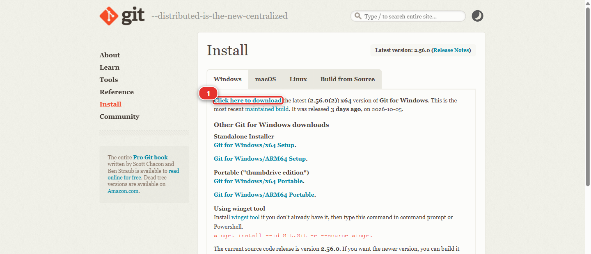
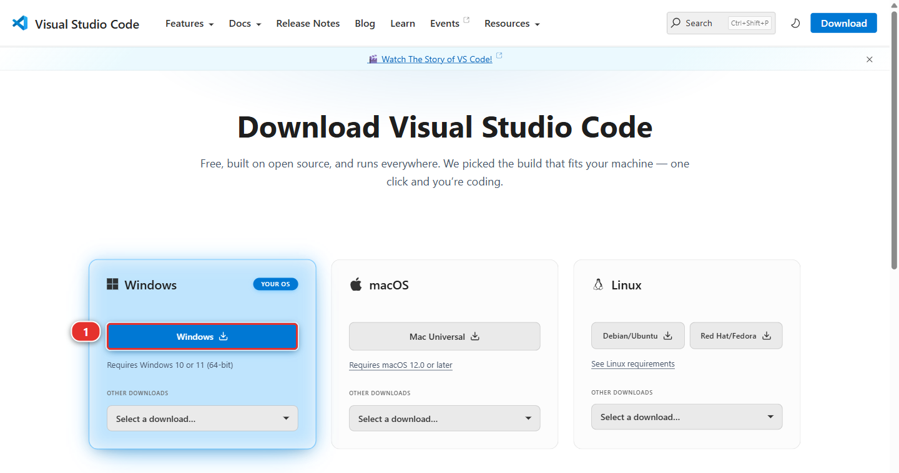
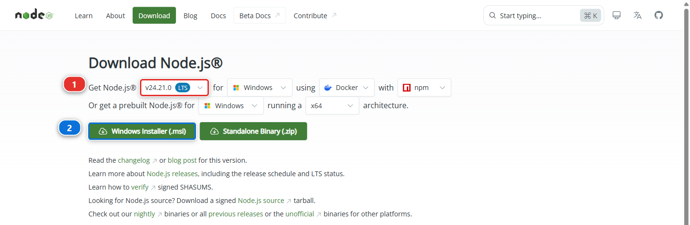
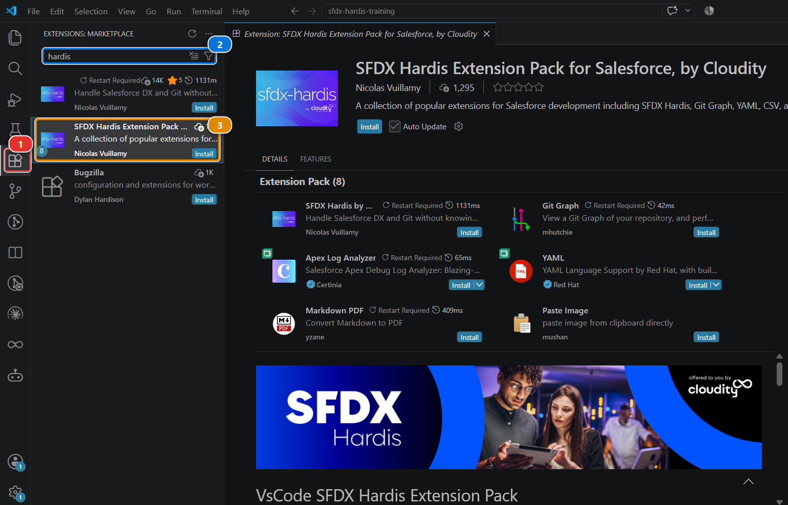
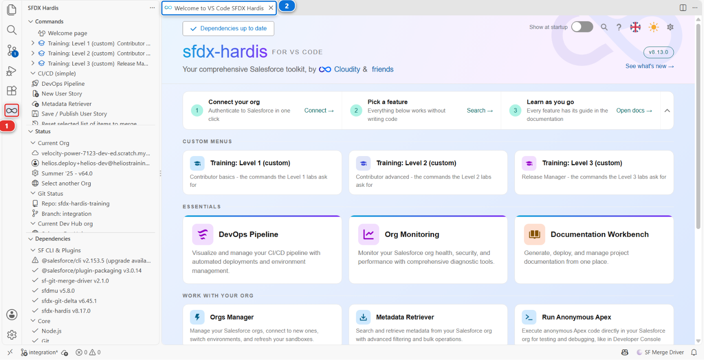
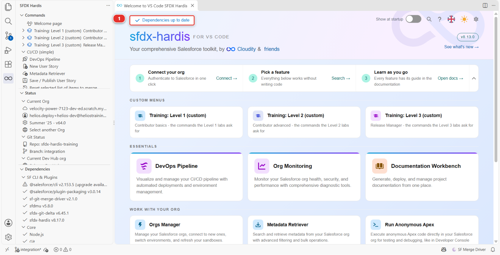
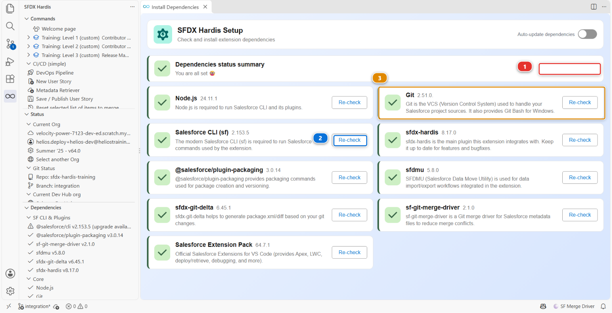
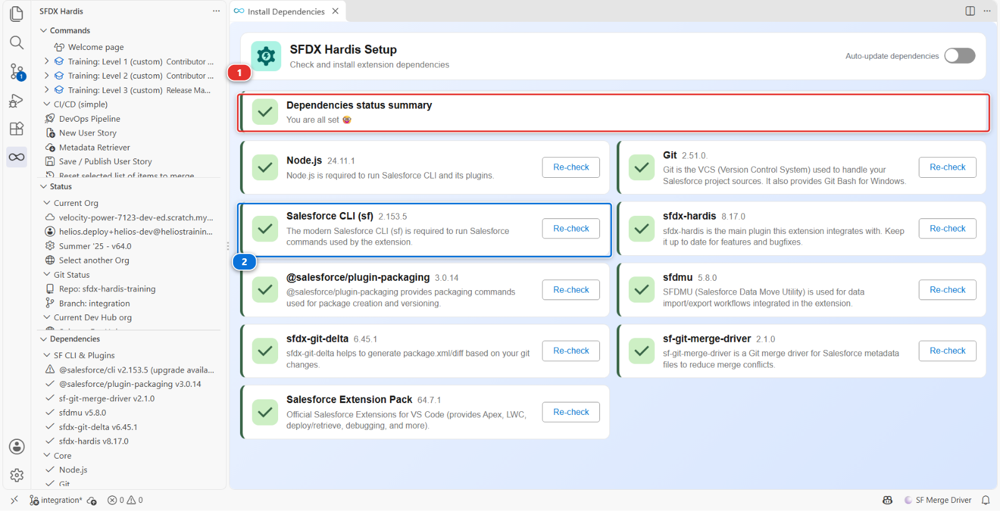

# Lab 1.1 - Install VS Code, Git and sfdx-hardis

**Level**: 1 Contributor basics

**Time**: ~15 min

**You will**: turn a plain computer into one that can do Salesforce DevOps, without typing a single
command.

## The situation

Your first morning on any Salesforce team, this one or a real one. Before you can be given a ticket,
five things have to be on your machine, and the last of them installs most of the rest for you.

The list is the same whether you are here for the course or joining a
project that already has a pipeline, and it does not care which git provider that project uses:
GitHub, GitLab, Azure DevOps and Bitbucket all work the same from here.

!!! warning "This lab stands on its own"
    If somebody sent you here to get set up before your first day, finish this lab and stop. Lab 1.2
    is where the training-specific part starts: free Salesforce orgs, a training repository,
    fictional data. None of that belongs on a real project.

No VS Code? A browser tab or another editor does it.
[Agentforce Vibes](https://www.salesforce.com/agentforce/developers/vibe-coding/ide/) is VS Code inside Google Chrome, launched from a Salesforce org:
a developer sandbox, or the free Developer Edition org [Lab 1.2](1-2-create-your-dev-hub-scratch-orgs-and-pipeline.md)
signs you up for, which means this path costs nothing and needs nothing you do not already
create here. The whole course runs in it. Two differences and no others: the
Salesforce CLI is already there, so the part of the Setup panel that installs it has nothing to
do, and the extension comes from [Open VSX](https://open-vsx.org/extension/NicolasVuillamy/vscode-sfdx-hardis)
rather than the Visual Studio Marketplace. Every panel, every button and every step below is
the same, and so are the screenshots: they were taken in desktop VS Code, which is the same
editor.

[Cursor](https://cursor.com/) and the other editors built on VS Code work the same way, and from the same
Open VSX listing. Whichever one you use, the rest of this lab is written for what you see in it.

## Before you start

- [ ] A computer where you can install software, and permission to do so, or any Salesforce
      org to launch Agentforce Vibes from: a developer sandbox, or the free Developer Edition org
      of Lab 1.2

## Steps

### 1. Install VS Code and the extension

Goal: Git, VS Code, Node.js and the sfdx-hardis extension pack on your machine, and the Welcome tab
open.

#### Do: install Git

1. In Agentforce Vibes, start at the extensions: skip the three downloads below and go straight to
   [installing the extension pack](#install-the-extension-pack), near the end of this step.
   Wherever this lab says to restart VS Code, reload the browser tab instead
2. Open the [Git](https://git-scm.com/downloads) download page. It offers your operating system at
   the top: on Windows take **Click here to download** **(1)**, the 64-bit standalone installer

   

3. Run the installer and accept every default it offers. If you already have Git, install it
   anyway: the installer recognises an existing Git and offers to update it
4. Read two screens rather than clicking through. On **Select Components**, leave **Open Git Bash
   here** and **Open Git GUI here** ticked
5. On **Adjusting your PATH environment**, keep the recommended middle option, **Git from the
   command line and also from 3rd-party software**, so VS Code can find Git
6. On Windows, check that Git Bash is there: right-click any folder, and the menu should offer
   **Open Git Bash here**. In VS Code you will also find **Git Bash** in the terminal's dropdown,
   next to PowerShell. If neither shows up, run the Git installer again and keep the defaults this
   time

!!! warning "Careful"
    On Windows, accepting every default matters more than it sounds. If you untick the Git Bash
    components, parts of this course fail with errors that look like nothing to do with Git.

#### Why Git, and why Git Bash

Git is the tool that records every version of a project and moves it between your laptop and
wherever your team keeps the project, and everything else in this course sits on it. You will
never have to type a Git command: the extension runs them for you, and shows you which one it ran.

You may already have it: plenty of machines do. The Setup panel in step 2 checks it as well, and
tells you if it is missing.

The defaults include Git Bash, a Unix-style terminal that comes with Git, and sfdx-hardis uses it:
several of the commands the extension runs for you are shell commands that the Windows command
prompt does not understand. macOS and Linux already have a Unix shell, so there is nothing to
choose there.

#### Do: install VS Code and Node.js

1. Open [Visual Studio Code](https://code.visualstudio.com/) and take the download for your machine.
   On Windows that is the **Windows** button **(1)**; the two cards next to it hold the macOS and
   Linux builds

   

2. Run its installer. It has nothing to choose: accept the licence and keep every default it offers
3. Open [Node.js](https://nodejs.org/). You need version 22 at the least, 24 recommended. Two things
   to get right on that page. First the version selector **(1)**: the one marked **LTS** is the safe
   choice, as long as it reads 22 or higher
4. Then **Windows Installer (.msi)** **(2)**, or the equivalent for your machine

   

5. Run the Node.js installer like the VS Code one: accept the licence and keep every default

!!! warning "Restart VS Code after installing Git or Node.js"
    The Git and Node.js installers add themselves to the PATH, the list of places your machine looks for a
    command. A program only reads that list when it starts, so a VS Code that was already open when
    you installed them still cannot find them, and the Setup panel in step 2 reports them missing
    even though they are there. Close VS Code completely, windows and all, and open it again.

    The same applies to a terminal you already had open.

#### Do: install the extension pack

1. Open VS Code and click the **Extensions** icon **(1)**. It sits in the narrow bar down the left,
   and looks like four small squares with one lifted away
2. Type `hardis` in the search box **(2)**
3. Click **Install** on **SFDX Hardis Extension Pack for Salesforce, by Cloudity** **(3)**,
   published by Nicolas Vuillamy. Take the pack rather than the single extension above it

   

4. If VS Code asks **Do you trust the publishers of these extensions?**, answer **Trust Publishers &
   Install**
5. Once it is installed, open the gear icon next to the pack and tick **Auto Update**
6. Click the new icon that appears in the left bar **(1)**: the **Welcome** tab **(2)** opens

   

#### Why the pack, and Auto Update

Two things happen around the Install click, and both are easy to miss. A pack installs extensions
from several publishers, and it stops at the trust question until you say so. And the course and the
product move together: an extension a few versions behind is the most common reason a panel in
these labs does not look like its screenshot.

The pack installs sfdx-hardis itself along with the tools that go with it: Git Graph, which draws
your branches, the YAML and Markdown support the configuration files use, and the Apex log viewer.
Later levels use them, so take the pack rather than the single extension.

In Agentforce Vibes, the three downloads are already in the tab: Git, Node.js and the editor itself
come with it. One difference at the extensions: the Extensions view of a browser IDE searches
[Open VSX](https://open-vsx.org/extension/NicolasVuillamy/vscode-sfdx-hardis) rather than the
Visual Studio Marketplace, and the pack is the same one under the same name. Reloading the browser
tab does the same thing as restarting VS Code, which is to let the editor see what was just
installed.

#### You should now see

- A new icon in the left bar, and the **Welcome** tab open: that tab is where every lab of this
  course starts

### 2. Let the Setup panel install the rest

Goal: the Salesforce CLI and its plugins installed, and every card of the Setup panel green.

You need the Salesforce CLI and a few plugins. You are not going to install them by hand: the
extension has a panel that checks what is missing and installs it.

#### Do

1. On the Welcome page, find the button at the top left of the header band **(1)**. It reads
   **Check in progress** while it is still looking, then either **Dependencies up to date** or
   **N update(s) needed**. Hover it and the tooltip says **Open Setup**

   

2. Wait for the check to finish, then click it: it opens the Setup panel
3. Read the panel: it lists every dependency the pipeline needs, with the version you have and the
   version that is current. Node.js and **Git** **(3)** have a card each as well: the panel checks
   what you installed in step 1 and says so

   

   The picture was taken on a machine where everything was already in place, so every card is green
   and offers nothing but **Re-check** **(2)**, and the band at the top has nothing to propose
   **(1)**. Your first run will not look like that. Anything missing or out of date turns amber and
   its button reads **Install** or **Upgrade**, and the band at the top then carries **Run pending
   installs** **(1)**

4. Click **Run pending installs** **(1)**: it queues the whole list and reports each item as it
   finishes. In Agentforce Vibes, the **Salesforce CLI** card is green before you start, and the
   panel has only the plugins left to install: run the same **Run pending installs** and read the
   same list; there is simply less of it
5. Wait for it to finish. This takes a few minutes

!!! warning "Restart VS Code once the installs are finished"
    The Salesforce CLI lands on the PATH as well, so the same rule applies: close VS Code and open
    it again before you carry on. Then press **Re-check** on the Setup panel. Anything that was
    still red for this reason turns green.

#### Why

There is no card called Setup: the button is labelled with the state of your dependencies.

The dependencies worth knowing by name:

- **Salesforce CLI** - the program every Salesforce tool on your machine talks to
- **sfdx-hardis** - the add-on that puts the User Story commands into that CLI
- **SFDMU** - loads and extracts records, which is how your orgs get their data
- **sfdx-git-delta** - works out what changed between two versions of the project, which is what the
  deployments send
- **Salesforce Extension Pack** - the official Salesforce tooling for VS Code

The installs are the longest part of this lab and the only one you never repeat.

Under the hood: what the Setup panel just did

For each missing dependency it ran the plain npm command you would have run yourself, for example:

    npm install --global @salesforce/cli
    sf plugins install sfdx-hardis
    sf plugins install sfdmu
    sf plugins install sfdx-git-delta

then re-ran `sf version` and `sf plugins` and compared the answers with the versions published on
the npm registry. That comparison is the whole point of the panel: a pipeline breaks in confusing
ways when one person is two major versions behind, and nobody notices until a deployment fails.

#### You should now see

- Every card of the Setup panel green after **Re-check**, with nothing left to install

## What you should see

The **Setup** panel with nothing left to install:

- [ ] The summary at the top **(1)** with nothing still missing: it names anything still missing,
      and missing is the only state that stops you
- [ ] Every card under it green, **Salesforce CLI** **(2)** included, with nothing left to do but
      **Re-check**

An amber **Upgrade** on one of them is not a failure: it means a newer version exists, and the
button fetches it whenever you feel like it.

That is the whole of this lab. Your machine can now run everything the rest of the course, and every
Salesforce project that uses sfdx-hardis, is going to ask of it.

## If it goes wrong

**The Setup panel says the Salesforce CLI is missing after it installed it.**
It landed somewhere that was not on the PATH of a terminal that was already open. Close VS Code
completely and open it again.

**The extension does not appear after installing it.**
Reload the window: **View > Command Palette**, then **Developer: Reload Window**.

**The Setup panel shows a red line you cannot clear.**
Click the line. The panel tells you what it tried and what it got back, and that message is nearly
always the answer.

## What comes next

If you came here to set up a real project, you are done: open your team's repository and the
**DevOps Pipeline** panel will tell you the rest.

If you are taking the course, [Lab 1.2](1-2-create-your-dev-hub-scratch-orgs-and-pipeline.md) builds you a small environment to work in: one free Salesforce
org, three scratch orgs created from it, a copy of the project, and a pipeline. It is the last of
the setup.

## Go deeper

- [Install sfdx-hardis](https://sfdx-hardis.cloudity.com/salesforce-devops-use-install/)
- [The VS Code extension](https://sfdx-hardis.cloudity.com/vscode-extension/)

[Next: Lab 1.2 - Create your Dev Hub, scratch orgs and CI/CD pipeline](1-2-create-your-dev-hub-scratch-orgs-and-pipeline.md){ .md-button .md-button--primary }
