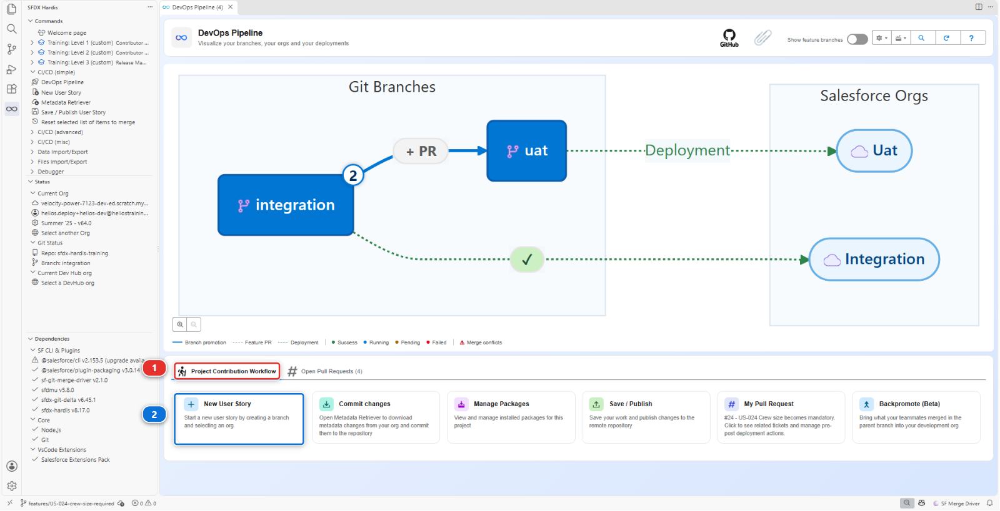
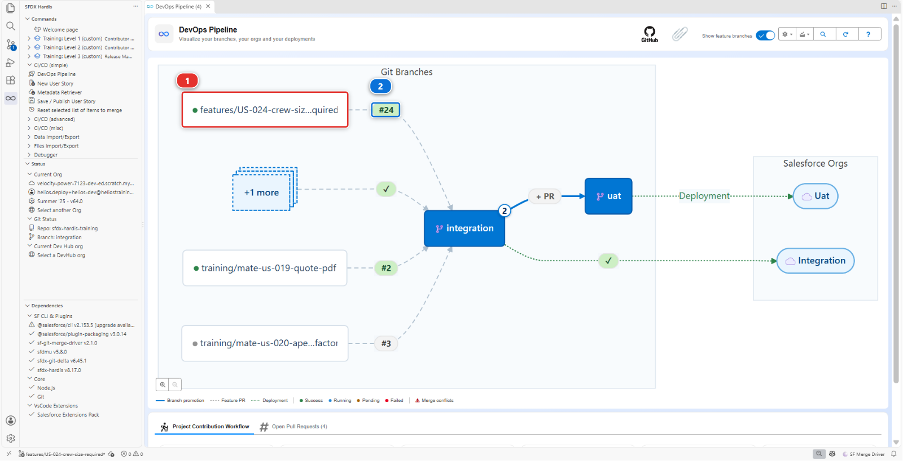
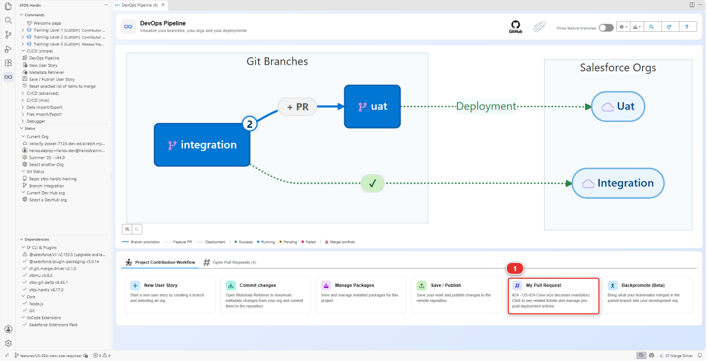
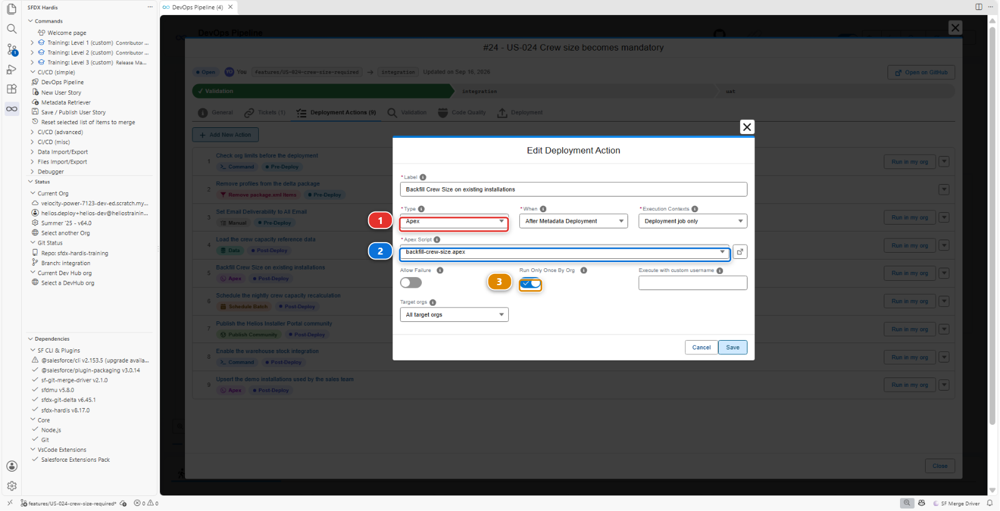
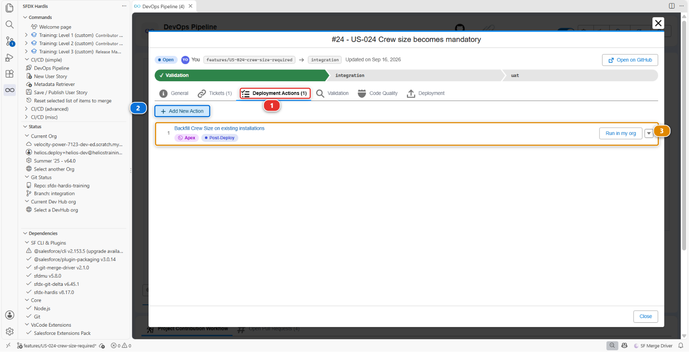

# Lab 2.3 - Fix broken records with an Apex deployment action

**Level**: 2 Contributor advanced

**Time**: ~45 min<!-- observed --> (observed: median 49 min, 11 learners, fastest 15 min)<!-- /observed -->

**You will**: hit a failure that no amount of metadata fixing solves, and learn the tool that exists
for it: a deployment action.

## The situation

> **US-024 - Crew size becomes mandatory**
>
> As a planner, I want Crew Size to be mandatory on every installation, so that no job is scheduled
> without a crew.
>
> Acceptance criteria:
>
> - Crew Size is required
> - Existing records are backfilled with the default of 2

One checkbox in Setup. Then two things happen, and the second one is the one that matters.

The deployment fails, for a reason that has nothing to do with your data. You fix that in a minute.
The deployment then goes green, and you have quietly broken thirty installation records for
everybody, with nothing anywhere telling you.

This lab is about the gap between a green deployment and a safe one.

## Before you start

- [ ] [Lab 2.2](2-2-fix-a-missing-dependency-deployment-error.md) finished and merged
- [ ] `helios-dev` level with `integration`

## Steps

### 1. Take the story and do the obvious thing

Goal: Crew Size required in `helios-dev`, and the field published on a Pull Request.
Refresher: [Lab 1.3](../level-1-contributor-basics/1-3-start-a-user-story-on-a-git-branch.md), [Lab 1.5](../level-1-contributor-basics/1-5-retrieve-commit-and-publish-your-changes.md)

#### Do

1. **New User Story** **(2)**, under **Project Contribution Workflow** **(1)** of the DevOps Pipeline
   panel. Name `US-024-crew-size-required`, org `helios-dev`

   

2. In `helios-dev`: **Setup > Object Manager > Installation > Fields & Relationships > Crew Size >
   Edit**, tick **Required**
3. The moment the box is ticked, Salesforce warns you about API and Apex callers and asks you to
   **Confirm**. Confirm, then **Save**
4. Bring the field down with **Commit changes** (the field, nothing else), and commit it
5. **Save / Publish**, push, and open the Pull Request

#### Why

Salesforce says not a word about your data, although most installations in your org have no crew
size. Remember that: it is the whole of this lab.

#### You should now see

- Crew Size required in `helios-dev`
- A Pull Request open for the field, with its check running

### 2. Read the first failure

Goal: the permission sets fixed and published again.

The check fails, and the sfdx-hardis comment names two components:

```text title="Output"
Helios_Delivery_Crew     You cannot deploy to a required field: Installation__c.Crew_Size__c
Helios_Delivery_Manager  You cannot deploy to a required field: Installation__c.Crew_Size__c
```

Not a word about your data. The problem is the permission sets.

#### Do

1. Bring the permission sets down: **Commit changes**, tick `Helios_Delivery_Crew` and
   `Helios_Delivery_Manager`, retrieve. Source Control shows each of them losing its `Crew_Size__c`
   entry and nothing else
2. Commit
3. **Save / Publish** again

#### Why

A universally required field has no field level security to grant: it is visible and mandatory
for everyone, by definition. So the moment the field becomes required, every field-level security
entry that mentions it becomes invalid, and the deployment refuses the permission sets rather than
the field.

The fix takes a minute, and the org has already done it: in `helios-dev` the entries disappeared
from both permission sets the moment the field became required. The sfdx-hardis comment even said
so, in the tip folded under each error, with a link to the rule.

#### Why this is a good error

It is precise, it names both offending components, and the fix is obvious once you know the rule.
Most Salesforce deployment errors are like this: they sound like they are about the thing you
changed, and they are about something that referenced it.

#### You should now see

- Both permission sets without their `Crew_Size__c` entry, published on the Pull Request

### 3. Watch it go green, and understand why that is the problem

Goal: you have seen, in `helios-dev`, the records a green check is about to break.

The check passes.

!!! warning "Careful"
    Do not merge yet.

#### Do

1. Open `helios-dev`, find an installation with no crew size
2. Change anything at all on it, and save. The record refuses:

   ```text title="Output"
   We hit a snag.
   Review the following fields
     • Crew Size
   ```

#### Why

The same refusal reads `Required fields are missing: [Crew_Size__c]` when it comes from Apex or
the API, which is how a script meets it.

Salesforce enforces a required field on save, not on the data that is already there. It was
perfectly happy to make the field required while most installations had it empty, and the green
check says the same: `helios-integration` has thirty installations with no crew size, and the
deployment would make every one of them unsaveable. Not just for you, for everybody, for any edit,
until somebody puts a crew size on them.

Nothing failed. No check went red. Merge now, and the first person to find out is a planner who
cannot save a record.

Anything you have to do by hand in one org, you will have to do in every org. That is what a
deployment action is for.

#### You should now see

- A green check on the Pull Request, and an installation in `helios-dev` that cannot be saved

### 4. Split the story into two moves

Goal: the fix planned in two moves, both in this Pull Request. This step has no clicks.

The shape of the fix, and it is the shape of most "the data is in the way" problems:

1. Make the data valid
2. Make the field required

#### Why

Both can travel in the same Pull Request, as long as the first one runs in every org the story
reaches. That is what a deployment action is: something the pipeline runs around the
deployment, in each org, without anybody opening Setup.

#### You should now see

- The two moves, in that order: the data first, the required field second

### 5. Add the backfill

Goal: the batch, its test and the script that starts it, in your project.

You do not have to write it.

#### Do

1. In the Explorer, with copy and paste, copy these four files from `scripts/apex/samples/` in the
   repository into `force-app/main/default/classes/`:

   - `CrewSizeBackfillBatch.cls` and `CrewSizeBackfillBatch.cls-meta.xml`: the batch. It gives the
     default crew of two to every installation that has none
   - `CrewSizeBackfillBatchTest.cls` and `CrewSizeBackfillBatchTest.cls-meta.xml`: its test. Salesforce
     deploys no Apex without one, and [Lab 2.5](2-5-pass-code-quality-and-apex-test-coverage.md) is about that gate

2. Then the script the action runs: create the file `scripts/apex/backfill-crew-size.apex` and copy
   this into it

   ```apex title="Edit this file"
   // Starts the backfill as a batch: the script returns at once, and Salesforce
   // works through the installations without a crew size, 200 at a time.
   Id jobId = Database.executeBatch(new CrewSizeBackfillBatch(), 200);
   System.debug('Crew size backfill started, batch job ' + jobId);
   ```

!!! warning "Careful"
    Those four and no others, and copied, not moved. The folder also holds `CrewCapacityBatch` and its
    test, which are for [Lab 2.4](2-4-ship-reference-data-and-a-batch-with-deployment-actions.md): they need an object this story does not bring, the check of your Pull
    Request fails on them, and [Lab 2.4](2-4-ship-reference-data-and-a-batch-with-deployment-actions.md) copies them from this folder.

#### Why a batch

Thirty installations in `helios-integration`, but a production org can hold millions, and a
deployment action runs in production too. A script that updates every record in one go stops at
the first Salesforce governor limit it meets: 10,000 records updated in one transaction, ten seconds
of processing. So the work goes into a batch, which Salesforce runs in chunks of 200 records,
each in a transaction of its own, whatever the size of the table.

Two things worth noticing, because they are what makes this safe to run in production:

- The batch only touches records that are actually wrong (`WHERE Crew_Size__c = null`)
- The script says what it started, so the deployment log is readable afterwards

#### You should now see

- The four class files under `force-app/main/default/classes/`, and `scripts/apex/backfill-crew-size.apex`

### 6. Declare it as a deployment action

Goal: the backfill declared as a deployment action of your Pull Request.

Open the **DevOps Pipeline** panel. There are two ways to your Pull Request, and both land in the
same place.

#### Do: open your Pull Request

1. In the diagram: turn on **Show feature branches** at the top right, which is off until you ask for
   it, and your own branch appears beside the major ones. Your feature branch **(1)**, and on the arrow
   leaving it the numbered badge **(2)**. Click the badge

   

  !!! tip "Another way in"
      Instead of the diagram, scroll to **Project Contribution Workflow** and click the **My Pull
      Request** card **(1)**, which always points at the Pull Request of the branch you are
      standing on.

      

#### Do: add the action

1. The Pull Request opens. Go to its **Deployment Actions** tab, and click **Add New Action**
2. In the **Edit Deployment Action** dialog set the **Type** **(1)** to **Apex**

   

3. Fill it in with the table below. **Apex Script** **(2)** is a dropdown of what it found under
   `scripts/apex/`, not a free text path, so the file has to exist in your branch before it appears.
   **Run Only Once By Org** **(3)** is the toggle below it
4. **Save**

| Field                | Value                                          |
|----------------------|------------------------------------------------|
| Label                | `Backfill Crew Size on existing installations` |
| When                 | **After Metadata Deployment**                  |
| Apex Script          | `backfill-crew-size.apex`                      |
| Execution Contexts   | **Deployment job only**                        |
| Target orgs          | **All target orgs**                            |
| Run Only Once By Org | **yes**                                        |

#### Why Deployment job only

**Deployment job only**, because the Pull Request check is a rehearsal: it validates the metadata
and changes nothing in the org. A script that updates thirty records does it for real, so it waits
for the merge. The check still lists the action in its comment, marked skipped, so the reviewer sees
it coming.

#### Why Run Only Once By Org

Tick it whenever the script is a one-time correction rather than something that should happen on
every deployment. sfdx-hardis records what it has run in each org, so the backfill fires once in
integration, once in UAT, once in production, and never again. Leave it unticked for a script
that does no harm if it runs twice and is meant to run on every deployment.

#### You should now see

- The action in the list on the **Deployment Actions** tab, whose counter **(1)** went up by one
- **Add New Action** **(2)** still there for the next one, and your row **(3)** carrying a
  **Post-Deploy** chip under its label



### 7. Check the order

Goal: you know why the backfill runs after the deployment, and what that costs. This step has no
clicks.

#### Why after

The action runs after the deployment, and here that is not a detail. The script starts
`CrewSizeBackfillBatch`, and that class travels in the very deployment the action goes with: before
the deployment, the target org does not have it, and a script that uses it fails to compile.

For a few minutes after the deployment, the installations without a crew size cannot be saved, as
you saw in `helios-dev`. Then the batch has given them one. That window is the price of the order,
and on a table of millions it is worth telling the planners about before the release.

#### Why: how to decide pre or post, every time

Ask what the action needs to already exist. An action that uses a class, an object or a field
the story brings is post-deploy: they only exist once the deployment is done, which is this lab
and [Lab 2.4](2-4-ship-reference-data-and-a-batch-with-deployment-actions.md). Pre-deploy is for what must happen with the org as it was, before anything
changes: disabling a scheduled job the deployment would collide with, for instance. The answer
is never a habit, it is that question.

#### You should now see

- Your action set to **After Metadata Deployment**, with the **Post-Deploy** chip of step 6

### 8. Commit it, and watch it run

Goal: the Pull Request merged, and every installation in `helios-integration` carrying a crew size.
Refresher: [Lab 1.6](../level-1-contributor-basics/1-6-pull-request-deployment-check-and-merge.md)

Files wait in **Source Control**, none of them committed: the four class files and the Apex script
you created in step 5, and the action the editor wrote under `scripts/actions/`, in a file named
after your Pull Request.

#### Do

1. Commit them all, then **Save / Publish**
2. The check passes again, and its comment now has a **Deployment actions** row in its table: your
   backfill, **🕒 1 after the merge**. Open the folded **🛠️ Deployment actions of this job (1)**
   below it: the backfill, **after** the deployment, with the reason **Runs after the merge only**
3. Merge the Pull Request: on its GitHub page, choose **Squash and merge**, then click **Squash
   and merge** and **Confirm squash and merge**, as in [Lab 1.6](../level-1-contributor-basics/1-6-pull-request-deployment-check-and-merge.md)
4. Open the log of the deployment job to `integration` in the **Actions** tab: you find the
   deployment, then the action starting, then the `System.debug` line of your script,
   `Crew size backfill started, batch job ...`

#### Why

The check shows the backfill waiting, because this is the validation job and it changes nothing in
the org. The deployment job to `integration` runs it, for real, right after the deployment.

`helios-dev` still has its empty crew sizes, and that is fine: the next backpromote runs the actions
of the Pull Requests it brings down, this one included.

<details markdown="1"><summary>Under the hood: where the action is stored and how it runs</summary>

The editor wrote a YAML file named after your Pull Request, under `scripts/actions/`:

    commandsPostDeploy:
      - id: 3f6d0a52-24b1-4c1a-9a0e-5b7f02400001
        label: Backfill Crew Size on existing installations
        type: apex
        parameters:
          apexScript: scripts/apex/backfill-crew-size.apex
        context: process-deployment-only
        runOnlyOnceByOrg: true

The `id` is the one the editor generated when it created the action, so yours is different. Never change it: it is how sfdx-hardis knows in which orgs the action already ran.

`sf hardis:project:deploy:smart` reads it, and around the Salesforce deployment it:

1. Collects the actions of every Pull Request included in this deployment
2. Runs the `commandsPreDeploy` ones, in order, of which this story has none
3. Deploys the metadata
4. Runs the `commandsPostDeploy` ones
5. Records in the target org which `runOnlyOnceByOrg` actions have already fired, so the next
   deployment skips them

`context` decides which jobs run it: `all` for both the validation job and the deployment job, or
`check-deployment-only` / `process-deployment-only` for one of the two. Which orgs it runs in is a
separate pair of keys, `includeTargetBranches` and `excludeTargetBranches`. Leave them out and the
action runs against every target, which is what a data correction usually wants. A "reset the
sandbox integration user" script usually names its branches.

Because the actions live in the repository and travel with the Pull Request, the same sequence
replays in UAT and in production months later, without anybody remembering it existed. That is the
whole value: the knowledge is in the repository, not in someone's head.

<!-- command-links:start -->
Command documentation: [hardis:project:deploy:smart](https://sfdx-hardis.cloudity.com/hardis/project/deploy/smart/)
<!-- command-links:end -->

</details>

#### You should now see

- A minute after the deployment, every installation in `helios-integration` carrying a crew size,
  and nobody opened Setup

## What you should see

- [ ] The Pull Request comment listing the deployment action it ran, above the deployment result
- [ ] `Crew Size` required in `helios-integration`, with all thirty installations carrying a value
- [ ] An installation you can still save, which is the whole point
- [ ] No manual step performed by anybody in any org

## If it goes wrong

**The action file is called `.sfdx-hardis.draft.yml`, or the check stops on *Draft deployment actions file found*.**
You added the action while the panel knew no Pull Request for your branch: the **My Pull Request**
card read *Pull Request not created yet*, so the action was kept in a draft. The pipeline only reads
`scripts/actions/.sfdx-hardis.` followed by the number of the Pull Request and `.yml`, so a draft, or
a file renamed to a name of your own, is never run. Once your Pull Request exists, open the
**DevOps Pipeline** panel again and click **Refresh**: it renames the draft after your Pull Request
and tells you so in a notification. Commit the renamed file, then **Save / Publish**.

**The action does not appear in the Deployment Actions tab.**
The panel reads the Pull Request from your fork (your own copy of the course repository on GitHub, for example `github.com/my-username/sfdx-hardis-training`). If the Pull Request was opened against the original
repository, it cannot see it. Close it and reopen it with the right base.

**The Apex script fails with `Invalid type: CrewSizeBackfillBatch`.**
The class is not in the org the script ran in. Either the action runs **before** the deployment,
when the class does not exist yet, or the class files were not committed with the story.

**The check fails with `ApexClass CrewCapacityBatch: Invalid type: Crew_Capacity__c`.**
The [Lab 2.4](2-4-ship-reference-data-and-a-batch-with-deployment-actions.md) batch went into `force-app/main/default/classes/` with the one of this lab, and
`manifest/package.xml` lists `CrewCapacityBatch` and `CrewCapacityBatchTest`. Delete their four files
from `force-app/main/default/classes/`, keep a copy in `scripts/apex/samples/` (put it back there if
you moved it), remove their two `<members>` lines from `manifest/package.xml`, commit, and push:
the check runs again.

**The deployment still fails on the permission sets.**
They still carry `fieldPermissions` for `Installation__c.Crew_Size__c`. A required field cannot have
any. Re-publish from an org where the field is already required, or delete the two blocks by hand.

**The script ran, and records are still unsaveable a minute later.**
The batch is still running, or it failed. In the org, **Setup > Apex Jobs** lists
`CrewSizeBackfillBatch` with its status and its errors.

**The action ran but nothing changed.**
`runOnlyOnceByOrg` is ticked and it already ran in that org during an earlier attempt. That is
correct behaviour. Untick it temporarily if you need to re-run while experimenting.

## Check your work

Welcome page > **Training: Level 2** > **Check my work**, then pick **Lab 2.3**.

## Go deeper

- [Deployment actions](https://sfdx-hardis.cloudity.com/salesforce-devops-work-on-user-story-deployment-actions/)

[Next: Lab 2.4 - Ship reference data and a batch with deployment actions](2-4-ship-reference-data-and-a-batch-with-deployment-actions.md){ .md-button .md-button--primary }
