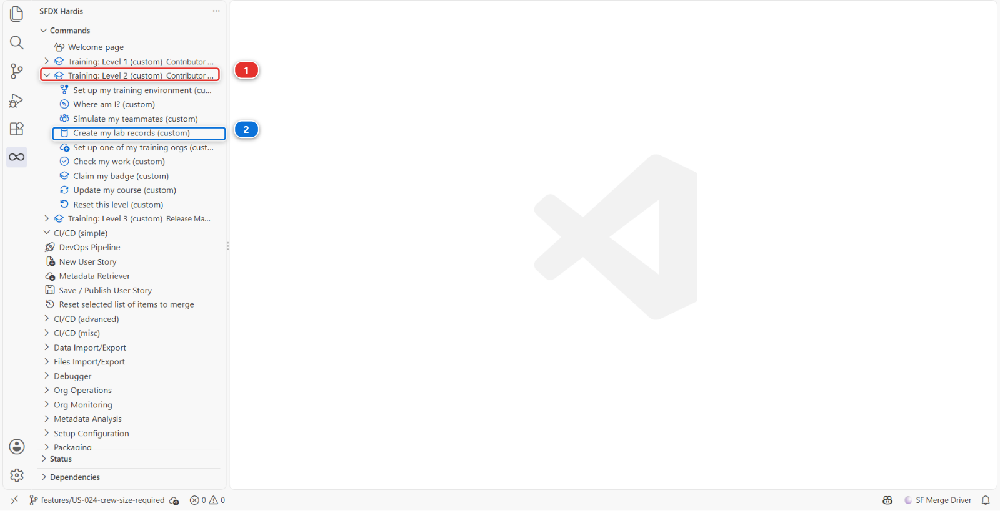
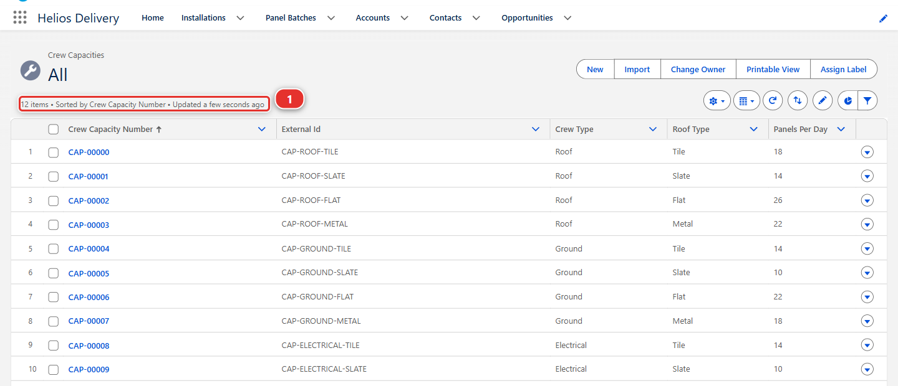
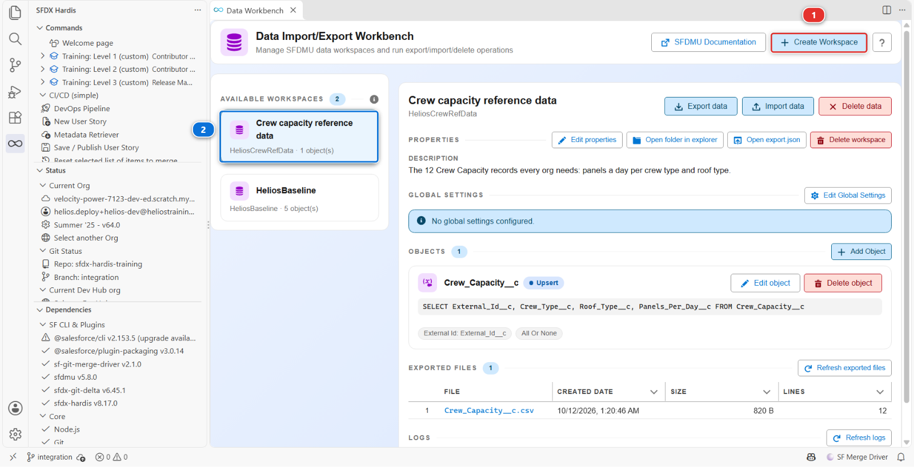
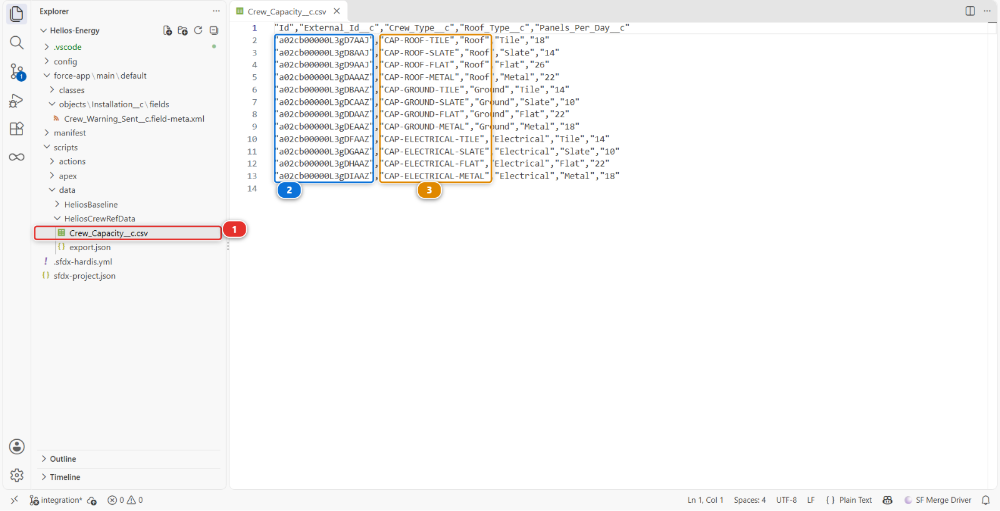
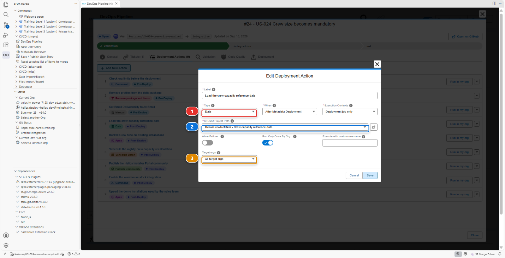
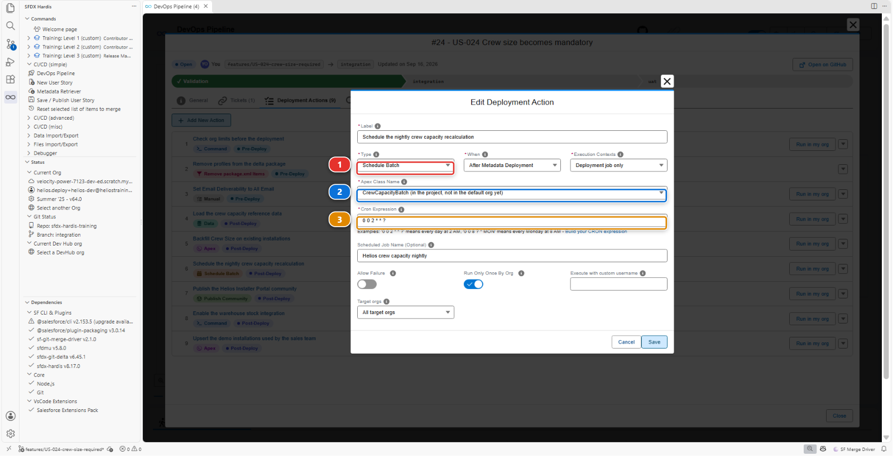
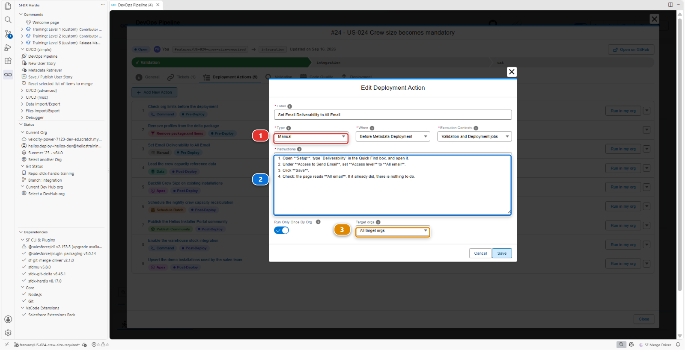
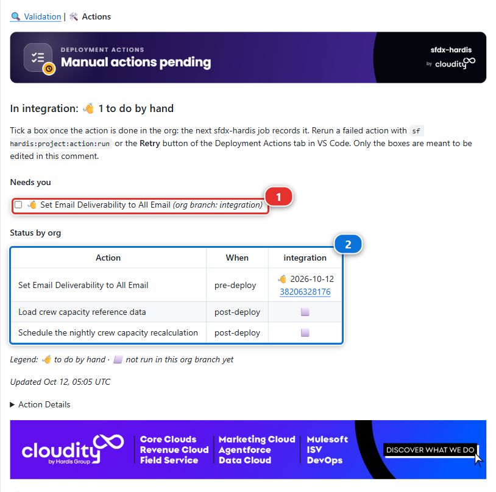

# Lab 2.4 - Ship reference data and a batch with deployment actions

**Level**: 2 Contributor advanced

**Time**: ~50 min<!-- observed --> (observed: median 50 min, 11 learners, fastest 20 min)<!-- /observed -->

**You will**: meet the worst kind of failure, the one where nothing fails, and fix it with three
deployment actions of three different kinds.

## The situation

> **US-026 - Crew capacity reference data and nightly recalculation**
>
> As a planner, I want capacity rules per crew type and a nightly job that recalculates them, so
> that the planning board is right every morning and I get a summary of it in my inbox.
>
> Acceptance criteria:
>
> - 12 Crew Capacity records exist in every org
> - The batch is scheduled nightly
> - The planner receives the morning summary email

You build it, the deployment is green, everyone signs it off, and three weeks later a planner says
the board has never updated. The metadata arrived. Nothing else did.

A deployment carries metadata. It does not carry records, it does not carry scheduled jobs, and
it does not carry anything a human had to click in Setup. Every one of those has to be declared,
or it happens once in your org and nowhere else, forever.

## Before you start

- [ ] [Lab 2.3](2-3-fix-broken-records-with-an-apex-deployment-action.md) finished and merged
- [ ] `helios-dev` level with `integration`

## Steps

### 1. Take the story and build the metadata

Goal: the Crew Capacity object, its tab, its access and its batch in place, and its 12 records in
`helios-dev`.
Refresher: [Lab 1.4](../level-1-contributor-basics/1-4-build-a-custom-field-in-your-org.md), [Lab 2.3](2-3-fix-broken-records-with-an-apex-deployment-action.md)

#### Do: take the story

1. **New User Story** **(2)**, under **Project Contribution Workflow** **(1)** of the DevOps Pipeline
   panel. Name `US-026-crew-capacity-data`, org `helios-dev`

   

#### Do: build the metadata

1. In `helios-dev`, create a custom object **Crew Capacity** (`Crew_Capacity__c`). On its creation
   page, set **Record Name** to `Crew Capacity Number`, **Data Type** **Auto Number**, **Display
   Format** `CAP-{00000}`, **Starting Number** `0`
2. Add four fields:

   - `External_Id__c`, Text 40, **External Id**, **Unique**
   - `Crew_Type__c`, Picklist: `Roof`, `Ground`, `Electrical`
   - `Roof_Type__c`, Picklist: `Tile`, `Slate`, `Flat`, `Metal`
   - `Panels_Per_Day__c`, Number 3,0

3. Create a tab for it: **Setup > Tabs**, **New** under **Custom Object Tabs**, object **Crew
   Capacity**, any tab style. Keep the profile visibility the wizard offers
4. On the last screen, **Add to Custom Apps**, untick **Include Tab** at the top of the list, then
   tick **Helios Delivery** alone
5. From `scripts/apex/samples/` in the repository, copy `CrewCapacityBatch.cls`,
   `CrewCapacityBatchTest.cls` and their two `.cls-meta.xml` files into
   `force-app/main/default/classes/`, in the Explorer, with copy and paste, as in [Lab 2.3](2-3-fix-broken-records-with-an-apex-deployment-action.md)
6. Give the access, on the **Helios Delivery Manager** permission set: **Read**, **Create** and
   **Edit** on Crew Capacity, **Read** and **Edit** on its four fields
7. Under **Tab Settings** on the same page, tick **Available** and **Visible**

#### Why

The Auto Number name makes the records read CAP-00000 to CAP-00011 rather than their record id. The
tab is there so the records can be found in the app, and the other apps have no use for it.

`CrewCapacityBatch` is an Apex class that recalculates `Total_Capacity_kW__c` on planned
installations and that Salesforce can run on a schedule, and `CrewCapacityBatchTest` is its test
class. You do not have to write these, and they are the one thing in this list you do not create in
the org. What they compute matters far less here than the fact that somebody has to schedule them
in every org, which is the whole point of the lab.

Planners maintain these numbers, and the Helios Delivery Manager permission set is also the one the
pipeline's own user holds in every org: without the access, the data load of step 4 would find
fields it is not allowed to write. The tab setting is what shows the tab in the other orgs, where
the profile visibility you kept in the wizard never travels.

#### Do: create the records

1. Click **Training: Level 2** **(1)** > **Create my lab records** **(2)**

   

2. The panel picks **Lab 2.4 - the 12 Crew Capacity records** and **helios-dev** on its own, the
   only lab and the only org it offers here: answer **Yes** to **Create them?**

  !!! tip "If a field is missing"
      If the panel says a field is missing, finish the object first, then run it again: it updates
      the same twelve records rather than creating more.

3. Open the **See them in the org** link the panel ends with, or open the **Crew Capacity** tab of
   the Helios Delivery app and pick the **All** list view

#### Why the menu creates them

Helios supports 12 combinations, three crew types by four roof types, and each one needs a Crew
Capacity record saying how many panels a day that crew lays on that roof. Typing twelve records
teaches nothing this lab is about, so the Training menu creates them. The panel first checks that
your object and its four fields are in the org, then creates the records, lists them, and ends with
the link.

<details markdown="1"><summary>Under the hood: how the records were created</summary>

The menu entry ran:

    node scripts/training.mjs records

which loaded `scripts/lab-records/lab-2-4/Crew_Capacity__c.csv` into `helios-dev` with
`sf data upsert bulk`, matching on `External_Id__c`, and added an **All** list view to the object
when it had none, so the link has a list to open. That list view is metadata, like the object: it
is one of the things step 2 retrieves. On a real project somebody enters these
records in the org, or loads them from a spreadsheet: either way they exist in one org only, which
is the problem the rest of this lab solves.

</details>

#### You should now see

- The **All** list view reading **12 items** **(1)**, named `CAP-00000` to `CAP-00011`



### 2. Publish and watch nothing fail

Goal: the story merged and deployed green, and you have seen what it did not bring.
Refresher: [Lab 1.5](../level-1-contributor-basics/1-5-retrieve-commit-and-publish-your-changes.md), [Lab 1.6](../level-1-contributor-basics/1-6-pull-request-deployment-check-and-merge.md)

#### Do

1. With **Commit changes**, retrieve the object, its fields, its tab, its **All** list view (the
   `ListView` row named `Crew_Capacity__c.All`), the `Helios_Delivery` app and
   `Helios_Delivery_Manager`
2. Commit all of it, the four class files you copied included
3. **Save / Publish**, push, Pull Request. The check is green
4. Merge. The deployment is green
5. Now open `helios-integration` and look

#### Why

Without the list view, the tab would open in the other orgs on **Recently Viewed**, which shows each
person only the records they opened themselves. The two Apex classes are not retrieved: they are
already files of the project, and Source Control lists the four you copied next to what you
retrieved.

The feature is in the org and completely inert. This is worse than a failure, because a failure
tells you.

#### You should now see

- The **Crew Capacity** tab in the Helios Delivery app and its **All** list view there, with zero
  records
- `CrewCapacityBatch` existing, scheduled nowhere
- Nobody having checked that the org is allowed to send the batch's summary email

### 3. Build a data workspace for the reference records

Goal: the 12 records exported as a CSV file of a data workspace, on a follow-up branch.

The story is merged, so what is missing goes into a second Pull Request for the same story.

#### Do: start the follow-up branch

1. **New User Story**, name `US-026-crew-capacity-actions`, org `helios-dev`

#### Why a second branch

A follow-up branch is how a team finishes a story, and sfdx-hardis says it itself at the end of
every Save / Publish: do not reuse the same branch.

#### Do: create the workspace

1. On the Welcome page, click **Data Workbench**. The panel that opens is titled **Data
   Import/Export Workbench**. **Create Workspace** **(1)** sits at the top right, and the workspaces
   the project already carries are listed on the left **(2)**: `HeliosBaseline` is the one the Training
   menu uses to seed your org

   

   The picture was taken at the end of this step, so it already lists `HeliosCrewRefData` under
   `HeliosBaseline`. Yours lists `HeliosBaseline` alone until you create it.

2. **Create Workspace** **(1)**, and fill in its three fields:

   - **Workspace Name**: `HeliosCrewRefData`, the name of its folder under `scripts/data/`
   - **Display Label**: `Crew capacity reference data`, the name the panels show, for example when
     you pick this workspace in a deployment action in step 4
   - **Description**: `The 12 Crew Capacity records every org needs: panels a day per crew type and
     roof type.`

3. **Add Object**, and paste this into **SOQL Query**. It names the object and the four fields you
   created

   ```sql title="Type this"
   SELECT External_Id__c, Crew_Type__c, Roof_Type__c, Panels_Per_Day__c FROM Crew_Capacity__c
   ```

4. **Operation**: **Upsert**
5. **External Id (for Upsert)**: `External_Id__c`
6. Then **Export data**. It asks two questions: whether to use your default org, `helios-dev`, and
   whether you confirm the export. Yes to both. The panel pulls your 12 records into
   `scripts/data/HeliosCrewRefData/Crew_Capacity__c.csv`
7. Open that file **(1)** and read it

   

#### Why

A workspace is a folder of CSV files plus the recipe that says which object each one fills and how.
It is run by [SFDMU](https://github.com/forcedotcom/SFDX-Data-Move-Utility), the data loader
sfdx-hardis uses, and nothing in it is specific to one org.

The `Id` column holds the record ids of `helios-dev`, which mean nothing anywhere else and which
the import ignores, because it matches on the external id. That file is now versioned, reviewed
and deployed like any other source. The `logs`, `reports` and `target` folders the export also
wrote next to it are git-ignored: nothing to commit there.

#### Why the external id is not optional

`Upsert` on `External_Id__c` means running the import twice updates the same twelve records
instead of creating twelve more. Without a stable external id the import is not repeatable, and
an import that is not repeatable cannot be part of a pipeline.

#### You should now see

- Twelve rows, one column per field, each with a stable external id **(3)**, and an `Id` column
  first **(2)**

### 4. Declare the three actions

Goal: three deployment actions on the second Pull Request, committed and pushed.
Refresher: [Lab 2.3](2-3-fix-broken-records-with-an-apex-deployment-action.md)

Actions belong to a Pull Request, so it has to exist first.

#### Do: open the Pull Request

1. Commit the workspace, its `export.json` and the CSV file
2. **Save / Publish**, and open the Pull Request
3. Open it in the **DevOps Pipeline** panel, **Deployment Actions** tab, where you add three

#### Do: one, load the reference data

1. Add an action, fill it in with the table below, and **Save**

   

| Field              | Value                               |
|--------------------|-------------------------------------|
| Type               | **Data**                            |
| Label              | `Load crew capacity reference data` |
| When               | After Metadata Deployment           |
| SFDMU Project Path | `HeliosCrewRefData`                 |
| Execution Contexts | Deployment job only                 |
| Target orgs        | All target orgs                     |

#### Why

**Deployment job only**, not both jobs, because a validation job is a rehearsal: it checks the
metadata and changes nothing. An import writes records for real, so it has no business running
during a check.

**Type** **(1)** decides which fields the rest of the dialog shows. **SFDMU Project Path** **(2)**
is a dropdown of the workspaces under `scripts/data/`, so it names `HeliosCrewRefData` rather than
its path. **Target orgs** **(3)** on **All target orgs** means every org the pipeline deploys to.

#### Do: two, schedule the batch

1. Add an action, fill it in with the table below, and **Save**

   

2. In your list the class reads **CrewCapacityBatch (in the project, not in the default org yet)**.
   Pick it: that is expected, and it is the right one

| Field                         | Value                                              |
|-------------------------------|----------------------------------------------------|
| Type                          | **Schedule Batch**                                 |
| Label                         | `Schedule the nightly crew capacity recalculation` |
| Apex Class Name               | `CrewCapacityBatch`                                |
| Cron Expression               | `0 0 2 * * ?` (every night at 02:00)               |
| Scheduled Job Name (Optional) | `Helios crew capacity nightly`                     |
| Run Only Once By Org          | yes                                                |

#### Why

**Schedule Batch** **(1)** replaces the script field with two of its own: **Apex Class Name**
**(2)**, a dropdown of the classes Salesforce can run on a schedule, read from your default org and
from the project, and **Cron Expression** **(3)**, which the dialog explains with examples under the
field.

The class went from the repository to `helios-integration` through the pipeline and never to
`helios-dev`, where you did not need it. The action runs in the orgs the pipeline deploys to, and
the class is there before it runs.

#### Do: three, the one nobody can automate

1. Add an action, fill it in with the table below, with the four numbered lines below as its
   **Instructions**, and **Save**

   

  !!! tip "With an older extension"
      If your dialog still lists three contexts under **Execution Contexts**, your extension is
      older: pick **Validation and Deployment jobs**.

| Field              | Value                                   |
|--------------------|-----------------------------------------|
| Type               | **Manual**                              |
| Label              | `Set Email Deliverability to All Email` |
| When               | **Before Metadata Deployment**          |
| Execution Contexts | Validation and Deployment jobs          |
| Instructions       | the four numbered lines below           |
| Target orgs        | All target orgs                         |

```text title="Type this"
1. Open **Setup**, type `Deliverability` in the Quick Find box, and open it.
2. Under **Access to Send Email**, set **Access level** to **All email**.
3. Click **Save**.
4. Check: the page reads **All email**. If it already did, there is nothing to do.
```

#### Why

Some things have no API. Email deliverability is the best known one: whether an org may send
email at all is a setting in Setup that no deployment can change. The batch emails the planner a
summary when it finishes, and in an org where deliverability is not **All email**, that email is
dropped without a word.

On your scratch orgs it already reads **All email**, so the step takes ten seconds. On a real
project it is the step people forget: every sandbox refresh puts a sandbox back to **System email
only**, and the first sign of it is a planner asking why the summary stopped arriving.

**Manual** **(1)** leaves one field that matters, **Instructions** **(2)**, a multi-line box that
takes Markdown: number the clicks, and finish with what the person should see afterwards.
**Target orgs** **(3)** stays on **All target orgs**, because this click is needed in every org.

**When** is **Before Metadata Deployment**, unlike the two others. The org must be allowed to send
email before anything that sends one arrives in it, so the person merging does this click first,
then merges. A manual step declared before the deployment is listed first in the Pull Request
comment, which is where they read it.

**Execution Contexts** is **Validation and Deployment jobs**, unlike the two others too: the check
of the Pull Request has to see the step to ask for it before the merge. Once **When** reads
**Before Metadata Deployment**, a manual step offers nothing else.

A manual step does not do anything. It appears in the Pull Request comment and in the deployment
report, so the person releasing to production is told, in the release itself, that there is a
click to make. That is the difference between a manual step that gets done and one that lives in a
Confluence page nobody opens.

So write it for somebody who has never seen your story: every click, in order, with the exact names
on the screen, and what the page shows when it is done, like the four lines above. The release
manager does it in an org you have never opened, often on release day. If they have to guess what
you meant, they will guess, and a wrong guess in production is worse than no step at all.

!!! warning "Careful"
    Then update the Pull Request, or none of the three exists for the pipeline.

#### Do: update the Pull Request

1. Click **Open Git** in the notification of the last **Save**: it opens **Source Control**, where
   the action file waits
2. Commit it, then **Save / Publish**

#### Why

So far the actions are only on your machine. Each **Save** wrote the action into a file under
`scripts/actions/`, named after the number of your Pull Request: `.sfdx-hardis.12.yml` for Pull
Request 12. VS Code said so each time, in a notification at the bottom right: **Deployment action
saved for Pull Request #12. Don't forget to commit and push**, followed by the path of the file.

The Pull Request check and the deployment read the actions from that file in the branch of the
Pull Request, not from the panel: an action that was never pushed does not run, and nothing fails
to tell you.

#### You should now see

- The action file under `scripts/actions/` committed and published, with the three actions in it

### 5. Read the Pull Request comment

Goal: the manual step marked as done in `integration`, the check green, and the Pull Request merged.

The check starts again on the commit you just published. This time it turns red, and on purpose.

#### Do

1. Open the **Deployment Actions** comment sfdx-hardis posts on the Pull Request

   

   Under its banner, a verdict reads **In integration: 👋 1 to do by hand**, then:

   - **Needs you** **(1)**: your deliverability step, with a checkbox, marked 👋 and followed by
     *(org branch: integration)*
   - **Status by org** **(2)**: one row per action, with its moment. The deliverability step,
     **pre-deploy**, is **to do by hand**; the import and the schedule, **post-deploy**, read **not
     run in this org branch yet**, because the check stopped before them, and a check runs neither
     anyway

2. The check comment lists the step too, under **👋 To do by hand in `integration` before the
   deployment**, with a checkbox of its own
3. Do the click in `helios-integration` (it already reads **All email** on your scratch orgs, so it is
   a ten-second check)
4. Tick the box **(1)**. In VS Code, **Mark as done in integration** on the step, in the
   **Deployment Actions** tab of your Pull Request, does the same
5. Run the check again: on the Pull Request, open **Checks** and click **Re-run all jobs**
6. Merge, and watch the deployment job

#### Why

The deliverability step runs before the deployment, so it has to be done before the merge, and
sfdx-hardis stops the check until somebody says it is. Its log names the step and the three ways to
mark it.

The second run reads your tick, records the step as done in `integration`, skips it, and goes
green. In the deployment job, the manual step is skipped because it is done in `integration`
already.

<details markdown="1"><summary>Under the hood: why the check stopped</summary>

A manual action declared **Before Metadata Deployment** has to be performed before the merge. The
validation job stops right after its pre-deployment actions while one of them is not marked as
performed in the target org branch. A draft Pull Request (or one with `draft` in its title) is not
stopped, so you can keep checking a story in progress. sfdx-hardis only lists the step by default:
the Helios project turns the stop on with `failValidationOnPendingManualActions: true` in
`config/.sfdx-hardis.yml`.

</details>

#### You should now see

- The check green after the re-run
- In the deployment job: the data import runs, the batch gets scheduled, and the manual step is
  skipped

### 6. Verify in the integration org

Goal: the records, the job and the manual step checked in `helios-integration` itself.

Do not take the green tick for it. Open the org and look.

#### Do

1. In `helios-integration`, open the **All** list view of the **Crew Capacity** tab, in the Helios
   Delivery app
2. Open **Setup > Scheduled Jobs**
3. Read **Status by org** in the Pull Request comment

!!! warning "If the records are not there and the job was green"
    Read the deployment log for the line **Listing Post-deployment actions**. When it is followed by
    *No post-deployment actions defined*, the actions were never found, and the deployment happily
    carried on without them.

    That happened for real while this course was being written. The CI job could not read its own
    git history, so the tool could not work out which Pull Requests the merge carried, and it
    reported no actions rather than a failure. It is fixed in this project, and sfdx-hardis now
    stops instead of carrying on. The habit it leaves behind is the one worth keeping: when a
    feature arrives empty, read the log for that line before you blame the import.

!!! warning "A data import succeeds when the object is missing"
    This one is worth knowing for the rest of your career, because it is SFDMU behaving as designed
    and it looks exactly like success:

    ```text title="Output"
    [WARNING] Describe failed for {Crew_Capacity__c}: The requested resource does not exist
    [WARNING] {Crew_Capacity__c} is missing in the Target.
    [WARNING] {Crew_Capacity__c} Object will be excluded from the process.
    [WARNING] Object set 1 has no objects to process after validation. Skipping.
    ===== MIGRATION JOB ENDED =====
    Command succeeded.
    Exit code 0 (SUCCESS).
    ```

    Exit code 0. The action is reported as run, the job is green, and not one record was
    written. If the object never reached the org, for any reason, the import that was supposed to
    fill it says nothing louder than a warning nobody reads.

    That is why the check in this step is the records and not the tick, and it is why those two
    `WARNING` lines are worth searching for in a deployment log when a feature arrives empty.

#### Why

You did the click before the merge, which is what a real release needs: the person merging does it
and ticks the box, and the pipeline does not let the merge through until they have. That is the
point: you did it because the pipeline told you to, not because you remembered.

The habit behind all of this: a green deployment is evidence that the metadata went in, and
evidence of nothing else. The org is the only thing that tells you an action ran.

<details markdown="1"><summary>Under the hood: the three action types</summary>

All three are entries in the same YAML file under `scripts/actions/`:

    commandsPreDeploy:
      - id: 5b2e8c71-0a3d-4f6e-9c1b-026000000003
        label: Set Email Deliverability to All Email
        type: manual
        parameters:
          instructions: |
            1. Open **Setup**, type `Deliverability` in the Quick Find box, and open it.
            ...
    commandsPostDeploy:
      - id: 5b2e8c71-0a3d-4f6e-9c1b-026000000001
        label: Load crew capacity reference data
        type: data
        parameters:
          sfdmuProject: HeliosCrewRefData
        context: process-deployment-only
        runOnlyOnceByOrg: true
      - id: 5b2e8c71-0a3d-4f6e-9c1b-026000000002
        label: Schedule the nightly crew capacity recalculation
        type: schedule-batch
        parameters:
          className: CrewCapacityBatch
          cronExpression: "0 0 2 * * ?"
          jobName: Helios crew capacity nightly
        context: process-deployment-only
        runOnlyOnceByOrg: true

The editor generated each `id` when it created the action, so yours are different.

The data import runs SFDMU through `sf hardis:org:data:import`, the same command the Training menu
uses to seed your org. The schedule action runs anonymous Apex that calls `System.schedule`. The
manual action runs nothing at all and only produces text.

Note what they have in common: they are files in the repository, reviewed in a Pull Request,
replayed identically in every org. A colleague can read the diff and see that this story needs
data, a job and a click, which is information that otherwise exists only in the head of whoever
built it.

<!-- command-links:start -->
Command documentation: [hardis:org:data:import](https://sfdx-hardis.cloudity.com/hardis/org/data/import/)
<!-- command-links:end -->

</details>

#### You should now see

- 12 records in the **All** list view of the **Crew Capacity** tab
- **Setup > Scheduled Jobs** listing `Helios crew capacity nightly`
- The manual step reading **done** for `integration` under **Status by org**, with the date
  of your tick

## What you should see

- [ ] Twelve Crew Capacity records in `helios-integration`
- [ ] `Helios crew capacity nightly` in **Setup > Scheduled Jobs**
- [ ] The manual step listed in the deployment report, ticked off by you

## If it goes wrong

**The check stays green in step 5, although the manual step is not marked as done.**
Your fork does not hold the setting that makes the check stop: the course received it on
2026-10-07, and a fork updated before that day only lists the step in the comment. Nothing is
broken, but nothing stops the merge either. Click **Welcome page** > **Training: Level 2** >
**Update my course**, merge the Pull Request it opens, then bring `integration` into your branch
as in [Lab 2.1](2-1-backpromote-your-teammates-work.md) and publish: the next check stops on the step.

**The action file is called `.sfdx-hardis.draft.yml`, or the check stops on *Draft deployment actions file found*.**
You added the action while the panel knew no Pull Request for your branch: the **My Pull Request**
card read *Pull Request not created yet*, so the action was kept in a draft. The pipeline only reads
`scripts/actions/.sfdx-hardis.` followed by the number of the Pull Request and `.yml`, so a draft, or
a file renamed to a name of your own, is never run. Once your Pull Request exists, open the
**DevOps Pipeline** panel again and click **Refresh**: it renames the draft after your Pull Request
and tells you so in a notification. Commit the renamed file, then **Save / Publish**.

**The Crew Capacity tab is missing from the app in `helios-integration`.**
Either the tab or the `Helios_Delivery` app was not in your Pull Request, or the tab is not
**Visible** under **Tab Settings** of `Helios_Delivery_Manager`. The profile visibility you set in
the wizard stays in `helios-dev`. Fix it there, retrieve the missing piece, and publish again.

**The data import fails on field level security.**
The CI user cannot write the fields: the grant of step 1 is missing from `Helios_Delivery_Manager`,
or never reached the repository. A deployment grants no field permissions to anybody by itself. Add
them in `helios-dev`, retrieve the permission set, and publish again.

**The import creates duplicates every run.**
The operation is `Insert`, not `Upsert`, or the external id is not set. Open the workspace in the
**Data Workbench** panel and correct both there.

**The schedule action fails with `Invalid cron expression`.**
Salesforce cron has seconds and a day-of-week field: `0 0 2 * * ?`, not `0 2 * * *`.

**The batch is scheduled twice.**
`runOnlyOnceByOrg` is unticked and the deployment ran twice. Delete the duplicate in **Setup >
Scheduled Jobs** and tick it.

## Check your work

Welcome page > **Training: Level 2** > **Check my work**, then pick **Lab 2.4**.

## Go deeper

- [Data workspaces with SFDMU](https://sfdx-hardis.cloudity.com/salesforce-devops-agent-data-workspaces/)
- [Deployment actions](https://sfdx-hardis.cloudity.com/salesforce-devops-work-on-user-story-deployment-actions/)

[Next: Lab 2.5 - Pass the code quality gate and Apex test coverage](2-5-pass-code-quality-and-apex-test-coverage.md){ .md-button .md-button--primary }
