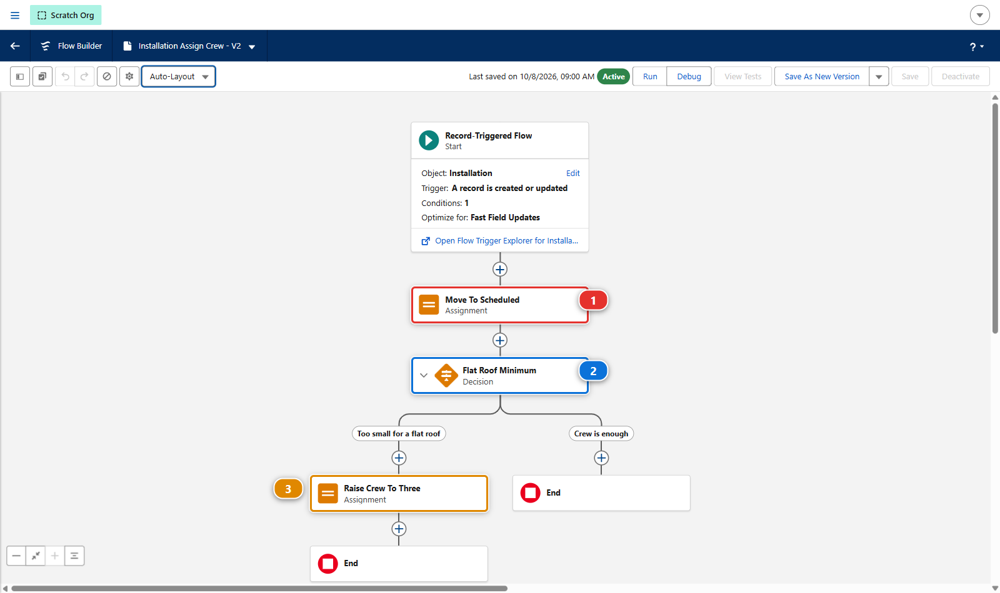
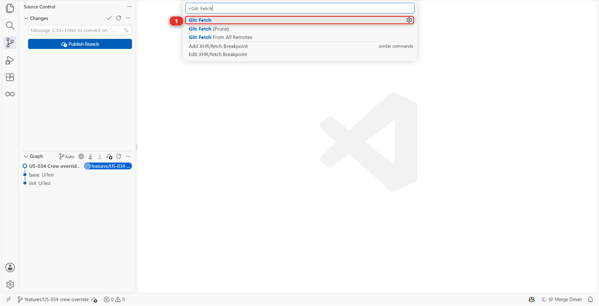
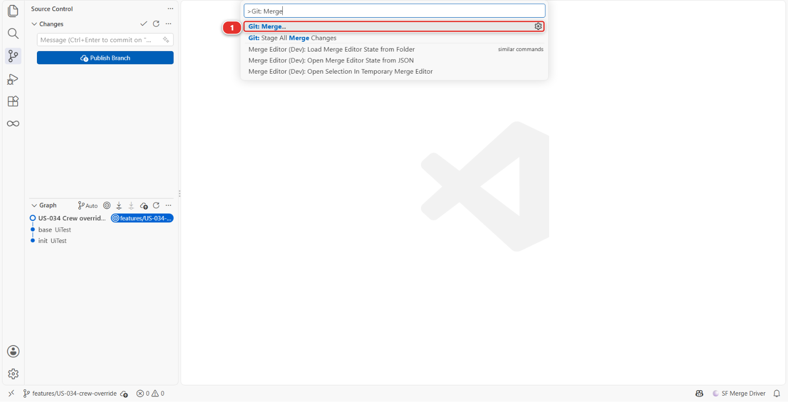
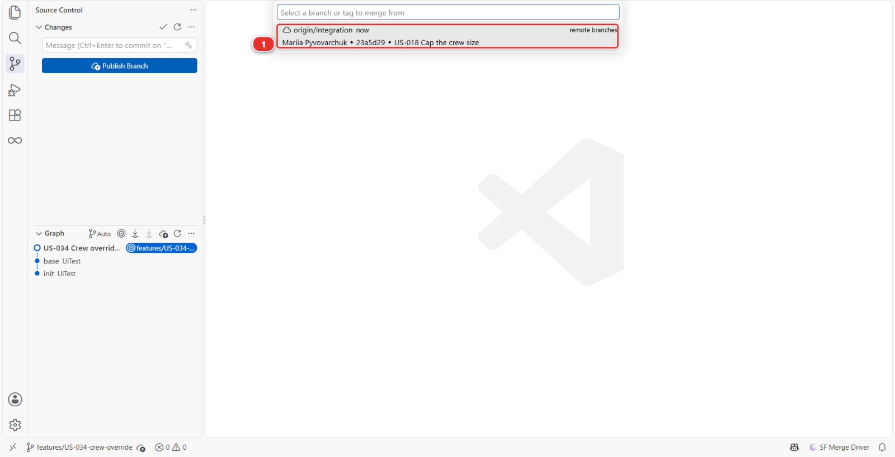
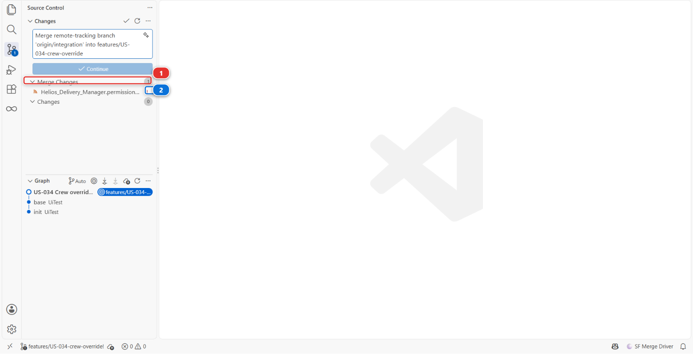
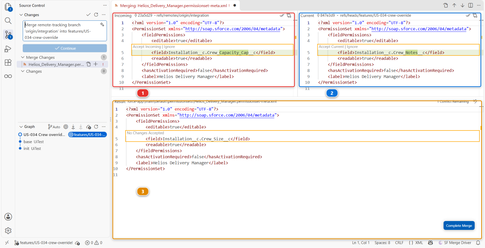
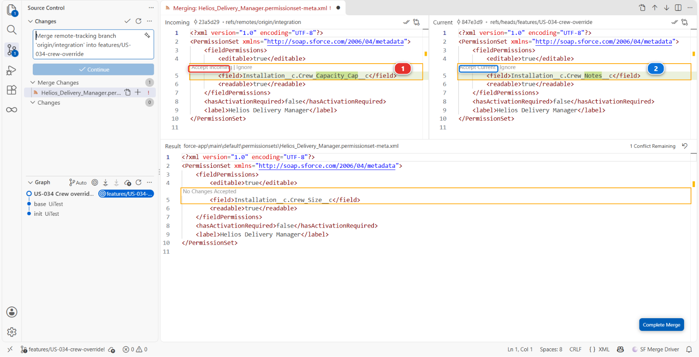
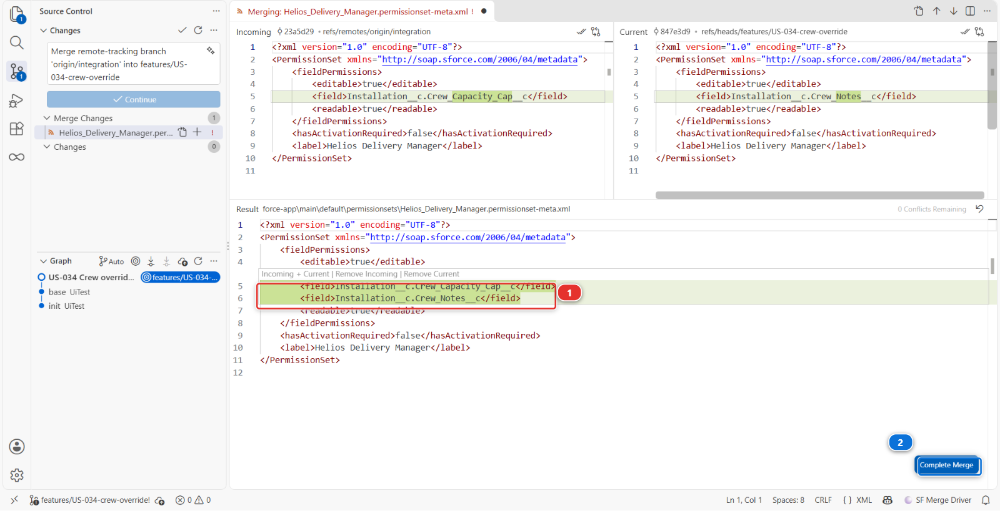
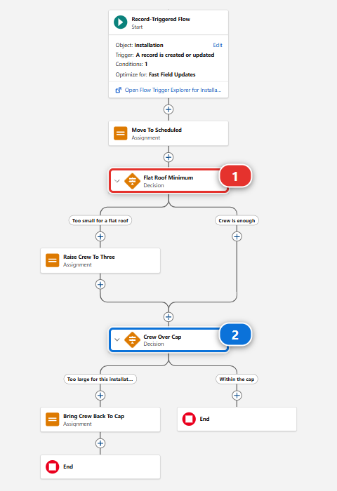

# Lab 2.7 - Resolve a Git merge conflict with a teammate

**Level**: 2 Contributor advanced

**Time**: ~50 min<!-- observed --> (observed: median 50 min, 11 learners, fastest 25 min)<!-- /observed -->

**You will**: face a real merge conflict on two files that conflict very differently, and resolve
both without losing anybody's work.

## The situation

Mariia Pyvovarchuk has been working on **US-018 - Cap the crew size a planner can assign**, in the same
flow and the same permission set as you. She merged this morning. You did not.

> Git conflicts on a Salesforce project are almost always one of two shapes: a Permission Set where
> two people added different entries, and a Flow where two people changed the logic. The first is
> mechanical. The second requires you to understand both changes.

## Before you start

- [ ] [Lab 2.6](2-6-permission-sets-and-profiles.md) finished and merged
- [ ] Nothing waiting in the **Source Control** panel that you still care about

## Steps

### 1. Start your own change

Goal: your flow rule and your field grant committed on `US-034-crew-override`, not published yet.
Refresher: [Lab 1.5](../level-1-contributor-basics/1-5-retrieve-commit-and-publish-your-changes.md)

#### Do

1. **New User Story** **(2)**, under **Project Contribution Workflow** **(1)**. Name
   `US-034-crew-override`, org `helios-dev`

   

2. In `helios-dev`, open the flow `Installation Assign Crew` and add a decision so that an
   installation whose roof type is `Flat` gets a crew of at least 3, whatever else the flow decided
3. Connect it to the same assignment the flow already ends on, so the new rule runs after the
   status change
4. **Save**, then **Activate**: each save of a flow is a new version, and only the active one runs
5. On the permission set `Helios Delivery Manager`, grant edit access on
   `Installation__c.Crew_Notes__c`, so a planner can say why a crew was raised
6. Retrieve the flow and the permission set, and commit them

!!! warning "Careful"
    Stop there: do not publish yet. The next step needs your change to exist before Mariia's work
    lands.

#### You should now see

- In Flow Builder, with the canvas in **Auto-Layout**, the flow reads: the assignment it already
  ended on, **Move To Scheduled** **(1)**, your new decision **(2)**, and on its flat roof branch the
  assignment that raises the crew to three **(3)**
- Your commit on the branch, and nothing published



### 2. While you were building it, Mariia merged

Goal: Mariia's US-018 merged into `integration`, and your branch behind it.
Refresher: [Lab 2.1](2-1-backpromote-your-teammates-work.md)

Mariia does not exist. Her work does, and the training reproduces it inside your own fork so you
can genuinely review and merge it.

#### Do

1. Once your own change exists, open **Training: Level 2** **(1)** > **Simulate my teammates**
   **(2)**, from the Welcome page or from the sfdx-hardis command list

   

2. The command panel asks three questions. Answer them as below

   | Question                               | Answer                                                  |
   |----------------------------------------|---------------------------------------------------------|
   | Which teammate work do you need?       | **US-018 Cap the crew size a planner can assign**       |
   | Create it?                             | **Yes**                                                 |
   | Merge it for you once its checks pass? | **Yes**, unless you want to merge it yourself on GitHub |

3. With **Yes**, let the panel wait for the checks, two to four minutes: it merges the Pull Request
   and writes **Pull Request merged into its base branch**. If you merge it on GitHub while the
   panel is still waiting, it notices and stops

  !!! tip "If you answered No"
      With **No**, open the address it printed, have a look at **Files changed**, and merge it
      with **Squash and merge** once the checks are green: the same clicks as
      [Lab 2.1](2-1-backpromote-your-teammates-work.md), step 1b, where each one has its screenshot.

#### Why after your change

Do this after your own change exists, because that is the situation the lab is about: you
branched, she merged, and neither of you knew about the other.

The command creates the branch `training/mate-us-018-crew-capacity` from your current
`integration`, commits Mariia's changes under her name, pushes it to your fork (your own copy of the
course repository on GitHub, for example `github.com/my-username/sfdx-hardis-training`), opens the
Pull Request and prints its address.

<details markdown="1"><summary>Under the hood: why the teammate is replayed rather than pre-existing</summary>

The command ran:

    node scripts/training.mjs simulate

which copied the files from `scripts/simulate/us-018-crew-capacity/files/` over your working tree,
committed them with Mariia's name and email, pushed the branch to your fork and opened the Pull
Request there with `gh pr create`.

It has to work this way. A Pull Request lives in one repository: you cannot review one that exists
in somebody else's. And a branch shipped in the repository months ago would not share a sensible
ancestor with the `integration` you have built up over five labs, so the conflict would be either
absent or absurd.

The same patch set produced the real teammate Pull Requests on the public training repository, so
what you are reviewing is byte for byte what the screenshots show.

</details>

#### You should now see

- Either way, Mariia is now in `integration`, and you are behind

### 3. Publish, and watch the Pull Request refuse to merge

Goal: your Pull Request open into `integration`, and GitHub naming the two files that conflict.

#### Do

1. Now publish your own change: **Save / Publish**, push, and open the Pull Request into
   `integration`

#### Why

Two files, two completely different kinds of problem.

Neither of them is git being awkward. Both changes are real, both are wanted, and in both files the
two of you wrote in the same place: Mariia granted a field on the permission set one line from where
you granted yours, and she connected the same assignment element in the flow to a decision of her
own. A merge tool cannot know which of two connectors should win. You can.

#### You should now see

- GitHub showing:

  > This branch has conflicts that must be resolved
  > `force-app/main/default/flows/Installation_Assign_Crew.flow-meta.xml`
  > `force-app/main/default/permissionsets/Helios_Delivery_Manager.permissionset-meta.xml`

### 4. Merge integration into your branch

Goal: the merge of `origin/integration` in progress on your branch, with two files in conflict.

#### Do

1. Open the **Source Control** panel, the icon of three small circles joined by lines in the left
   bar
2. Open the **Command Palette**: **View > Command Palette** in the menu bar, or `Ctrl+Shift+P`
   (`Cmd+Shift+P` on a Mac). Type `Git: Fetch` and pick **Git: Fetch** **(1)**

   

3. Then the Command Palette again, type `Git: Merge`, and pick **Git: Merge...** **(1)**. The same
   command is in the **...** menu at the top of the Source Control panel, under **Branch**

   

4. VS Code asks which branch to merge. Type `integration` and pick **origin/integration** **(1)**,
   listed under **remote branches**. Not the plain `integration` if it is listed too

   

5. Leave the files under **Staged Changes** where they are: they are part of the merge

#### Why fetch, then origin/integration

The fetch first makes sure your machine knows what Mariia merged. Nothing changes in your files:
fetching only downloads what is new on GitHub.

**origin/integration** is the copy of `integration` that is on GitHub, with Mariia's work in it. The
plain `integration` is the copy on your machine, which you have not updated since you branched.

Under **Staged Changes**, two more files wait, the field Mariia created and the layout she changed:
git merged those on its own.

<details markdown="1"><summary>Under the hood: what Merge Branch ran</summary>

    git fetch origin
    git merge origin/integration

A conflict is not an error. It is git saying that two people wrote in the same place and it will not
guess which one meant it.

</details>

#### You should now see

- Two files come back marked as conflicting. They appear in the panel under **Merge Changes**
  **(1)**, each with an exclamation mark **(2)**, and the status bar says a merge is in progress
- The picture lists only the permission set. Yours also lists the flow `Installation_Assign_Crew`,
  with its own exclamation mark: two files, as GitHub said
- Under **Staged Changes**, the field Mariia created and the layout she changed



### 5. Resolve the permission set: take both

Goal: both grants in the permission set, as two complete blocks, and the file out of **Merge
Changes**.

#### Do: take both sides

1. Click the permission set file under **Merge Changes**, then **Resolve in Merge Editor** at the
   bottom right of the file. VS Code opens its merge editor: **Incoming** **(1)**, Mariia's version
   from `integration`, on the left, **Current** **(2)**, yours, on the right, and the **Result**
   **(3)** you are building at the bottom, which starts from the version you both branched from

   

2. Click **Accept Incoming** **(1)** above the highlighted line of the **Incoming** pane
3. Click **Accept Current** **(2)** above the one of the **Current** pane

   

#### Why both

This one is mechanical, and you can decide it without understanding the XML: both entries
belong. Mariia granted one field, you granted another, and a permission set holds as many as it
needs.

#### Do: make two blocks of the result

1. Now read the **Result** **(1)** before anything else

   

2. Type it in the **Result** pane: after the first `<field>` line, add the four lines that close the
   first block and open the second. Copy them from here: nobody is asked to write XML from memory

   ```xml title="Edit this file"
           <readable>true</readable>
       </fieldPermissions>
       <fieldPermissions>
           <editable>true</editable>
   ```

3. Then click **Complete Merge** **(2)**

#### Why two blocks

The editor kept both lines, and put them in the same block: one `<fieldPermissions>` with two
`<field>` lines, which Salesforce refuses. Git merges lines, not permissions. You want two complete
blocks, one per field, Mariia's `Crew_Capacity_Cap__c` first and your `Crew_Notes__c` second. The
under the hood section below shows the result you are aiming at.

Take both is the right answer for almost every permission set conflict. Choosing one side is how
a teammate's permission quietly disappears, and nobody notices until somebody cannot see a field.

<details markdown="1"><summary>Under the hood: what the conflict actually looked like</summary>

Git conflicts on lines, not on XML, so the markers landed inside one block rather than around two:

```xml title="Output"
    <fieldPermissions>
        <editable>true</editable>
<<<<<<< HEAD
        <field>Installation__c.Crew_Notes__c</field>
=======
        <field>Installation__c.Crew_Capacity_Cap__c</field>
>>>>>>> origin/integration
        <readable>true</readable>
    </fieldPermissions>
```

Once you added the four lines, the result holds two complete blocks, in alphabetical order, which is
how Salesforce writes them anyway:

```xml title="Edit this file"
    <fieldPermissions>
        <editable>true</editable>
        <field>Installation__c.Crew_Capacity_Cap__c</field>
        <readable>true</readable>
    </fieldPermissions>
    <fieldPermissions>
        <editable>true</editable>
        <field>Installation__c.Crew_Notes__c</field>
        <readable>true</readable>
    </fieldPermissions>
```

</details>

#### You should now see

- The permission set under **Staged Changes**, with two complete `<fieldPermissions>` blocks:
  `Crew_Capacity_Cap__c` first, `Crew_Notes__c` second

### 6. Resolve the flow: understand both, then decide

Goal: the flow rebuilt in Flow Builder, your minimum first and Mariia's cap last, retrieved and
staged next to the permission set.
Refresher: [Lab 2.5](2-5-pass-code-quality-and-apex-test-coverage.md)

This one you cannot resolve by taking both, because the two changes are in the same decision path.

- Mariia's change caps the crew at what the installation allows: never more than N
- Your change raises the crew to at least 3 on flat roofs: never fewer than 3

Read on their own, both are correct. Together, they can contradict each other on a flat roof whose
cap is 2.

This is the moment that matters, and the answer is not technical: go and ask Mariia. On a real
project, a conflict in business logic is a conversation, not a merge strategy.

For this lab, the decision has been made for you: the cap wins. A crew larger than the
installation allows is a safety problem; a crew of 2 on a flat roof is a slow day. Resolve so that
your minimum applies only when it does not exceed Mariia's cap.

!!! warning "Careful"
    Do it in Flow Builder, not in the file. A flow is stored as XML that nobody can read reliably,
    developers included, and a flow that deploys but behaves wrongly is worse than one that fails.

#### Do

1. Open the flow file under **Merge Changes** in the merge editor, the same way. Click **Accept
   Incoming** above each conflict of the **Incoming** pane, then **Complete Merge**: Mariia's whole
   version wins for now
2. **Save / Publish User Story** is not what you want yet. First send what the merge brought in to
   your dev org, so `helios-dev` has Mariia's field, her grant and her cap: in the **Explorer**,
   right-click the `force-app` folder, then **SFDX: Deploy This Source to Org**, the same command
   [Lab 2.5](2-5-pass-code-quality-and-apex-test-coverage.md) used on one class

   It deploys every file of the folder as it is on your machine, and nothing else. The sfdx-hardis
   **Push from local files to Salesforce org** command would send your org every change git has
   seen since the last sync, deletions included, which is more than this step needs

3. Open Mariia's version of the flow, which is the latest one: in Setup, **Flows**, open the menu at
   the end of the `Installation Assign Crew` row, **View Details and Versions**, and open the
   version at the top of the list. Opening the flow from its name can land on an older version,
   without her **Crew Over Cap** decision
4. Add your flat-roof rule again, before her cap. Your decision **(1)** comes first, her **Crew Over
   Cap** decision **(2)** last

   

5. **Save**, then **Activate**
6. Come back to VS Code, retrieve the rebuilt flow with **Commit changes**, and stage it in
   **Source Control**, next to the permission set. Do not commit yet: a merge ends with one commit,
   and the next step makes it

#### Why this order

The flow raises a flat roof crew to three first, and her cap, which now runs last, has the final
word.

Slower to describe, much faster to do, and you can see what you are building.

<details markdown="1"><summary>Under the hood: resolving it in the file instead</summary>

If you can read flow XML and want to: take Mariia's version of the element and its connectors as the
base, re-add your flat-roof decision before her cap, and delete every conflict marker. Then publish,
which re-runs the cleaning rules over what you wrote by hand.

The risk is not that it fails. The risk is that it deploys and the decisions run in an order you did
not intend, which no check catches and no test in this project covers.

</details>

#### You should now see

- In `helios-dev`, the active flow with your flat roof decision first and **Crew Over Cap** last
- The flow and the permission set both under **Staged Changes**, nothing committed yet

### 7. Finish the merge and re-validate

Goal: the merge committed and pushed, your branch published again, and the Pull Request merged.

#### Do

1. When both files are under **Staged Changes**, the message box already reads `Merge
   remote-tracking branch 'origin/integration' into features/US-034-crew-override`, and the blue
   button under it reads **Continue** while a merge is in progress: click it
2. Then **Sync Changes** to push
3. Then re-publish: **Save / Publish User Story**
4. Watch the check go green, then merge

#### Why publish again

**Complete Merge** moved each file from **Merge Changes** to **Staged Changes**.

Publishing again matters. The merge produced XML by hand, and publishing re-runs the cleaning rules
over it and rebuilds `manifest/package.xml` from what your branch now changes. Skipping it is how a
stray conflict marker reaches a deployment.

#### You should now see

- A green check on your Pull Request, then the Pull Request merged into `integration`

### 8. Verify both changes survived

Goal: Mariia's rule and yours both working in `helios-integration`.

#### Do

1. In `helios-integration`, open the flow `Installation Assign Crew` and the permission set
   `Helios Delivery Manager`

#### You should now see

- The flow caps the crew, Mariia's rule
- The flow raises flat-roof crews, your rule, without breaking the cap
- The permission set grants both fields

If either side is missing, the resolution lost work, and the badge audit will say so.

## What you should see

- [ ] No conflict markers anywhere: search the repository for `<<<<<<<`
- [ ] Both field permissions in `Helios_Delivery_Manager`
- [ ] Both behaviours in the flow

## If it goes wrong

**`Error parsing file: Element assignments is duplicated at this location in type Flow`.**
Your resolution left the flow with its elements out of order. A flow file groups every element of
the same kind together: all the assignments, then all the decisions. If your merge dropped a kept
element between two blocks of another kind, move it back up next to its own kind. The order inside
each group does not matter, the grouping does.

**`Element field is duplicated at this location in type PermissionSetFieldPermissions`.**
You kept both sides inside a single grant instead of keeping both grants. One `<fieldPermissions>`
block names one field: the fix is two blocks, not one block with two `<field>` lines.

**The flow will not deploy after the merge: "duplicate element name".**
You kept both sides of an element that can only exist once. Flow element names are unique. Rename or
remove one.

**You lost your change entirely.**
You accepted Mariia's side on the whole file. In the **Source Control** panel, the **...** menu >
**Branch** > **Abort Merge**, then start step 4 again.

**The check fails on a conflict marker.**
Search the whole repository for `<<<<<<<`, `=======` and `>>>>>>>`. A marker in an XML file is
sometimes syntactically tolerated by git and always fatal to Salesforce.

**You cannot untangle it at all.**
**Training: Level 2 > Reset this level**, then redo from step 1. Losing twenty minutes is better than
merging something you do not understand.

## Check your work

Welcome page > **Training: Level 2** > **Check my work**, then pick **Lab 2.7**.

The check asserts outcomes, not procedure: both changes present and correct on `integration`,
no markers left. However you got there, including resolving in the GitHub web editor or redoing the
work in the Flow Builder, passes.

## Go deeper

- [Profiles and Permission Sets](https://sfdx-hardis.cloudity.com/salesforce-devops-work-on-user-story-profiles/)
- [Overwrite management](https://sfdx-hardis.cloudity.com/salesforce-devops-config-overwrite/)

[Next: Lab 2.8 - Recover from committing the wrong metadata](2-8-recover-from-committing-the-wrong-metadata.md){ .md-button .md-button--primary }
