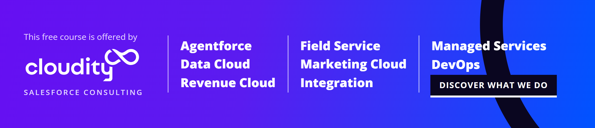
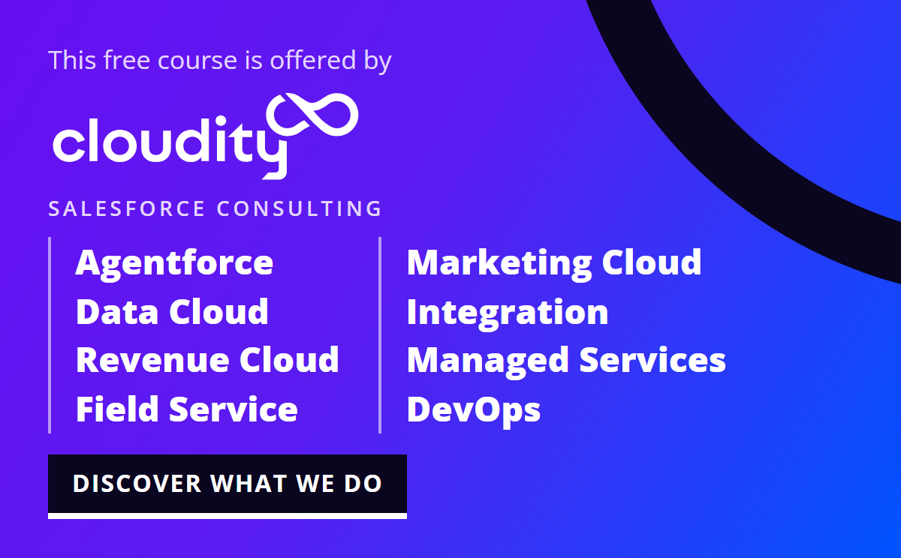

# Lab 2.9 - Capstone: deliver a User Story that has it all

**Level**: 2 Contributor advanced

**Time**: ~45 min<!-- observed --> (observed: median 48 min, 11 learners, fastest 23 min)<!-- /observed -->

**You will**: deliver one story that contains a dependency to check, a data deployment action and a
teammate working on the same permission set, with no step-by-step.

## The situation

> **US-041 - Installation handover checklist**
>
> As a planner, I want a handover checklist on the installation with its reference items, so that a
> job is only closed when the checklist is complete.
>
> Acceptance criteria:
>
> - A `Handover_Item__c` object exists, child of Installation
> - 10 reference checklist items are loaded in every org
> - The close flow blocks on an incomplete checklist

Three of the situations you met separately are waiting in this one story. You already know how to
handle all three.

## Before you start

- [ ] Labs 2.1 to 2.8 finished and merged
- [ ] `helios-dev` level with `integration`

## What to do

### The story

1. Take it. Name `US-041-handover-checklist`, org `helios-dev`
2. Build the object: `Handover_Item__c`, its **Record Name** an Auto Number `Handover Item
   Number`, `HI-{00000}`, **Starting Number** `0`, as [Lab 2.4](2-4-ship-reference-data-and-a-batch-with-deployment-actions.md) did for Crew Capacity, with `External_Id__c` (Text 40, external
   id, unique), `Installation__c` (Lookup to Installation), `Label__c` (Text 255), `Sequence__c`
   (Number 3, 0), `Is_Done__c` and `Is_Template__c` (Checkbox, unchecked). When you create it, tick **Launch New Custom Tab Wizard after saving this custom object**, pick any tab
   style and keep the other defaults of the wizard: the tab is how you reach the records in step 4
3. Grant the new object and its fields, before you create any record: on the `Helios Delivery
   Manager` permission set, never on a Profile, the way [Lab 2.6](2-6-permission-sets-and-profiles.md) had you do: **Read**, **Create** and **Edit** on Handover Item, and
   **Read** and **Edit** on its fields. You hold that permission set in `helios-dev`, so this is the
   access the records and the flow of the next two steps need. The pipeline's user holds it too, and
   the data load of the second trap needs it, as in [Lab 2.4](2-4-ship-reference-data-and-a-batch-with-deployment-actions.md)
4. Build the reference data: 10 template `Handover_Item__c` records with no installation, the
   checklist every job starts from. You create these by hand, in `helios-dev`, like any record:
   open the org from **Orgs Manager**, search **Handover Items** in the App Launcher, and click
   **New** ten times. For each record, give an **External Id**
   (`HANDOVER-TPL-01` to `HANDOVER-TPL-10`), a **Label** (`Panels fixed and torqued`,
   `Inverter commissioned`, `Isolator labelled`...), a **Sequence** (10, 20, 30...), tick
   **Is Template**, and leave **Installation** empty
5. Update the close check: the flow `Installation Close Check` already refuses to close an
   installation with no install date. Save a new version of it that also refuses while any related
   handover item is not done: after its date decision, a **Get Records** of one `Handover Item` of
   this installation with `Is Done` false, a decision on whether one was found, and a **Custom
   Error**. Describe every element you add, and give the Get Records a fault path, the way [Lab 2.2](2-2-fix-a-missing-dependency-deployment-error.md)
   had you do
6. Retrieve it: **Commit changes**, **Recent Changes**, and take what you made and nothing
   else, the tab included. The tab wizard also touched Profiles and apps: leave those rows. Commit it
7. Count before you push: what you created, then the same again in `force-app/` (One, below)
8. Merge the teammate first: simulate US-019, merge it, bring `integration` into your branch,
   and check the permission set holds both grants (Three, below)
9. Build the data workspace for the ten records, as in [Lab 2.4](2-4-ship-reference-data-and-a-batch-with-deployment-actions.md), and commit it (Two, below)
10. Publish and open the Pull Request into `integration`, and read the **Git Delta
    package.xml** report: every component you counted in step 7 is in it
11. **Declare the data action** on the Pull Request, then commit the file the editor wrote and
    publish again (And the data action, below)
12. Green, then merge with **Squash and merge**

The sections below say why each of these steps sits where it does.

### The three things waiting for you

#### One: the dependency

The flow now reads `Handover_Item__c` and two of its fields. Do not assume
every component it reads reached the repository: count what you created, count it again in
`force-app/` and in the **Git Delta package.xml** report before you push. Whatever is missing, the
deployment error three steps later names it, as in [Lab 2.2](2-2-fix-a-missing-dependency-deployment-error.md), and it is cheaper to find it now.

#### Two: the data

Ten records in your org are ten records in your org. A green deployment will put
the object and the flow into `helios-integration` and the checklist will be empty there, and the
feature will do nothing at all. Build a data workspace and declare an action.

#### Three: the teammate on the same file

Before you open your Pull Request, run **Training:
Level 2 > Simulate my teammates** and pick US-019. Romain adds a quote PDF field and grants it
on `Helios Delivery Manager`, the same permission set your checklist needs. Answer **Yes** to
**Merge it for you once its checks pass?** and the panel merges his Pull Request as soon as its
checks are green, or answer **No** and merge it yourself on GitHub from the address the panel
prints, the way [Lab 2.1](2-1-backpromote-your-teammates-work.md), step 1b, shows. Then bring
`integration` into your branch from the **Source Control** panel.

This time git merges it on its own, with no conflict: Salesforce keeps the permissions of a
permission set in alphabetical order, so his `Panel_Batch__c` grant and your `Handover_Item__c`
ones land far apart in the file.

!!! warning "A clean merge is not proof"
    Open the permission set and find both, `Panel_Batch__c.Quote_Pdf_Url__c` and your
    `Handover_Item__c` fields, before you publish. A merge that git did alone and nobody read is how
    a grant goes missing without a conflict to warn anybody.

!!! warning "Not US-018 again"
    Lab 2.7 already merged US-018, so simulating it a second time reports nothing to commit. Each
    teammate story merges once per level.

#### And the data action

Declare it the way [Lab 2.4](2-4-ship-reference-data-and-a-batch-with-deployment-actions.md) did: the Pull Request has to exist first, so
publish, open it, then add the **Data** action on its **Deployment Actions** tab, **Deployment job
only**, commit the file the editor wrote and publish again.

### A hint on sequencing, because getting this wrong costs an hour

The reference records need the object to exist before they can be loaded. So:

- The object and the flow deploy as metadata
- The data action runs after the deployment, not before

Same order as [Lab 2.3](2-3-fix-broken-records-with-an-apex-deployment-action.md), for the same reason: the batch class there, the object here, only exist once
the deployment is done. The rule is not "always after" either: it is *what does this action need
to already exist?*

## What you should see

In `helios-integration`, after the merge:

- `Handover_Item__c` with 10 template records
- Saving an installation to `Completed` with an incomplete checklist is refused, with your message
- `Helios_Delivery_Manager` granting the new fields, and Romain's quote PDF field still present

## If it goes wrong

Everything you need is in Labs 2.2, 2.4 and 2.7. Look up the one step you are stuck on rather than
rereading the labs.

**Training: Level 2 > Reset this level** if the repository gets away from you. It resets to the start of
Level 2, which means redoing the capstone, not the whole level.

## Check your work

Welcome page > **Training: Level 2** > **Check my work**, then pick **Everything in level 2, capstone included**.

Nine checks.

## Claim your badge

Welcome page > **Training: Level 2** > **Claim my badge**.

Same as Level 1: it re-checks everything here, asks for your Trailblazer username, the last part of
the address of your Trailhead profile, and opens the claim form filled in. Pick your level in the
**Level** dropdown, which a link cannot prefill, then tick the three boxes and submit.

A Level 2 claim re-runs the Level 1 audit as well, because the badge says you can do both. If
you skipped Level 1, that is where it will say so, and the command says it before the form opens.

The badge for this level is called **sfdx-hardis Contributor Advanced**. Level 1 makes you able to
deliver a User Story; Level 2 makes you able to deal with everything that goes wrong on the way.

!!! tip "If the course helped you"
    [oxsecurity/megalinter](https://github.com/oxsecurity/megalinter) is the linting engine behind
    the quality gate your Pull Requests went through. A star is how an open source project stays
    visible: open its page and click **Star** **(1)**, on the right of the repository name. Give it a star if you liked this
    course!

    

!!! tip "Put it on your LinkedIn banner"
    [Trailhead Banner](https://thb.nabondance.me/) draws a LinkedIn cover image from a Trailblazer
    username, and it shows the highest sfdx-hardis training badge you claimed here. Type your
    username, generate the picture, and set it as your LinkedIn cover.

## What comes next

You can stop here and be genuinely good at the contributor job.

Level 3 is a different role. You stop asking for your work to be merged and start deciding what
gets merged, when it is released, and what happens when production breaks at 17:40 on a Friday.

The project you have been contributing to stops at `integration`: no UAT, no production, no proper
CI authentication, no monitoring. Level 3 is finishing it.

[Continue to Level 3 - Release Manager](../level-3-release-manager/index.md){ .md-button .md-button--primary }

## On a real project

Everything Level 2 put in your way happens on real projects too, usually on the day of a release.
[Cloudity](https://sfdx-hardis.cloudity.com/salesforce-devops-home/#get-help-from-cloudity), the company behind sfdx-hardis and this course, trains delivery teams and
stays reachable after go-live. It also runs Salesforce projects of its own, from Agentforce and
Revenue Cloud to Field Service: [see what it does](https://cloudity.com/services/?utm_source=sfdx-hardis-training&utm_medium=referral&utm_campaign=capstone-2).

[{ .cloudity-banner .wide-only loading=lazy }](https://cloudity.com/services/?utm_source=sfdx-hardis-training&utm_medium=referral&utm_campaign=capstone-2)
[{ .cloudity-banner .narrow-only loading=lazy }](https://cloudity.com/services/?utm_source=sfdx-hardis-training&utm_medium=referral&utm_campaign=capstone-2)
