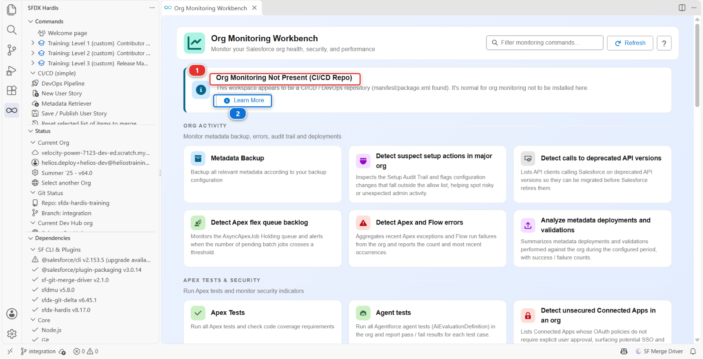
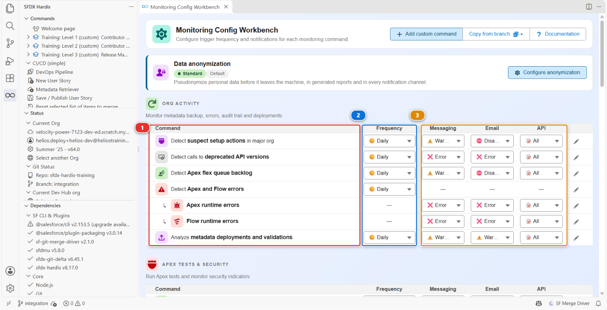
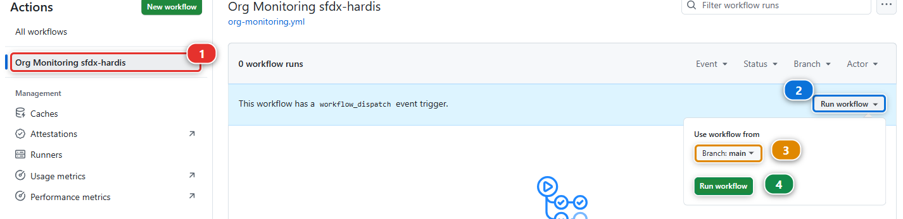
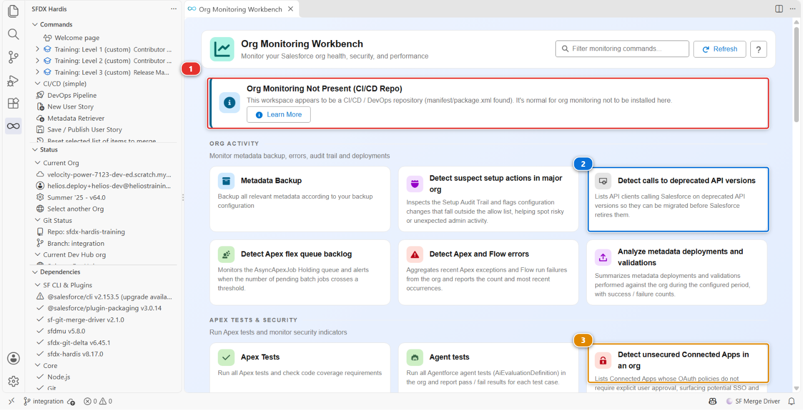

# Lab 3.8 - Monitor your production org

**Level**: 3 Release Manager

**Time**: ~10 min<!-- observed --> (observed: median 13 min, 5 learners, fastest 6 min)<!-- /observed -->

**You will**: set up nightly monitoring on production, read its first report, and decide what is
worth being told about.

## The situation

You now know what shipped and when. You do not know what state production is in between releases.

On an org Victor ran for two years, that would mean: inactive users still holding licences, a
Connected App nobody remembers authorising, Apex on an API version four years old, a scheduled job
that has been failing every night since March. Nobody is looking, because looking means remembering
to look.

Monitoring is the part of the release manager job that happens when nothing is being released.

What it gives you, every night, is three things, and none of them is a log file to dig through:

| What                  | Where you read it                                                                                          |
|-----------------------|------------------------------------------------------------------------------------------------------------|
| **A metadata backup** | The git history of the monitoring repository: every change made to the setup of production, dated          |
| **Indicators**        | One per check: a count and a severity, with a report file behind it. Inactive users, limits, failing tests |
| **Alerts**            | The indicators that crossed a severity you chose, sent to you: a message in a team channel, or an email    |

The backup is a backup of **metadata**: objects, fields, flows, Apex, permission sets, layouts, the
way the org is built. It is **not a backup of data**. No account, no contact, no installation
record is in it, and it will never restore one. Losing records is a different risk, covered by a
data backup tool, and a team that hears "production is backed up every night" has to know which of
the two was meant.

The alerts are how monitoring is read day to day: nobody opens a report every morning, and a
message that arrives gets read. On a real project they go to **Slack, Microsoft Teams or Google
Chat**, in a channel the whole team sees. This lab uses **email**, because it needs nothing but
an address you already have. The indicators can also be sent to Grafana, which is where they
become curves over months. That is out of scope here.

## Before you start

- [ ] [Lab 3.7](3-7-hotfix-and-retrofit.md) finished
- [ ] `helios-prod` connected in **Orgs Manager**
- [ ] An empty GitHub repository of your own, with `monitoring` in its name
- [ ] An email address you can read, for the alerts
- [ ] About 20 of those 35 minutes will be the first monitoring run

## Steps

### 1. Create the second repository yourself, first

Monitoring **always** lives in its own repository, separate from the one your pipeline deploys
from. Not usually, not by preference: always. This is the part people get wrong, and it is the part
that is expensive to undo once a year of nightly commits has piled up in the wrong place.

`sf hardis:org:configure:monitoring` does not create that repository for you. It checks the name of
the one it is standing in, and if that name does not contain `monitoring` it asks
**Do you use a separate repository for your monitoring deployment sources?**, with two answers:

- *Yes, I'm sure because I know what I'm doing, like Roman 😊*, which carries on regardless
- *Mmmmm no, let me create another repo with the word "monitoring" in its name !*, which stops the
  command

**Take the second one.** The question exists because the command cannot be certain from a name
alone, not because the two are alternatives. In a repository whose name does contain `monitoring`
the question is never asked at all, which is the state you want to be in before you start.

So, before anything else: create an empty private repository called
`sfdx-hardis-training-monitoring` on GitHub. Then clone it the way [Lab 1.2](../level-1-contributor-basics/1-2-create-your-dev-hub-scratch-orgs-and-pipeline.md) cloned this
one: **File > Open Folder** on an empty folder, **Source Control** panel, **Clone Repository**,
and paste the address from the green **Code** button of your new repository. Nothing in this lab
happens in the repository you have been working in all course.

Why two repositories, and it is the same reason real projects do it:

| Reason                | Detail                                                                                                                         |
|-----------------------|--------------------------------------------------------------------------------------------------------------------------------|
| Different permissions | Monitoring holds credentials for production. Every contributor has access to the source repository, and does not need this one |
| Different rhythm      | Monitoring commits every night. Mixing that history with your source history makes both unreadable                             |
| Different content     | Monitoring stores nightly org backups. It grows, and it should not grow inside the repository people clone every day           |

Your source repository and your monitoring repository are two different things with two different
audiences. If you ever find yourself about to answer yes to that question, the right move is to stop
and create the second repository, however late it feels.

### 2. Run the configuration

From the monitoring repository, open the **Org Monitoring Workbench** from the Welcome page and click
**Install Org Monitoring**.

!!! note "No such button?"
    Then you are in the wrong folder. Open the same panel from the repository you have been working
    in all course and you get this instead:

    

    **Org Monitoring Not Present (CI/CD Repo)** **(1)** is the panel telling you it will not install
    monitoring here, and **Learn More** **(2)** is all it offers. A project that has recorded where
    its monitoring repository lives gets an **Open Monitoring Repository** button beside it. The
    install button only exists where the thing it installs belongs.

It runs in a command panel and asks its questions one at a time, the way [Lab 3.1](3-1-configure-the-pipeline-up-to-production.md) did:

1. **Did you configure the sfdx-hardis monitoring pre-requisites on your Git server ?** The second
   answer, *ℹ️ No, bring me to the documentation!*, opens that page and ends the command, so read it
   first if you have not
2. **Please select or connect to the org that you want to monitor** - `helios-prod`. The command makes it your default org. If it asks for the org a second time,
   pick `helios-prod` again
3. **What is the address of the CI/CD repository that deploys to this org? (optional)** - the
   address of your fork, `https://github.com/<your-handle>/sfdx-hardis-training`. It is the mirror
   of step 8: the monitoring repository records where the pipeline lives, so that a coding agent
   opened in it can search your fork and its workflow runs too
4. **Branch monitoring_... does not exist on the remote server. Do you want to push it?** - yes.
   This one comes before the certificate, not after, and it only appears the first time
5. Then the certificate questions from [Lab 3.1](3-1-configure-the-pipeline-up-to-production.md), unchanged and in the same order: self-signed,
   let sfdx-hardis configure the External Client App, encrypted certificate as a file, then the same
   stop while you store the two secrets, this time in the **monitoring** repository, then the name,
   the contact email and the profile of the app. The profile list is in the language of the org's
   user, as in [Lab 3.1](3-1-configure-the-pipeline-up-to-production.md)
6. **Do you want to save the configuration on the remote server (auto-commit)?** - yes

Last, it writes the workflow on `main` and says so: *The monitoring workflow on main now runs
monitoring_...*. GitHub only schedules the workflows of the default branch, and only offers **Run
workflow** for those, so the workflow that runs every monitored org lives on `main` and lists each
monitoring branch.

If GitHub refuses a push on the way, the command says *GitHub refused this push* and names the
`workflow` scope: the first entry of **If it goes wrong** below is the way out. Do not get past it by
merging the monitoring branch into `main`, even through a Pull Request. `main` carries the workflow
and nothing else, each monitored org lives on its own branch, and such a merge brings the example
workflow of the branch to `main`, whose jobs fail on branches called `monitoring_myclient`.

It never asks for a repository name to create or for a git provider, because it creates neither: the one address it asks for, your fork, it only records. The authentication is the same code as [Lab 3.1](3-1-configure-the-pipeline-up-to-production.md): External Client App, JWT, two secrets to store,
this time in the **monitoring** repository. The key lands in `./.ssh/` rather than
`config/branches/.jwt/`, and the configuration in a `.sfdx-hardis.yml` at the repository root, on a
branch called `monitoring_` plus the org's domain, cut from `main`. The repository was empty, so it
first gives `main` an empty commit to start from. One branch per monitored org is how one repository
watches several.

### 3. Choose what it watches

Open the **Monitoring Config Workbench** panel. One row per check, and six columns: **Command**
**(1)**, **Frequency** **(2)**, then **Messaging**, **Email** and **API** **(3)**, which are the
severity each channel is sent at, and a last column of per-row actions.

There are around thirty checks, they come from the product rather than from your configuration file,
and they are all on by default at frequencies the product chose: some daily, some weekly, some
monthly. That is the right default and the wrong long-term setting.

For a first run, leave it all on. You are about to find out which of them say something useful about
**this** org, and that is not knowable in advance.

Now give the run somewhere to send its alerts, before it runs. Two things, and it takes both:

**An address.** On GitHub, in the **monitoring** repository: **Settings > Secrets and variables >
Actions**, then **New repository secret**, the same form as [Lab 3.1](3-1-configure-the-pipeline-up-to-production.md) step 6. Name it
`NOTIF_EMAIL_ADDRESS` and give it your email address as its value. Several addresses go in the same
secret, separated by commas. The workflow already reads that secret: it was written to.

**A severity.** An address alone may bring you nothing. Look at the **Email** column: most checks
read **Disabled** or **Error** there, so an org with nothing wrong sends no email at all, which is
the right setting for a team and the wrong one for a first run. On the row **Detect if org limits
are close to be reached**, set **Email** to **All**. That check will now write to you every night,
whatever it found.

The panel saves as you click, into `.sfdx-hardis.yml` at the root of the monitoring repository, and
the nightly job reads that file from GitHub, not from your computer. So publish it: in the **Source
Control** panel, stage `.sfdx-hardis.yml` with the **+** on its row, type a message such as
`Email me the org limits`, **Commit**, then **Sync Changes**.

!!! note "Why email, and what a real project does"
    Email is the channel that needs no workspace, no channel and no webhook, which is why this lab
    uses it. A real project sends its alerts to **Slack, Microsoft Teams or Google Chat**, where the
    whole team sees them and can answer in a thread, and often keeps email for one person or one
    check: the security team and the audit trail, say. The **Messaging** column is the same setting
    for those three, and the links under Go deeper set each of them up.

### 4. Run it once by hand

Do not wait for tonight. The workflow, **Org Monitoring sfdx-hardis**, is scheduled at `0 0 * * *`
(midnight UTC) and also accepts a manual run. In the monitoring repository, open **Actions**, click
**Org Monitoring sfdx-hardis** **(1)** in the list on the left, then **Run workflow** **(2)**. Leave
the branch on `main` **(3)** and click the green **Run workflow** **(4)**.

The run appears in the list a few seconds later: click it to follow it.

It takes a while, most of it the org backup. When it finishes, the repository holds a full source
backup of production, its metadata and none of its records, and a set of reports.

### 5. Read the first report

Start with your mailbox, because that is where monitoring finds you from now on. The run sent an
email whose subject starts with `[sfdx-hardis]`, from your own org: look in the spam folder if it is
not in the inbox. It holds what a release manager needs before the first coffee: which org, what
the check found, the list of what is wrong when something is, the full report attached as a
spreadsheet, and a link to the job that produced it.

That email is one indicator, on one day. Each check produces one like it, and the **Email** and
**Messaging** columns of step 3 decide which of them are worth interrupting somebody for.

Then the whole picture. Open the **Org Monitoring Workbench** panel in VS Code, pointed at the
monitoring repository.

Check the banner first **(1)**. **Org Monitoring Not Present (CI/CD Repo)** means you opened the
wrong folder: this panel reads the monitoring repository, not the one you have been working in all
course. Open the monitoring repository and the banner goes.

Under the monitored org, the panel shows the **Deployment repository** you gave the command in
step 2: click it to open your fork in a new VS Code window. Had you left that question empty, the
panel would offer **Set deployment repository** instead. It is optional either way.

Each check is a card, and the two worth opening first are **Detect calls to deprecated API versions**
**(2)** and **Detect unsecured Connected Apps in an org** **(3)**.

Be honest about what you are looking at. `helios-prod` is a Developer Edition org that is a few days
old, with one user in it and an app you deployed yourself. Nothing seeds it with the findings a
two-year-old org has, and a report that comes back nearly clean is not a broken report.

Nearly clean, not clean. The run itself is green, and that says nothing about the org: a monitoring
job that ran to its end stays green even when it found issues, and turns red only when the job
itself could not run. The findings are in the report. **Detect if org limits are close to be reached** has
one limit at 100%: `ActiveScratchOrgs`, 3 of 3. `helios-prod`
is also your Dev Hub, and your three training scratch orgs use every slot it has. That is a true
finding, the kind a limit check exists for: on a real Dev Hub it means nobody on the team can create
a scratch org until one expires.

And **Detect unsecured Connected Apps** has one too: **Salesforce CLI**, marked *Unsecured*. It is the
app every `sf org login` goes through, yours included, and on a Developer Edition org it is open to
any user who can log in. On a production org that is the first finding to take to the security team:
an admin can restrict it to approved users, and the CLI keeps working for them.

The same report may list a second one, `orgfarm_app_1`. It is not yours: it belongs to the Salesforce
service that created your Developer Edition org, and a production org does not have it.

What you are reading for is the **shape** of each finding, so that you recognise it on a real org:

| Finding on a real org           | What it actually means                                                     |
|---------------------------------|----------------------------------------------------------------------------|
| **Inactive users still active** | Licences being paid for, and accounts that can still log in                |
| **An unsecured Connected App**  | Something can reach your production data and nobody remembers approving it |
| **Apex on an old API version**  | It will break at a Salesforce release, on a date you do not control        |

The one finding you should genuinely expect here is in the **backup** rather than in a check: the
validation rule [Lab 3.7](3-7-hotfix-and-retrofit.md) hotfixed is in the org with its new formula, and now it is in the monitoring
repository's git history, dated. That is the answer to "when did that change", and it is the part of
monitoring that pays for itself first.

### 6. Decide what is noise, which is the actual skill

This is the step that decides whether monitoring survives six months.

Go through every finding and put it in one of three buckets:

| Bucket                     | What you do                                                 | Example                                 |
|----------------------------|-------------------------------------------------------------|-----------------------------------------|
| **Act now**                | Fix it this week                                            | The unsecured Connected App             |
| **Track**                  | Put it in the backlog as a story                            | The old API version                     |
| **Silence, with a reason** | Turn it off in the configuration, with a comment saying why | A check that does not apply to this org |

On `helios-prod`, `ActiveScratchOrgs` goes in **Track**: it is real, it is expected for as long as
the course runs, and it expires with the scratch orgs. Silencing the whole limits check for it would
hide every other limit with it, which is exactly the inconvenient kind of silencing.

**Silencing is legitimate.** A monitoring report with forty findings that nobody acts on is worse
than no monitoring, because it teaches the team that the report is noise. A report with four
findings that all matter gets read every morning.

What is not legitimate is silencing something because it is inconvenient. Write the reason in the
configuration file, and the next person can disagree with you knowingly.

### 7. Route one notification

A report nobody opens is not monitoring, and you have just seen the other half: the email of
step 5 reached you without you opening anything.

It was also set the wrong way for the long run, on purpose. **All** on the limits check means a
message every night saying nothing is wrong, and a nightly "everything is fine" message is read for
a week and filtered forever after. Back in the **Monitoring Config Workbench**, put the **Email** of
that row back to **Error**, and publish the file as in step 3. From tonight you are written to when
a limit is nearly reached, and only then.

That is the rule for every row: the **Messaging**, **Email** and **API** columns hold the severity
each channel is sent at, per check, and they should let through the failures and the critical
findings only. **Disabled** is a legitimate value.

Keep **one** channel. On a real project that channel is Slack, Microsoft Teams or Google Chat rather
than email, and one is enough: two on day one means the same message arriving twice and being
ignored in both places.

Those settings are written as `notificationConfig` in the monitoring repository's `.sfdx-hardis.yml`,
one entry per notification type, merged over the product's defaults.

### 8. Make it findable

The next release manager will need the monitoring repository on their first day, and the one place
they will look is the project. Back in the source repository: **DevOps Pipeline** > gear menu >
**Configure Pipeline Settings**, scope **Global Settings**, tab **Salesforce Project**. **Monitoring
repository**: **Edit**, paste the address of your monitoring repository,
`https://github.com/<your-handle>/sfdx-hardis-training-monitoring`, and **Save**. Then **Training:
Level 3** > **Publish my pipeline configuration**: it is pipeline configuration, like the rest.

That command does the whole trip on its own, as in [Lab 3.1](3-1-configure-the-pipeline-up-to-production.md): it creates a branch, commits the
configuration, pushes it and opens the Pull Request. You have nothing to commit and no Pull
Request to create: wait for its checks, merge it with **Squash and merge**, as its **How to merge**
line says and as in [Lab 3.5](3-5-promote-to-uat-and-write-release-notes.md), then **Pull** in the
**Source Control** panel.

From then on, the **Org Monitoring Workbench** opened from the source repository offers **Open
Monitoring Repository** instead of a dead end.

Under the hood: what runs every night

The command was:

    sf hardis:org:configure:monitoring

and it copied in the CI files for **every** git provider at once, not only GitHub. The workflow it
generated for GitHub has four jobs:

1. **Backup** runs first, on its own: `sf hardis:org:monitor:backup` retrieves the whole org in
   source format and commits it. The git history of that repository becomes an answer to "what
   changed in production, and when", which nothing else gives you. When the retrieve is done, the
   same command regenerates the project documentation of [Lab 3.9](3-9-generate-the-project-documentation.md) before it finishes
2. Then three jobs in parallel, each waiting only on the backup: `sf hardis:org:test:apex`,
   MegaLinter, and `sf hardis:org:monitor:all`

`monitor:all` is where the checks live. It runs the `sf hardis:org:diagnose:*` commands itself, one
per check, then applies the thresholds and sends the notifications. You will not find them listed in
the workflow.

`monitoringCommands` in the monitoring repository's `.sfdx-hardis.yml` is **not** the list of checks:
the list is built into the product, around thirty of them, and this key only overrides entries by key
or appends new ones. Leaving it empty still runs everything. `monitoringDisable` is the per-check
off switch, by the check's key rather than its label, and setting a check's `frequency` to `off`
takes it out of the run too.
`notificationConfig` decides what is sent where, and at what severity.

The nightly backup is the underrated part. When somebody asks "when did that validation rule
change", the answer is a `git log` on the monitoring repository, and it works even for changes
nobody made through the pipeline.

The backup also writes an `AGENTS.md` at the root of the monitoring branch, and a `CLAUDE.md`
pointing at it. It explains the repository to a coding agent: what each folder holds, what the
backup skips, how to read the history, which checks run. With `deploymentRepository` set, it also
tells the agent how to clone your fork next to it, read-only, find the branch that deploys to
`helios-prod`, and read the workflow runs of both repositories. That is what lets an agent answer
"was this change deployed by the pipeline, or made directly in production?".

If your organisation runs Grafana, the results can feed [ready-made
dashboards](https://sfdx-hardis.cloudity.com/salesforce-monitoring-grafana-v2/). That is out of
scope here, and worth knowing exists.

<!-- command-links:start -->
Command documentation: [hardis:org:configure:monitoring](https://sfdx-hardis.cloudity.com/hardis/org/configure/monitoring/), [hardis:org:monitor:backup](https://sfdx-hardis.cloudity.com/hardis/org/monitor/backup/), [hardis:org:test:apex](https://sfdx-hardis.cloudity.com/hardis/org/test/apex/), [hardis:org:monitor:all](https://sfdx-hardis.cloudity.com/hardis/org/monitor/all/)
<!-- command-links:end -->

## What you should see

- A second repository, created by you, with an **Org Monitoring sfdx-hardis** workflow run: the
  backup, the Apex tests, MegaLinter and the Monitoring job all green
- The `ActiveScratchOrgs` limit at 100% in the report, which the green run did not tell you
- A full metadata backup of `helios-prod` committed in it: its sources, not its records
- A first report you have read and triaged, however short it is
- An email from the first run in your mailbox, subject starting with `[sfdx-hardis]`, with the org
  limits report attached
- The **Email** of the limits check back on **Error**, committed and pushed
- `monitoringRepository` in `config/.sfdx-hardis.yml` on `integration`, pointing at it
- `deploymentRepository` in the monitoring branch's `.sfdx-hardis.yml`, pointing back at your fork,
  and an `AGENTS.md` at the root of that branch

## If it goes wrong

**Source Control shows hundreds of files to commit after Publish my pipeline configuration.**
Look at which repository they are under: with both folders open in one window, **Source Control**
lists the two repositories one above the other. The files are in `sfdx-hardis-training-monitoring`,
not in your fork, and Publish my pipeline configuration never touches that one. They are a backup
taken from your computer, when the **Metadata Backup** card of the **Org Monitoring Workbench** runs
there instead of in the nightly job. Do not commit them: the job commits its own backup. On that
repository, **...** > **Changes** > **Discard All Changes**, then **Pull**, and you have what the
job saved.

**The push is refused: *refusing to allow an OAuth App to create or update workflow ... without `workflow` scope*.**
The monitoring branch carries a GitHub workflow file, and GitHub only lets credentials that have
the `workflow` permission push one. The ones VS Code used do not. Click the **Accounts** icon at the
bottom of the activity bar, sign out of GitHub, then click **Install Org Monitoring** again: VS Code
asks you to sign in, and the permissions it requests include workflows. The command can be run
again safely. Each run makes a new certificate, though: store the two secrets it gives this time,
in place of the ones of the first run, or the job fails at authentication. Do not push the branch
another way and move on, and do not merge it into `main`: the command also writes the workflow on
`main` at the end, and without that step the workflow keeps its example branch names and never runs
your org.

**The workflow run fails on a branch called `monitoring_myclient`.**
The workflow on `main` still lists the example branches: the command did not reach its last step,
most often after the refused push above. Click **Install Org Monitoring** again once the push
works: it rewrites the workflow on `main` with your branch and its two secrets.

**The monitoring workflow fails at authentication.**
Same as [Lab 3.1](3-1-configure-the-pipeline-up-to-production.md): the External Client App needs the user pre-authorised, and the secrets have to be in
the **monitoring** repository, not the source one. After a second run of the command, they also
have to be the two it gave the last time: each run replaces the certificate.

**Actions offers no Run workflow for Org Monitoring sfdx-hardis.**
The workflow is not on `main`. The command writes it there at the end, on GitHub, and says so. If it
said it could not, copy `.github/workflows/org-monitoring.yml` from the monitoring branch to `main`
and follow the `MANUAL` comments in it.

**The backup times out.**
A large org takes a long time. On a Developer Edition org it should not, so if it does, look at
which metadata type it is stuck on and exclude it.

**No email arrived.**
Open the run on GitHub, the **Monitoring** job, and search its log for `Email`. It says which of
three things happened:

- *Skipped email notification for ORG_LIMITS (severity log, threshold error)*: the address is
  there and the severity is not. The **Email** column still reads **Error**, or the change of
  step 3 was not committed and pushed: the job reads `.sfdx-hardis.yml` from GitHub
- no line about email at all: the job has no address. The secret is missing, misspelt, or stored
  in your fork instead of the **monitoring** repository. It is `NOTIF_EMAIL_ADDRESS`, exactly
- *Sent email to ...*: it left. Look in the spam folder: the sender is your own Salesforce org

The email is sent by the org itself, so it counts against the org's daily limit, which is 15 on a
Developer Edition org. If the log says the org refused to send, in `helios-prod`: **Setup > Email >
Deliverability**, **Access level** on **All email**.

**Notifications never arrive in Slack, Teams or Google Chat.**
The webhook is wrong, or the threshold is above what the report produced. Lower the threshold
temporarily to prove the channel works, then raise it again.

**The report has forty findings.**
Expected on a first run against any real org, and unlikely on a Developer Edition org a few days
old. Step 6 is the lab either way.

**The command refuses to run.**
You told it you are not in a separate monitoring repository, which is the right answer when you are
not. Go back to step 1 and make the monitoring one.

## Check your work

Welcome page > **Training: Level 3** > **Check my work**, then pick **Lab 3.8**.

## Go deeper

- [Org Monitoring](https://sfdx-hardis.cloudity.com/salesforce-monitoring-home/)
- [Monitoring on GitHub](https://sfdx-hardis.cloudity.com/salesforce-monitoring-config-github/)
- Notifications: [email](https://sfdx-hardis.cloudity.com/salesforce-devops-setup-integration-email/),
  [Slack](https://sfdx-hardis.cloudity.com/salesforce-devops-setup-integration-slack/),
  [Microsoft Teams](https://sfdx-hardis.cloudity.com/salesforce-devops-setup-integration-ms-teams/)
- [Grafana dashboards](https://sfdx-hardis.cloudity.com/salesforce-monitoring-grafana-v2/)

[Next: Lab 3.9 - Generate the Salesforce project documentation](3-9-generate-the-project-documentation.md){ .md-button .md-button--primary }
