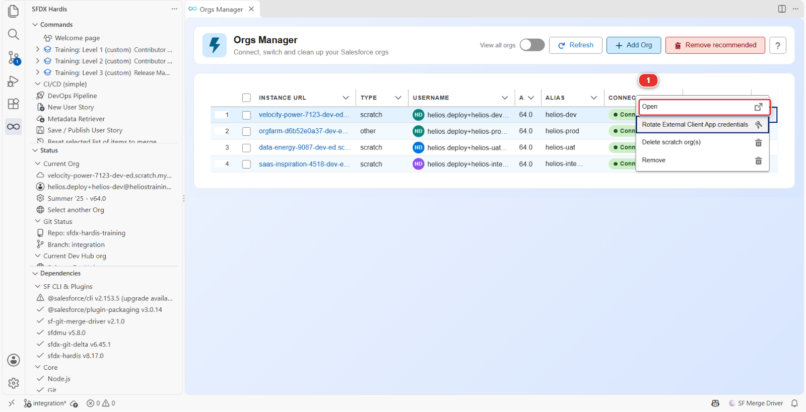
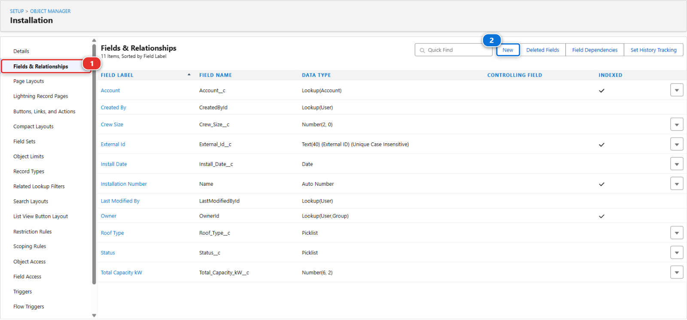
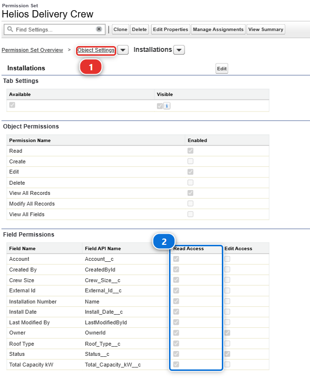
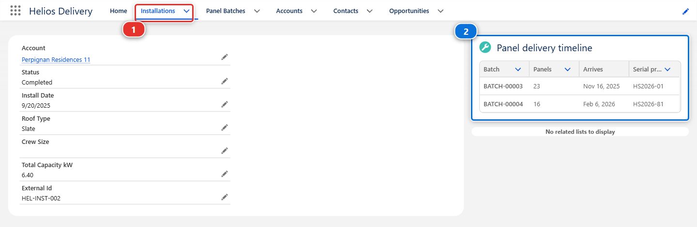

# Lab 1.4 - Construire un champ personnalisé dans votre org Salesforce

**Niveau** : 1 Contributeur, les bases

**Durée** : ~10 min<!-- observed --> (observé : médiane 13 min, 26 participants, le plus rapide 6 min)<!-- /observed -->

**Vous allez** : construire US-014 comme un admin construit n'importe quoi, en cliquant dans
Salesforce Setup, et le vérifier sur de vrais enregistrements.

## La situation

Vous avez une branche et une org. Passez maintenant au vrai travail. Rien dans ce lab n'est propre au
CI/CD : c'est de la configuration Salesforce ordinaire. La seule règle est où vous le faites :
dans `helios-dev`, votre propre org, jamais dans l'org partagée.

## Avant de commencer

- [ ] [Lab 1.3](1-3-start-a-user-story-on-a-git-branch.md) terminé : vous êtes sur `features/US-014-panels-required`
- [ ] La section Status du panneau sfdx-hardis affiche le nom d'utilisateur de `helios-dev` comme org
      courante : celui de la ligne `helios-dev` d'**Orgs Manager**, car cette section n'affiche jamais d'alias

## Les étapes

### 1. Ouvrir votre org

Objectif : `helios-dev` ouverte dans votre navigateur, déjà connectée.
Rappel : [Lab 1.2](1-2-create-your-dev-hub-scratch-orgs-and-pipeline.md)

#### À faire

1. Dans **Orgs Manager**, trouvez la ligne dont la colonne **ALIAS** dit `helios-dev`. Lisez
   l'alias, pas l'adresse
2. Au bout de cette ligne, cliquez sur le chevron. Il ouvre tout ce que vous pouvez faire sur cette
   org, et la première entrée est **Open** **(1)**. Cliquez dessus

   

  !!! tip "Dans Agentforce Vibes"
      L'org s'ouvre dans un nouvel onglet du même navigateur. VS Code peut d'abord demander s'il
      peut ouvrir le site externe : répondez **Open**. Si aucun onglet n'apparaît du tout, mettez
      l'extension à jour.

#### Pourquoi

Aucune des adresses ne dit à quoi sert l'org. L'org Developer Edition a une chaîne `orgfarm-`
inventée par Salesforce, et les scratch orgs ont deux mots au hasard et un nombre : vos quatre orgs
se ressemblent donc partout sauf dans la colonne **ALIAS**.

Pas de mot de passe, pas de page de connexion : l'extension a utilisé l'identifiant qu'elle a rangé
quand vous avez connecté l'org au [Lab 1.2](1-2-create-your-dev-hub-scratch-orgs-and-pipeline.md).

Ouvrir l'org depuis ce panneau plutôt que depuis un favori est une habitude à prendre. C'est la
différence entre "l'org que je voulais" et "l'org qui se trouvait ouverte dans cet onglet".

!!! tip "Dans Agentforce Vibes"
    VS Code tourne dans votre navigateur, l'org ne peut donc pas s'ouvrir à côté. Les anciennes
    versions de l'extension lançaient la commande d'ouverture dans l'environnement de l'onglet, où
    aucun navigateur ne peut s'ouvrir, et n'affichaient rien.

#### Vous devriez voir

- Votre navigateur sur l'org, déjà connecté

### 2. Créer le champ

Objectif : un champ nombre `Panels Required` sur Installation, sur sa présentation de page, et
visible d'aucun profil.

#### À faire

1. Dans Salesforce : **Setup > Object Manager > Installation**, puis **Fields & Relationships**
   **(1)** dans la colonne de gauche, puis **New** **(2)**

   

   La liste que vous voyez est l'objet avant votre modification. `Panels Required` est ce que vous
   êtes sur le point d'y ajouter.

2. Remplissez les paramètres du tableau ci-dessous, Description et Help Text compris
3. L'écran de sécurité au niveau des champs arrive avec **Visible** déjà coché pour presque tous les
   profils. Décochez-les : la case dans l'en-tête de la colonne **Visible** bascule toute la
   colonne, donc cliquez une fois pour tout cocher et une seconde fois pour ne rien laisser coché
4. Cliquez sur **Next**
5. Sur l'écran de présentation de page, **Installation Layout** est déjà coché. Laissez-le tel quel
6. Cliquez sur **Save**

| Paramètre      | Valeur                                                        |
|----------------|---------------------------------------------------------------|
| Data Type      | **Number**                                                    |
| Field Label    | `Panels Required`                                             |
| Length         | 4                                                             |
| Decimal Places | 0                                                             |
| Field Name     | `Panels_Required` (Salesforce le remplit depuis le label)     |
| Description    | `How many panels the crew has to load for this installation.` |
| Help Text      | `Ask the planner if this is empty.`                           |
| Required       | non                                                           |

#### Pourquoi

La case **Field Name** est ce que Salesforce appelle le nom d'API, et il la remplit depuis le label
au fur et à mesure que vous tapez. Elle affiche `Panels_Required`, sans le `__c` : Salesforce
ajoute ce suffixe à chaque champ personnalisé au moment de l'enregistrement, et la suite de ce
cours, fichiers de métadonnées compris, appelle le champ `Panels_Required__c`.

Remplissez Description et Help Text : deux secondes maintenant, et la documentation de projet
générée au [Lab 3.9](../level-3-release-manager/3-9-generate-the-project-documentation.md) se lit comme quelque chose écrit par un être humain. Les descriptions vides sont
la raison la plus fréquente pour laquelle cette documentation ne sert à rien.

Vous décochez les profils parce que vous allez accorder ce champ par un permission set, pas par un
profil, et le [Lab 2.6](../level-2-contributor-advanced/2-6-permission-sets-and-profiles.md)
explique pourquoi cette distinction compte plus qu'il n'y paraît.

**Installation Layout** coché, c'est ce qui met le champ sur l'enregistrement.

#### Vous devriez voir

- Le champ enregistré, et `Panels Required` dans la liste **Fields & Relationships** d'Installation

### 3. L'accorder à l'équipe de pose, et aux planificateurs

Objectif : `Panels Required` lisible par l'équipe de pose et modifiable par les planificateurs, par
leurs permission sets.

Les critères d'acceptation disent que l'équipe de pose doit le voir, et que les planificateurs
doivent pouvoir le renseigner. Personne ne l'a encore, pas même vous : vous n'avez rien accordé, et
un champ qu'aucune permission n'accorde est invisible pour tout le monde, y compris l'administrateur
qui l'a créé.

#### À faire

1. **Setup > Permission Sets > Helios Delivery Crew**, puis **Object Settings** **(1)** et
   **Installations**, puis **Edit**

   

2. Dans **Field Permissions**, trouvez `Panels Required` et cochez **Read Access** **(2)**. Cette
   image a été prise avant que le champ existe, `Panels Required` n'y est donc pas encore : après
   votre modification il apparaît dans cette liste, par ordre alphabétique
3. Laissez **Edit Access** décoché, et cliquez sur **Save**
4. Ouvrez les mêmes écrans sur **Helios Delivery Manager**, le permission set des planificateurs
5. Cochez à la fois **Read Access** et **Edit Access** sur `Panels Required`, et cliquez sur
   **Save**

!!! warning "Attention"
    Sautez cette étape et l'étape 4 ne vous montre rien : vous chercheriez un champ que votre propre
    permission set n'accorde pas.

#### Pourquoi

**Field Permissions** est le tableau qui compte, une ligne par champ, et **Read Access** est la
colonne pour laquelle vous êtes là. Un membre de l'équipe de pose lit combien de panneaux charger,
il ne décide pas du nombre.

**Helios Delivery Manager** est aussi celui que **Set up my training environment** vous a donné, et
c'est ce qui vous permet de voir l'application Helios tout court. Les planificateurs sont ceux qui
décident du nombre.

#### Vous devriez voir

- Sur **Helios Delivery Crew**, **Read Access** coché sur `Panels Required`, et sur **Helios
  Delivery Manager**, à la fois **Read Access** et **Edit Access**

### 4. Le mettre là où les gens regarderont

Objectif : `Panels Required` sur la page d'enregistrement Installation, sans rien de plus à
construire.

Le champ est sur la présentation de page, celle qu'utilisent les pages Salesforce à l'ancienne. La
page d'enregistrement Installation est une page Lightning, et la colonne de champs à sa gauche est
cette présentation de page : vous avez donc déjà fini.

#### À faire

1. Ouvrez n'importe quelle installation : **App Launcher > Helios Delivery > Installations**, prenez
   `INST-00001`
2. Regardez le bas de la colonne de champs

#### Vous devriez voir

- `Panels Required` là, vide, avec à côté de son nom le petit **i** du texte d'aide que vous avez
  écrit

### 5. Le tester sur de vraies données

Objectif : une valeur `Panels Required` enregistrée sur trois installations.

Un champ vide ne prouve rien. Mettez-y un nombre.

#### À faire

1. Sur `INST-00001`, lisez le **Panel delivery timeline** **(2)** à droite de l'enregistrement. Il
   liste les palettes réservées pour cette installation avec leurs quantités

   

   L'image a été prise avant que cette story existe : il n'y a donc pas encore de Panels Required
   dans sa colonne. L'installation qu'elle montre a deux palettes, de 23 et 16 panneaux : 39 est le
   nombre à y saisir.

2. Cliquez sur le crayon à droite de **Panels Required**, tapez le nombre auquel la timeline
   aboutit, et cliquez sur **Save** en bas de la page. Cette page n'a pas de bouton **Edit** :
   chaque champ se modifie sur place, avec son propre crayon
3. Regardez les deux nombres côte à côte
4. Faites de même sur deux autres installations, pour avoir quelque chose à regarder après le
   déploiement. L'onglet **Installations** **(1)** est la façon de revenir à la liste depuis
   n'importe où dans l'application

#### Pourquoi

La plupart des installations ont deux ou trois palettes. Sur une vraie story, vous demanderiez au
planificateur si ce champ doit être saisi ou calculé à partir des palettes. Ici, la saisie est ce
que demande la story, et cette question est exactement celle qu'un bon contributeur pose avant de
construire quoi que ce soit.

#### Vous devriez voir

- Sur trois installations, une valeur `Panels Required` qui correspond à leur timeline, enregistrée
  sans erreur

## Ce que vous devez voir

- [ ] Sur trois installations : une valeur `Panels Required`, visible dans la colonne de champs,
      enregistrée sans erreur
- [ ] Et dans VS Code, rien du tout. Le repository ne sait encore rien de tout cela. Vos
      modifications vivent dans une org et nulle part ailleurs, et c'est exactement l'état auquel le
      [Lab 1.5](1-5-retrieve-commit-and-publish-your-changes.md) existe pour mettre fin

## En cas de problème

**Object Manager ne liste pas Installation.**
Vous êtes dans la mauvaise org. Vérifiez la section Status dans VS Code, puis rouvrez l'org depuis
**Orgs Manager**.

**Vous cliquez sur Open et aucun onglet de navigateur n'apparaît.**
Les anciennes versions de l'extension pouvaient échouer à ouvrir l'org sans dire pourquoi, et dans
Agentforce Vibes elles n'ouvraient rien du tout : la commande tournait dans l'environnement de
l'onglet, où aucun navigateur ne peut s'ouvrir. Mettez l'extension à jour, c'est à cela que sert
**Auto Update** dans le [Lab 1.1](1-1-install-vs-code-and-sfdx-hardis.md), et cliquez de nouveau
sur **Open**. En attendant, hors d'Agentforce Vibes, il existe une seconde entrée : dans la section
**Status** du panneau sfdx-hardis, sous **Current Org**, cliquez sur la première ligne, l'adresse de
l'org. Elle ouvre votre org par défaut, qui est `helios-dev` ici.

**Orgs Manager affiche vos scratch orgs comme déconnectées, et propose Reconnect au lieu d'Open.**
Les anciennes versions de l'extension ne lisaient que la sonde de connexion, qu'une scratch org ne
porte jamais : c'est son Dev Hub qui répond pour elle. Mettez l'extension à jour, ce à quoi sert
**Auto Update** au [Lab 1.1](1-1-install-vs-code-and-sfdx-hardis.md), puis cliquez sur **Refresh**
dans le panneau. Les orgs vont bien dans les deux cas, et **Reconnect** vous aurait reconnecté pour
rien.

**Le champ n'apparaît pas sur la page d'enregistrement.**
Vous avez sauté l'étape de présentation de page. **Setup > Object Manager > Installation > Page
Layouts > Installation Layout**, glissez `Panels Required` dans la section Information, **Save**.

**L'enregistrement échoue avec une erreur de règle de validation.**
L'org Helios a une règle qui refuse de déplacer une date d'installation dans le passé. Si vous avez
modifié la date par accident, remettez-la à une date future.

**Le permission set n'a pas d'Object Settings pour Installation.**
Un permission set ne liste un objet qu'à partir du moment où quelque chose y est accordé. Servez-vous
plutôt de **Field Permissions** en haut de la page : choisissez-y `Installation`, et l'objet apparaît
avec ses champs.

## Vérifiez votre travail

Welcome page > **Training: Level 1** > **Check my work**, puis choisissez le **Lab 1.4**.

Rien de votre travail n'a encore quitté l'org, le contrôle lit donc l'org elle-même : il demande à
`helios-dev` si `Panels_Required__c` existe sur Installation et si `Helios_Delivery_Crew` peut le
lire. Le repository apprend l'existence du champ au lab suivant.

## Pour aller plus loin

- [Travailler dans votre org](https://sfdx-hardis.cloudity.com/salesforce-devops-work-on-user-story/)
- [Règles de configuration](https://sfdx-hardis.cloudity.com/salesforce-devops-work-on-user-story-configuration/)

[Suite : Lab 1.5 - Récupérer, commiter et publier vos modifications Salesforce](1-5-retrieve-commit-and-publish-your-changes.md){ .md-button .md-button--primary }
