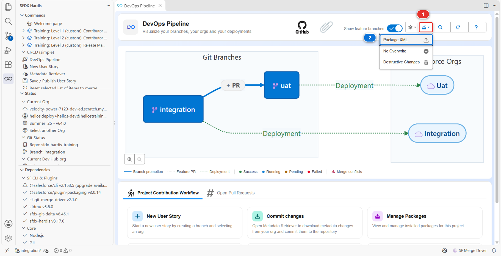
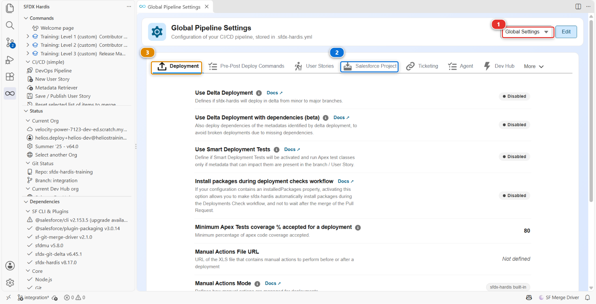

# Lab 2.6 - Permission sets, profils, et pourquoi une autorisation disparaît

**Niveau** : 2 Contributeur avancé

**Durée** : ~20 min<!-- observed --> (observé : médiane 20 min, 6 participants, le plus rapide 10 min)<!-- /observed -->

**Vous allez** : courir après une permission qui s'évapore entre un déploiement vert et l'org cible,
et découvrir qu'elle a été retirée exprès.

## La situation

> **US-033 - Crews can read the panel batch cost**
>
> As a delivery crew member, I want to see the cost of the batch I am installing, so that I report
> damage with the right value.

Vous accordez la permission, vous publiez, le contrôle est vert, le déploiement est vert, et la
permission n'est pas dans l'org d'intégration. Rien n'a échoué. Rien ne vous a averti.

C'est le mode de défaillance qui fait perdre confiance dans une pipeline, et il s'explique
entièrement.

## Avant de commencer

- [ ] [Lab 2.5](2-5-pass-code-quality-and-apex-test-coverage.md) terminé et mergé
- [ ] `helios-dev` au niveau d'`integration`

## Les étapes

### 1. Prendre la story et la faire comme un admin le ferait

**New User Story** **(2)**, sous **Project Contribution Workflow** **(1)** du panneau DevOps
Pipeline. Nom `US-033-batch-cost-visibility`, org `helios-dev`.

Les équipes de pose se connectent avec le profil **Helios Crew**. C'est l'un des deux profils que
porte ce repository, à côté d'`Admin`, le profil System Administrator : dans le panneau **DevOps
Pipeline**, ouvrez le menu **Deployment packages** **(1)**, l'icône d'une boîte avec une flèche dans
l'en-tête, qui n'affiche son nom qu'au survol, puis **Package XML** **(2)**, comme au
[Lab 1.5](../level-1-contributor-basics/1-5-retrieve-commit-and-publish-your-changes.md). La ligne
**Profile** liste les deux.

Dans `helios-dev`, la voie rapide : **Setup > Object Manager > Panel Batch > Fields & Relationships >
Cost > Set Field-Level Security**, cochez **Visible** pour le profil **Helios Crew**, **Save**.

C'est ainsi que la plupart des gens accordent une permission, et c'est là-dessus que ce lab est
construit.

Faites-en un retrieve comme d'habitude : **Commit changes**, **Recent Changes**, **Search Metadata**,
cochez le profil `Helios Crew`, récupérez, et commitez-le depuis **Source Control**. Puis
**Save / Publish**, poussez, Pull Request, vert, merge.

Le fichier est bien plus long que celui du repository. Le **Retrieve mode** du Metadata Retriever
indique **Auto** : il récupère un profil en entier, toutes les permissions qu'il accorde dans
`helios-dev`, donc votre nouvel accès à `Cost` s'y trouve, avec tout ce que le profil peut faire
d'autre.

### 2. Découvrir qu'il ne s'est rien passé

Ouvrez `helios-integration` et vérifiez la sécurité au niveau du champ de **Panel Batch > Cost** : la
colonne **Helios Crew** n'est pas cochée. La permission n'y est pas.

Retournez à la Pull Request. Le commentaire de déploiement dit **✅ Deployed to `integration`**, et
son tableau replié **📋** compte un **Profile** parmi les composants qui ont changé. Sauf que ce qui a été déployé n'est pas ce que vous avez commité.

### 3. Lire votre propre diff

Votre commit contenait la permission. Vous l'avez vue dans le diff avant de cliquer sur Commit.

Ouvrez le panneau **Source Control**, regardez l'historique de votre branche, et lisez le commit que
**Save / Publish** a fait après le vôtre, `chore(sfdx-hardis): clean sfdx project`. Il ressort
aussitôt la permission que vous aviez ajoutée, avec toutes les autres sections du fichier qu'un
permission set pourrait porter. Ce qui reste est ce que seul un profil peut contenir.

C'est un réglage de projet appelé **minimizeProfiles**, l'une des règles de nettoyage que ce projet a
activées, et vous pouvez le voir dans le panneau **Pipeline Settings**, onglet **Salesforce
Project**.

### 4. Comprendre pourquoi un projet ferait une chose pareille

Les profils sont le pire type de métadonnée à versionner, pour trois raisons qui mordent toutes en
même temps :

1. **Ils sont énormes et ils sont partagés.** Un seul fichier de profil liste toutes les permissions
   d'objet, de champ, d'onglet, d'application et de classe de l'org. Deux personnes qui travaillent
   sur deux stories sans rapport produisent chacune un diff de mille lignes du même fichier, et elles
   entrent en conflit à chaque fois
2. **Un profil récupéré peut dire non à ce qu'il n'avait pas.** Récupéré de la façon standard, il
   liste les champs et objets de votre package avec `false` partout où le profil n'avait pas accès
   au moment de la récupération. Si un collègue en a accordé un depuis, déployer votre fichier
   **le lui éteint**, en silence. Le mode **Auto** du Metadata Retriever laisse ces lignes `false`
   de côté
3. **Ce que vous récupérez dépend de la façon, et de l'org.** Récupéré de la façon standard, un
   profil ne porte que les permissions des composants récupérés avec lui. Récupéré en entier, comme
   le fait le Metadata Retriever en **Auto**, il porte tout ce que le profil a dans l'org d'où il
   vient. Dans les deux cas, le même profil a une tête différente selon qui l'a récupéré, depuis
   quelle org, et quand

`minimizeProfiles` retire des profils tout ce qu'un permission set pourrait porter à la place, en
laissant les profils ne contenir que ce qui ne peut vraiment vivre nulle part ailleurs : les plages
horaires de connexion, les plages d'adresses IP, les types d'enregistrement par défaut, les
affectations de présentation de page.

La pipeline n'a donc pas perdu votre travail. Elle a refusé de le transporter, parce que le
transporter finirait par supprimer celui de quelqu'un d'autre.

!!! note "Pourquoi les profils restent quand même dans le repository"
    Retirer les profils des sources serait la mauvaise conclusion. Un utilisateur se connecte avec un
    profil, et ce que seul un profil contient, l'application par défaut, la présentation de page de
    chaque objet, les réglages d'onglets, les plages horaires de connexion, doit être identique dans
    chaque org. `Admin` et `Helios Crew` restent donc dans `force-app/main/default/profiles/`,
    restent dans `manifest/package.xml`, et sont déployés avec tout le reste.

    Ils ne portent **aucune permission de champ, d'objet, de classe ou de flow**, exprès, et aucune
    permission utilisateur sauf sur `Admin`. Un profil récupéré en entier liste des centaines de
    permissions utilisateur, et Salesforce en ajoute et en retire à chaque release, trois fois par an :
    un profil complet commité au printemps peut échouer au déploiement à l'automne sur une permission
    qui n'existe plus. `minimizeProfiles` retire ces permissions à chaque fois que quelqu'un publie un
    profil. Ce qui reste peut quand même être long, car un profil récupéré en entier liste le réglage
    d'onglet et la présentation de page de chaque objet de l'org : c'est exactement ce que seul un
    profil peut porter.

    Ces lignes sont aussi ce qui garde un profil attaché à l'org d'où il vient. Il nomme chaque
    présentation de page et chaque onglet, objets standard compris, et une org à qui il en manque
    un refuse le profil entier. Il se déploie partout dans ce cours parce que vos orgs sont
    construites pour contenir les mêmes objets, sous les mêmes noms. **En cas de problème**, plus
    bas, montre comment trouver quelle org diffère quand ce n'est pas le cas.

### 5. Le faire comme le projet l'attend

Refaites l'autorisation là où elle a sa place. Votre première Pull Request est mergée, celle-ci est
donc une deuxième pour la même story : **New User Story**, nom `US-033-crew-permission-set`, org
`helios-dev`.

Dans `helios-dev` : **Setup > Permission Sets > Helios Delivery Crew > Object Settings > Panel
Batches > Edit**, cochez **Read Access** sur `Cost`, **Save**.

Récupérez le **permission set** cette fois, commitez-le, **Save / Publish**, et ouvrez la Pull
Request. Le rapport **Git Delta package.xml** nomme `Helios_Delivery_Crew`.

Rien à ranger : le profil que vous avez publié à l'étape 1 reste dans le repository, nettoyé, et il
continue d'être déployé comme il l'a toujours été.

Le contrôle passe au vert. Mergez, et vérifiez `helios-integration` : **Setup > Permission Sets >
Helios Delivery Crew > Object Settings > Panel Batches**, `Cost` est lisible. Chaque membre d'équipe
de pose porte ce permission set, quel que soit son profil.

### 6. Regarder l'autre protection, tant que vous y êtes

Ouvrez le panneau **DevOps Pipeline**, puis **Configure Pipeline Settings** dans le menu engrenage. Laissez le
sélecteur de portée **(1)** sur **Global Settings** : ce sont des règles de projet, identiques pour
chaque branche.

Les réglages sont groupés en onglets. Deux d'entre eux font le travail que vous venez de rencontrer,
et il vaut la peine de savoir lequel fait quoi :

| Réglage                            | Onglet                         | Ce dont il protège                                                                                        |
|------------------------------------|--------------------------------|-----------------------------------------------------------------------------------------------------------|
| `autoCleanTypes: minimizeProfiles` | **Salesforce Project** **(2)** | Un profil qui porte des permissions dont la place est sur un permission set                               |
| `autoRemoveUserPermissions`        | **Salesforce Project** **(2)** | Des permissions utilisateur précises qui ne doivent jamais voyager entre orgs, quel qu'en soit le porteur |

Les deux tournent sur votre machine, au moment où vous publiez : ils décident de ce que votre commit
transporte. L'onglet voisin, **Deployment** **(3)**, décide comment la pipeline l'envoie dans chaque
org. Celui-là appartient au release manager, et le Niveau 3 est là où vous le rencontrez.

Sous le capot : ce que le nettoyage a vraiment fait au fichier

La passe de nettoyage de `hardis:work:save` a parcouru le profil que vous aviez commité, et pour
`minimizeProfiles` elle a réécrit son XML dans un commit à part.

Des sections entières sont supprimées, parce qu'un permission set peut toutes les porter :

`agentAccesses`, `classAccesses`, `customMetadataTypeAccesses`, `customPermissions`,
`externalDataSourceAccesses`, `fieldPermissions`, `flowAccesses`, `objectPermissions`,
`pageAccesses`, `ServicePresenceStatusAccesses`.

Trois sections sont allégées plutôt que supprimées, en gardant seulement les entrées qu'un permission
set ne sait pas exprimer :

| Section                   | Ce qui survit                                                                                     |
|---------------------------|---------------------------------------------------------------------------------------------------|
| `recordTypeVisibilities`  | seulement les entrées marquées `default` (ou `personAccountDefault`)                              |
| `applicationVisibilities` | seulement l'application par défaut, et les applications explicitement cachées (`visible` à false) |
| `userPermissions`         | seulement les permissions explicitement **désactivées**, plus tout ce qui est sur le profil Admin |

Et certaines sections ne sont jamais touchées, parce que rien d'autre ne peut les contenir :
`loginHours`, `loginIpRanges`, `layoutAssignments`, `tabVisibilities`, `custom`, `userLicense`.

Un profil a donc toujours un rôle dans cette pipeline. Simplement beaucoup plus petit.

Rien n'a été retiré de votre org. Le nettoyage change **ce que le repository transporte**, jamais ce
que Salesforce contient. Votre autorisation à la mode admin est toujours dans `helios-dev`, et c'est
exactement pour cela que le lab vous demande de la refaire sur le permission set plutôt que de
réparer le fichier à la main.

La règle à retenir : **si une permission peut vivre sur un permission set, mettez-la là.** Ce n'est
pas une opinion de sfdx-hardis, c'est ce que Salesforce recommande depuis des années, et cette pipeline
l'impose au lieu d'espérer.

<!-- command-links:start -->
Documentation de la commande : [hardis:work:save](https://sfdx-hardis.cloudity.com/hardis/work/save/)
<!-- command-links:end -->

## Ce que vous devez voir

- `Cost` accordé sur le permission set **Helios Delivery Crew** dans `helios-integration`
- `Admin` et `Helios Crew` toujours dans `force-app/main/default/profiles/`, sans aucune permission
  de champ dedans

## En cas de problème

**L'édition du permission set n'affiche pas le champ Cost.**
Le champ n'est pas dans les object settings du permission set tant que l'objet n'est pas accordé.
Accordez d'abord la lecture sur **Panel Batch**.

**Le déploiement échoue avec `INSUFFICIENT_ACCESS` sur le permission set.**
L'utilisateur de CI ne peut pas accorder une permission qu'il n'a pas lui-même. Affectez
**Helios Delivery Manager** à l'utilisateur de l'org d'intégration, ce que fait
**Training: Level 2 > Set up one of my training orgs**.

**Le profil revient long de mille lignes.**
Un profil récupéré en entier garde, après le nettoyage, les réglages d'onglets et la mise en page
de chaque objet de l'org, son application et ses types d'enregistrement par défaut, et sur `Admin`
ses permissions utilisateur : ils restent exprès. S'il porte encore des
permissions de champ, d'objet ou de classe, il a été commité après une récupération et n'est
jamais passé par le nettoyage. Vérifiez que
`minimizeProfiles` est toujours listé dans l'onglet **Salesforce Project** de **Pipeline Settings**,
puis refaites **Save / Publish**. Ne raccourcissez pas le fichier à la main.

**Un déploiement refuse le profil avec `no Layout named ...` ou `no CustomTab named ...`.**
Cela peut arriver sur cette Pull Request, ou bien plus tard, la première fois que le profil atteint
une org du Niveau 3. Le profil attribue une présentation de page, ou affiche un onglet, que l'org
cible n'a pas. Le message la nomme, sous la forme `Objet-Nom de la présentation` : partez de là.

1. **Est-elle à vous ?** Cherchez le nom de la présentation dans le repository (`Ctrl+Shift+F`).
   Si un fichier la contient, elle manque seulement dans `manifest/package.xml`, et c'est l'erreur
   du [Lab 2.2](2-2-fix-a-missing-dependency-deployment-error.md). Si aucun fichier ne la contient,
   Salesforce l'a créée dans l'org d'où le profil a été récupéré, et personne ne l'a décidée
2. **Pourquoi une org l'a et pas l'autre ?** Ouvrez **Setup > Object Manager** dans les deux orgs,
   cherchez l'objet, puis ses **Page Layouts**. Il y a trois réponses habituelles :

    | Ce que vous trouvez dans l'org cible                | La cause                                                                                                                                          |
    |-----------------------------------------------------|---------------------------------------------------------------------------------------------------------------------------------------------------|
    | L'objet n'y est pas                                 | Une fonctionnalité Salesforce est active dans une org et pas dans l'autre. `ServiceAppointment` et ses voisins viennent avec Field Service        |
    | L'objet y est, sa présentation porte un nom traduit | La présentation a été créée par un utilisateur travaillant dans une autre langue : `Présentation Crew Capacity` au lieu de `Crew Capacity Layout` |
    | L'objet y est, sans présentation ou avec une autre  | Les deux orgs n'ont pas été créées au même moment, ou quelqu'un a renommé ou supprimé la présentation à la main                                   |

3. **Corrigez la cause, pas le message.** Une fonctionnalité : mettez les orgs d'accord, en
   l'activant dans l'org cible avant le déploiement, ce qui est une action manuelle pour le release
   manager, ou en la désactivant dans l'org où vous construisez, puis récupérez le profil de
   nouveau. Une langue : passez votre utilisateur en anglais dans l'org cible, **votre photo >
   Settings > Language & Time Zone**, et renommez-y la présentation. Tout le reste, sur un objet
   que votre projet n'utilise pas : la ligne n'a rien à faire dans le repository. Ouvrez le
   fichier du profil, supprimez le bloc `<layoutAssignments>` qui nomme la présentation, ou le
   bloc `<tabVisibilities>` qui nomme l'onglet, commitez, et faites **Save / Publish** : sur la
   branche de ce lab quand c'est sa propre Pull Request qui est rouge, dans une User Story **Fix**
   quand le profil est déjà mergé

Salesforce signale un seul nom manquant par déploiement : un deuxième peut se cacher derrière le
premier.

Si la liste compte des dizaines de noms, tous des objets standard, vos scratch orgs ont été créées
avant que ce cours n'y désactive Field Service et les badges Thanks. **Training: Level 2 > Update my
course**, puis de nouveau **Training: Level 1 > Set up my training environment** : il désactive les
deux dans les scratch orgs que vous avez, et ne supprime rien. Ensuite une User Story **Fix** depuis
`helios-dev`, récupérez `Helios Crew` de nouveau comme à l'étape 3, et **Save / Publish**.

## Vérifiez votre travail

Welcome page > **Training: Level 2** > **Check my work**, puis choisissez le **Lab 2.6**.

## Pour aller plus loin

- [Profils et permission sets](https://sfdx-hardis.cloudity.com/salesforce-devops-work-on-user-story-profiles/)

[Suite : Lab 2.7 - Résoudre un conflit de merge Git avec un collègue](2-7-resolve-a-git-merge-conflict.md){ .md-button .md-button--primary }
