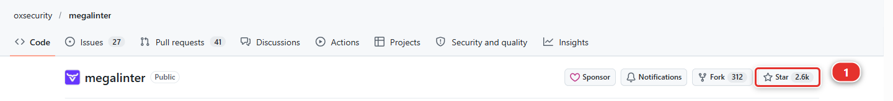
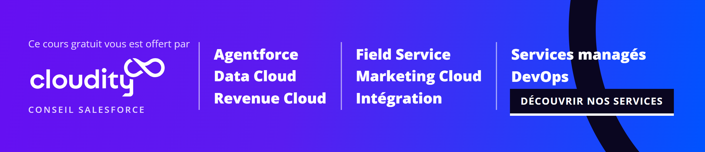
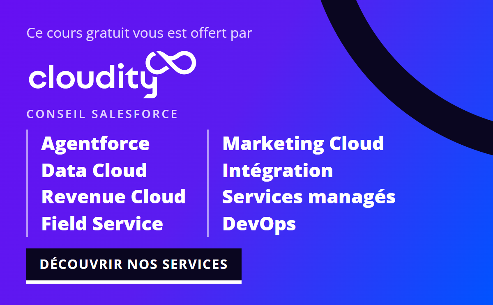

# Lab 2.9 - Épreuve finale : livrer une User Story qui a tout

**Niveau** : 2 Contributeur avancé

**Durée** : ~40 min<!-- observed --> (observé : médiane 41 min, 6 participants, le plus rapide 11 min)<!-- /observed -->

**Vous allez** : livrer une story qui contient une dépendance à vérifier, une deployment action de
données et un collègue qui travaille sur le même permission set, sans pas-à-pas.

## La situation

> **US-041 - Installation handover checklist**
>
> As a planner, I want a handover checklist on the installation with its reference items, so that a
> job is only closed when the checklist is complete.
>
> Critères d'acceptation :
>
> - Un objet `Handover_Item__c` existe, enfant d'Installation
> - 10 éléments de checklist de référence sont chargés dans chaque org
> - Le flow de clôture bloque sur une checklist incomplète

Trois des situations que vous avez rencontrées séparément vous attendent dans cette seule story. Vous
savez déjà traiter les trois.

## Avant de commencer

- [ ] Labs 2.1 à 2.8 terminés et mergés
- [ ] `helios-dev` au niveau d'`integration`

## Ce qu'il faut faire

### La story

1. **Prenez-la.** Nom `US-041-handover-checklist`, org `helios-dev`
2. **Construisez l'objet** : `Handover_Item__c`, son **Record Name** en Auto Number
   `Handover Item Number`, `HI-{00000}`, **Starting Number** à `0`, comme le [Lab 2.4](2-4-ship-reference-data-and-a-batch-with-deployment-actions.md) pour Crew Capacity, avec `External_Id__c`
   (Text 40, identifiant externe, unique), `Installation__c` (Lookup vers Installation), `Label__c`
   (Text 255), `Sequence__c` (Number 3, 0), `Is_Done__c` et `Is_Template__c` (Checkbox, décochées).
   En le créant, cochez **Launch New Custom Tab Wizard after saving this custom object**, choisissez
   n'importe quel style d'onglet et gardez les autres valeurs par défaut de l'assistant : l'onglet est
   ce qui vous mène aux enregistrements à l'étape 4
3. **Accordez le nouvel objet et ses champs**, avant de créer le moindre enregistrement : sur le
   permission set `Helios Delivery Manager`, jamais sur un profil, comme le [Lab 2.6](2-6-permission-sets-and-profiles.md) vous l'a fait faire : **Read**, **Create** et **Edit** sur
   Handover Item, et **Read** et **Edit** sur ses champs. Vous portez ce permission set dans
   `helios-dev` : c'est l'accès dont les enregistrements et le flow des deux étapes suivantes ont
   besoin. L'utilisateur de la pipeline le porte lui aussi, et le chargement de données du deuxième
   piège en a besoin, comme au [Lab 2.4](2-4-ship-reference-data-and-a-batch-with-deployment-actions.md)
4. **Construisez les données de référence** : 10 enregistrements `Handover_Item__c` modèles sans
   installation, la checklist dont part chaque chantier. **Vous les créez à la main, dans
   `helios-dev`**, comme n'importe quel enregistrement : ouvrez l'org depuis **Orgs Manager**,
   cherchez **Handover Items** dans l'App Launcher, et cliquez dix fois sur **New**. Pour chaque enregistrement, donnez un **External Id**
   (`HANDOVER-TPL-01` à `HANDOVER-TPL-10`), un **Label** (`Panels fixed and torqued`,
   `Inverter commissioned`, `Isolator labelled`...), une **Sequence** (10, 20, 30...), cochez
   **Is Template**, et laissez **Installation** vide
5. **Mettez à jour le contrôle de clôture** : le flow `Installation Close Check` refuse déjà de
   clôturer une installation sans date d'installation. Enregistrez-en une nouvelle version qui
   refuse aussi tant qu'un élément de handover lié n'est pas fait : après sa décision sur la date, un
   **Get Records** d'un `Handover Item` de cette installation avec `Is Done` à faux, une décision sur
   le fait qu'on en a trouvé un, et une **Custom Error**. Décrivez chaque élément que vous ajoutez,
   et donnez un fault path au Get Records, comme le [Lab 2.2](2-2-fix-a-missing-dependency-deployment-error.md) vous l'a fait faire
6. **Faites un retrieve** : **Commit changes**, **Recent Changes**, et prenez ce que vous avez fait
   et rien d'autre, onglet compris. L'assistant d'onglet a aussi touché des profils et des
   applications : laissez ces lignes. Commitez
7. **Comptez avant de pousser** : ce que vous avez créé, puis la même chose dans `force-app/`
   (**Une**, ci-dessous)
8. **Mergez d'abord le collègue** : simulez US-019, mergez-la, ramenez `integration` dans votre
   branche, et vérifiez que le permission set porte les deux droits (**Trois**, ci-dessous)
9. **Construisez le workspace de données** des dix enregistrements, comme au [Lab 2.4](2-4-ship-reference-data-and-a-batch-with-deployment-actions.md), et commitez-le
   (**Deux**, ci-dessous)
10. **Publiez et ouvrez la Pull Request** vers `integration`, et lisez le rapport **Git Delta
    package.xml** : chaque composant compté à l'étape 7 y figure
11. **Déclarez l'action de données** sur la Pull Request, puis commitez le fichier écrit par
    l'éditeur et publiez à nouveau (**Et l'action de données**, ci-dessous)
12. **Vert, puis merge** avec **Squash and merge**

Les sections ci-dessous expliquent pourquoi chacune de ces étapes est à sa place.

### Les trois choses qui vous attendent

**Une : la dépendance.** Le flow lit maintenant `Handover_Item__c` et deux de ses champs. Ne
présumez pas que chaque composant qu'il lit a atteint le repository : comptez ce que vous avez créé,
recomptez-le dans `force-app/` et dans le rapport **Git Delta package.xml** avant de pousser. Ce qui
manque, l'erreur de déploiement trois étapes plus loin le nommera, comme au [Lab
2.2](2-2-fix-a-missing-dependency-deployment-error.md), et il est moins coûteux de le trouver
maintenant.

**Deux : les données.** Dix enregistrements dans votre org sont dix enregistrements dans votre org.
Un déploiement vert mettra l'objet et le flow dans `helios-integration` et la checklist y sera vide,
et la fonctionnalité ne fera rien du tout. Construisez un data workspace et déclarez une action.

**Trois : le collègue sur le même fichier.** Avant d'ouvrir votre Pull Request, lancez **Training:
Level 2 > Simulate my teammates** et choisissez **US-019**. Romain ajoute un champ de PDF de devis et
l'accorde sur `Helios Delivery Manager`, le permission set même dont votre checklist a besoin.
Répondez **Yes** à **Merge it for you once its checks pass?** et le panneau merge sa Pull Request dès
que ses checks sont verts, ou répondez **No** et mergez-la vous-même sur GitHub depuis l'adresse
affichée par le panneau, comme le montre le [Lab 2.1](2-1-backpromote-your-teammates-work.md),
étape 1b. Faites ensuite entrer `integration` dans votre branche depuis le panneau **Source Control**.

Cette fois git merge tout seul, sans conflit : Salesforce garde les permissions d'un permission set
par ordre alphabétique, son autorisation `Panel_Batch__c` et les vôtres sur `Handover_Item__c`
atterrissent donc loin les unes des autres dans le fichier. **Un merge propre n'est pas une preuve.**
Ouvrez le permission set et trouvez les deux, `Panel_Batch__c.Quote_Pdf_Url__c` et vos champs
`Handover_Item__c`, avant de publier. Un merge que git a fait seul et que personne n'a lu est la
façon dont une autorisation disparaît sans qu'aucun conflit n'avertisse qui que ce soit.

!!! note "Pas US-018 à nouveau"
    Le Lab 2.7 a déjà mergé US-018 : la simuler une deuxième fois ne signale rien à commiter. Chaque
    story de collègue ne se merge qu'une fois par niveau.

**Et l'action de données.** Déclarez-la comme au [Lab 2.4](2-4-ship-reference-data-and-a-batch-with-deployment-actions.md) : la Pull Request doit exister d'abord,
publiez donc, ouvrez-la, puis ajoutez l'action **Data** sur son onglet **Deployment Actions**,
**Deployment job only**, commitez le fichier écrit par l'éditeur et publiez à nouveau.

### Un indice sur l'ordre, parce que se tromper là-dessus coûte une heure

Les enregistrements de référence ont besoin que l'objet existe avant de pouvoir être chargés. Donc :

- L'objet et le flow se déploient comme métadonnée
- L'action de données tourne **après** le déploiement, pas avant

Le même ordre qu'au [Lab 2.3](2-3-fix-broken-records-with-an-apex-deployment-action.md), pour la même raison : la classe de batch là-bas, l'objet ici, n'existent
qu'une fois le déploiement fait. La règle n'est pas non plus "toujours après" : c'est **de quoi cette
action a-t-elle besoin de trouver déjà présent ?**

## Ce que vous devez voir

Dans `helios-integration`, après le merge :

- `Handover_Item__c` avec 10 enregistrements modèles
- L'enregistrement d'une installation en `Completed` avec une checklist incomplète est refusé, avec
  votre message
- `Helios_Delivery_Manager` accordant les nouveaux champs, et le champ de PDF de devis de Romain
  toujours présent

## En cas de problème

Tout ce qu'il vous faut est dans les Labs 2.2, 2.4 et 2.7. Allez chercher la seule étape sur laquelle
vous bloquez plutôt que de relire les labs.

**Training: Level 2 > Reset this level** si le repository vous échappe. Il réinitialise au début du
Niveau 2, ce qui veut dire refaire l'épreuve finale, pas tout le niveau.

## Vérifiez votre travail

Welcome page > **Training: Level 2** > **Check my work**, puis choisissez **Everything in level 2, capstone included**.

Neuf contrôles.

## Demandez votre badge

Welcome page > **Training: Level 2** > **Claim my badge**.

Comme au Niveau 1 : il recontrôle tout ce qui précède, demande votre nom d'utilisateur Trailblazer,
la dernière partie de l'adresse de votre profil Trailhead, et ouvre le formulaire de demande déjà
rempli. Choisissez votre niveau dans la liste **Level**, qu'un lien ne peut pas pré-remplir, puis
cochez les trois cases et soumettez.

Une demande de Niveau 2 rejoue **aussi l'audit du Niveau 1**, parce que le badge dit que vous savez
faire les deux. Si vous avez sauté le Niveau 1, c'est là qu'il le dira, et la commande le dit avant
que le formulaire s'ouvre.

!!! tip "Si ce cours vous a servi"
    [oxsecurity/megalinter](https://github.com/oxsecurity/megalinter) est le moteur de linting
    derrière la barrière de qualité que vos Pull Requests ont traversée. Une étoile est ce qui permet
    à un projet open source de rester visible : ouvrez sa page et cliquez sur **Star** **(1)**, à droite
    du nom du repository. Donnez une étoile si vous avez aimé ce cours !

    

Le badge de ce niveau s'appelle **sfdx-hardis Contributor Advanced**. Le Niveau 1 vous rend capable
de livrer une User Story ; le Niveau 2 vous rend capable de traiter tout ce qui tourne mal en chemin.

!!! tip "La mettre en bannière LinkedIn"
    [Trailhead Banner](https://thb.nabondance.me/) dessine une image de couverture LinkedIn à partir
    d'un nom d'utilisateur Trailblazer, et il y affiche le badge sfdx-hardis le plus élevé que vous
    avez réclamé ici. Tapez votre nom d'utilisateur, générez l'image, et mettez-la en bannière de
    votre profil LinkedIn.

## La suite

Vous pouvez vous arrêter ici et être vraiment bon dans le métier de contributeur.

Le Niveau 3 est un autre rôle. Vous cessez de demander que votre travail soit mergé et commencez à
décider ce qui est mergé, quand c'est livré, et ce qui se passe quand la production casse à 17h40 un
vendredi.

Le projet auquel vous avez contribué s'arrête à `integration` : pas d'UAT, pas de production, pas
d'authentification de CI correcte, pas de monitoring. Le Niveau 3, c'est le terminer.

[Continuer vers le Niveau 3 - Release Manager](../level-3-release-manager/index.md){ .md-button .md-button--primary }

## Sur un vrai projet

Tout ce que le Niveau 2 a mis sur votre route arrive aussi sur les vrais projets, en général le jour
d'une release. [Cloudity](https://sfdx-hardis.cloudity.com/salesforce-devops-home/#get-help-from-cloudity), la société derrière sfdx-hardis et ce cours, forme les équipes
de delivery et reste joignable après la mise en production. Elle mène aussi ses propres projets
Salesforce, d'Agentforce et Revenue Cloud à Field Service :
[voir ce qu'elle fait](https://cloudity.com/fr/services/?utm_source=sfdx-hardis-training&utm_medium=referral&utm_campaign=capstone-2).

[{ .cloudity-banner .wide-only loading=lazy }](https://cloudity.com/fr/services/?utm_source=sfdx-hardis-training&utm_medium=referral&utm_campaign=capstone-2)
[{ .cloudity-banner .narrow-only loading=lazy }](https://cloudity.com/fr/services/?utm_source=sfdx-hardis-training&utm_medium=referral&utm_campaign=capstone-2)
