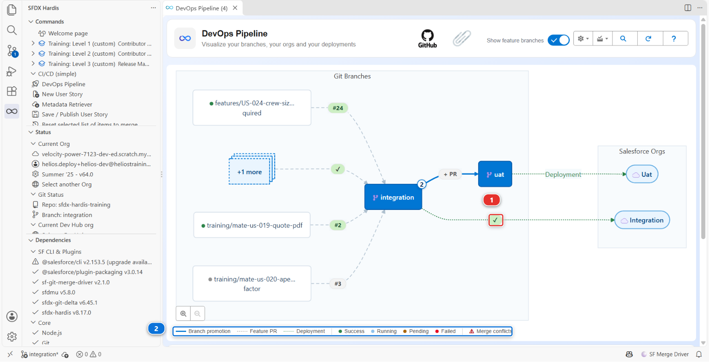
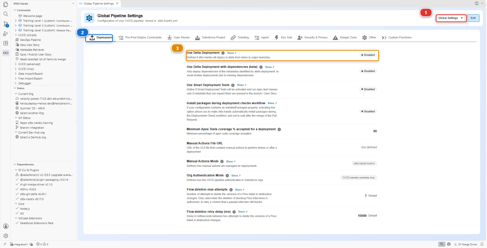
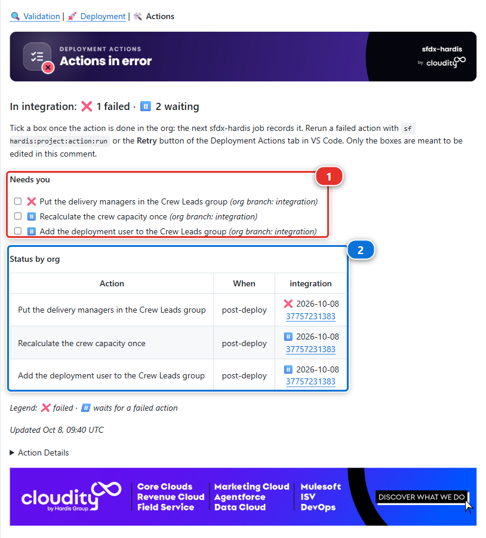
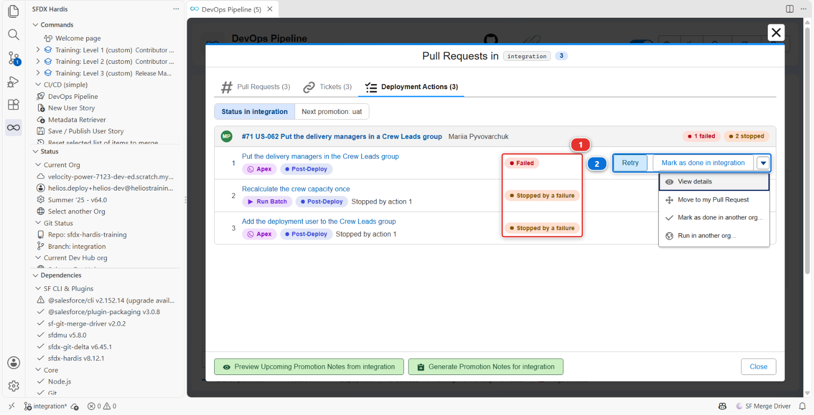
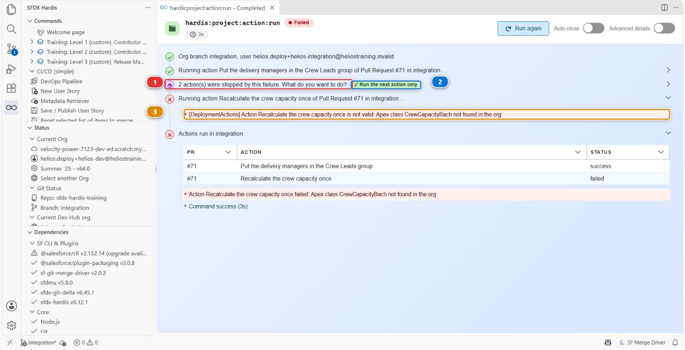
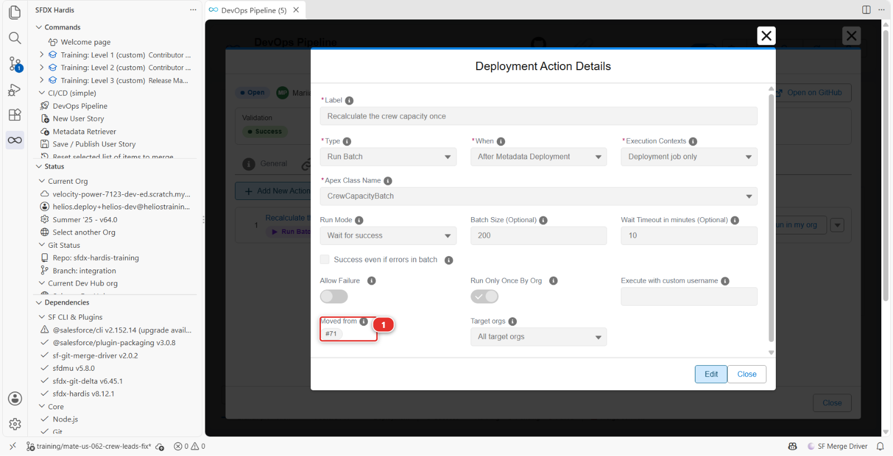
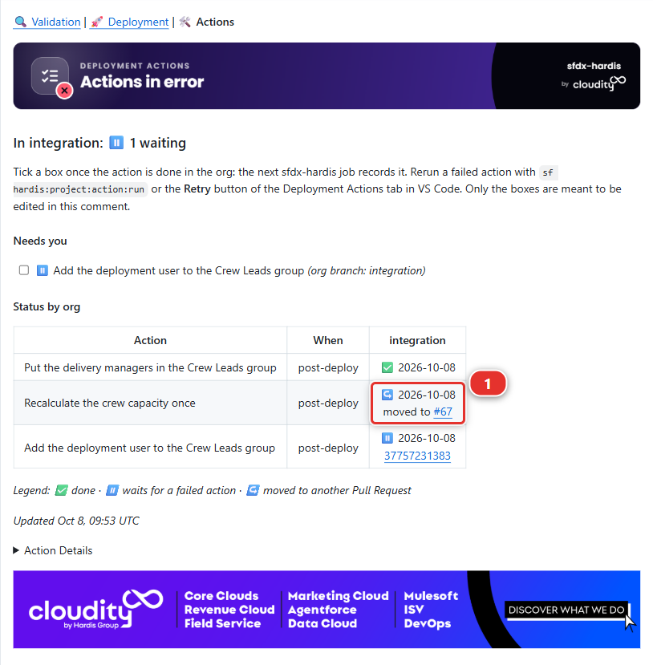

# Lab 3.3 - Lire le log de déploiement, et ce que .forceignore lui cache

**Niveau** : 3 Release Manager

**Durée** : ~1 h 25<!-- observed --> (observé : médiane 1 h 26, 6 participants, le plus rapide 30 min)<!-- /observed -->

**Vous allez** : lire correctement un log de déploiement, relire une Pull Request dont le contrôle
échoue sur un champ qui est pourtant dans son diff et trouver le fichier qui le cache, puis
rattraper des actions de post-déploiement en échec après un merge, sans redéployer.

## La situation

Merger la correction de présentation de page de Mariia a démarré un job de déploiement. La plupart
des gens regardent la couleur et passent à autre chose.

Un release manager le lit, parce que le log de déploiement est le seul endroit qui dise ce qui a
réellement atteint l'org, et que l'écart entre cela et ce que vous pensiez livrer est l'origine des
incidents.

## Avant de commencer

- [ ] [Lab 3.2](3-2-review-a-contributor-pull-request.md) terminé : la correction de présentation de page de Mariia mergée dans `integration`

## Partie 1 : lire le log

### 1. Ouvrir le job

Objectif : le job de déploiement de la correction de Mariia ouvert.
Rappel : [Lab 3.2](3-2-review-a-contributor-pull-request.md)

#### À faire

1. Ouvrez l'onglet **Actions** de votre fork (votre copie personnelle du repository du cours sur
   GitHub, par exemple `github.com/my-username/sfdx-hardis-training`), et l'exécution **Process
   Deployment (sfdx-hardis)** qui a démarré quand vous avez mergé
2. Ou depuis VS Code : le panneau **DevOps Pipeline** pose le job sur la flèche entre `integration`
   et son org **(1)**, coloré selon son statut, et la légende sous le diagramme **(2)** dit ce que
   signifie chaque couleur. Cliquez sur le marqueur pour ouvrir l'exécution

   

#### Vous devriez voir

- Le log de l'exécution **Process Deployment (sfdx-hardis)** sur `integration`

### 2. Le lire en cinq parties

Objectif : les cinq parties du log repérées, dans l'ordre.
Rappel : [Lab 3.1](3-1-configure-the-pipeline-up-to-production.md)

Un log de déploiement sfdx-hardis a toujours la même forme.

#### À faire

1. Partie un, l'authentification : repérez quelle org, quel mécanisme. Sur `integration`, il dit
   auth URL : le raccourci du Niveau 1, que le [Lab 3.1](3-1-configure-the-pipeline-up-to-production.md) a laissé en place. Sur `preprod` et `main`, il
   dit JWT
2. Partie deux, ce qu'il faut déployer : le package qu'il a calculé, et d'où. C'est la partie
   intéressante et l'étape 3 en parle
3. Partie trois, les actions pre-deploy : tout ce qui est déclaré pour tourner avant, avec son
   résultat
4. Partie quatre, le déploiement Salesforce : composants déployés, tests lancés, couverture, durée.
   Sur un job de merge, cherchez `Deployment mode: FULL + Quick Deploy`
5. Partie cinq, les actions post-deploy, puis la notification

#### Pourquoi

Si l'authentification dit un jour autre chose, c'est que quelque chose a changé sans que vous le
changiez.

Le job de contrôle de votre Pull Request avait déjà validé ce package exact, tests compris, et le job
de merge a demandé à Salesforce d'appliquer cette validation plutôt que de redéployer. C'est pourquoi
il prend quelques secondes, et pourquoi il ne lance lui-même aucun test.

#### Vous devriez voir

- Auth URL dans la partie un, et `Deployment mode: FULL + Quick Deploy` dans la partie quatre

### 3. Comprendre pourquoi le package est plus gros que le diff

Objectif : le nombre de composants envoyés par le job, comparé à l'unique fichier de votre Pull
Request.

Vous avez modifié un composant. Lisez maintenant ce que le job a réellement envoyé.

#### À faire

1. Ouvrez le package : panneau **DevOps Pipeline**, le menu **Deployment packages** **(1)**, l'icône
   d'une boîte avec une flèche dans l'en-tête, puis **Package XML** **(2)**. Il liste toute
   l'application Helios, quelques dizaines de composants

   

2. Lisez vous-même que ce projet a le delta désactivé : **DevOps Pipeline**, menu engrenage,
   **Configure Pipeline Settings**, portée **Global Settings** **(1)**, onglet **Deployment**
   **(2)**. **Use Delta Deployment** **(3)** affiche **Disabled**

   

3. Trouvez la ligne `Components: N deployed` dans le log, sous *Deployment summary*. Sur une
   exécution standard de ce cours, elle tourne autour de soixante. Comparez-la avec l'unique fichier
   de votre Pull Request

#### Pourquoi

La liste du package, c'est cela le package : sur ce projet chaque déploiement vers `integration`
envoie le tout, quoi qu'ait dit le diff. Le compteur de composants envoyés du log le dira.

C'est le comportement par défaut, et il vaut la peine de le ressentir une fois avant d'apprendre ce
qui le corrige.

Le déploiement delta. Au lieu d'envoyer le package déclaré, sfdx-hardis calcule ce qui a changé
entre le commit déjà déployé dans cette org et le nouveau, et n'envoie que cela. Un déploiement
Salesforce complet d'un projet mature prend 40 minutes ; un delta en prend 3. La contrepartie est que
l'org doit vraiment être au commit où la pipeline la croit.

Ce projet a le delta désactivé, exprès. `useDeltaDeployment` est absent de
`config/.sfdx-hardis.yml` : chaque déploiement de ce cours envoie donc le package complet.

L'application Helios fait maintenant une soixantaine de composants : un déploiement complet coûte une
minute et le delta n'économiserait rien tout en ajoutant une façon pour le cours d'échouer de
manière déroutante sur une dépendance manquante. Activez-le quand un déploiement commence à vous
coûter du temps réel, ce qui sur un vrai projet arrive vite. Il y a une deuxième clé pour les
promotions entre branches majeures, `enableDeltaDeploymentBetweenMajorBranches`, dans l'onglet
**Danger Zone**, et elle est désactivée par défaut pour la même raison : une promotion transporte
davantage, et c'est l'endroit le plus risqué où en envoyer moins.

L'écart entre le compteur et votre unique fichier est le coût du delta désactivé, et c'est l'argument
pour l'activer.

#### Vous devriez voir

- Une soixantaine de composants déployés, contre un seul fichier dans votre Pull Request
- **Use Delta Deployment** qui affiche **Disabled**

### 4. Savoir ce qu'est Smart Deploy, et ce qu'il n'est pas

Objectif : ce que fait Smart Deploy, distingué de deux choses qu'il ne fait pas.

"Smart Deploy" est le nom de la commande, pas celui d'un filtre. `sf hardis:project:deploy:smart`
est l'orchestrateur : il décide du package, réutilise un déploiement validé en Quick Deploy quand il
le peut, lance les actions pre et post déploiement, traduit les erreurs Salesforce en conseils, et
écrit le commentaire de la Pull Request. Il est intelligent sur le job, pas sur la comparaison
entre votre repository et l'org composant par composant.

#### Pourquoi : deux choses qu'il n'est pas

Deux choses qu'on suppose souvent en faire partie et qui n'en font pas partie :

- Rien ne compare chaque composant à l'org pour écarter les identiques. Il existe un mécanisme
  optionnel qui en fait quelque chose d'approchant, `manifest/packageDeployOnChange.xml`, et il ne
  regarde jamais que les composants listés dans ce fichier. Le fichier n'existe pas dans ce projet,
  et il ne fait rien tant qu'il n'existe pas
- Le nettoyage n'est pas un filtre de déploiement. Il a tourné sur la machine d'un contributeur,
  au moment du commit. L'étape 3 de la section sous le capot ci-dessous en parle

La réponse honnête à "pourquoi a-t-il déployé soixante composants pour en changer un" est donc :
parce que rien n'a été configuré pour l'en empêcher. C'est une décision de ce projet, pas quelque
chose que l'outil fait pour vous.

#### Vous devriez voir

- Rien dans ce projet de configuré pour empêcher un déploiement d'envoyer soixante composants pour
  en changer un

### 5. Vérifier dans l'org, pas dans le log

Objectif : votre modification vue dans `helios-integration` elle-même.

#### À faire

1. Dans **Orgs Manager**, trouvez `helios-integration` par son alias **(2)**, et vérifiez qu'elle dit
   toujours **Connected** **(3)**. Si elle dit déconnectée à la place, le menu d'actions au bout de
   sa ligne propose **Reconnect**, et **Add Org** **(1)** est la façon de connecter une org que le
   tableau n'a pas du tout

   

2. Cliquez sur **Open** dans le menu d'actions au bout de sa ligne
3. Ouvrez un enregistrement Installation

#### Pourquoi

Un log est une affirmation. L'org est le fait. Sur un vrai projet, vous vérifiez l'org après chaque
déploiement vers un environnement majeur, et cela prend trente secondes.

#### Vous devriez voir

- **Total Capacity (kW)** de retour sur la présentation de page, dans la colonne de droite à côté du
  champ de plafond de Mariia

## Partie 2 : ce que .forceignore cache

### 6. Une Pull Request qui échoue sur un champ qu'elle transporte

Objectif : la US-056 de Romain ouverte, son contrôle de déploiement en échec sur un champ qui est
dans son propre diff.

Romain a une story pour les planificateurs.

#### À faire

1. Ouvrez **Training: Level 3** > **Simulate my teammates**, et choisissez **US-056 Show the panels
   each crew member has to lay**. Cela ouvre sa Pull Request vers `integration`
2. Attendez ses contrôles. Le contrôle de déploiement échoue, et le commentaire sfdx-hardis nomme un
   champ :

   ```text title="Résultat"
   Installation__c-Installation Layout  In field: field - no CustomField named Installation__c.Crew_Workload__c found
   ```

3. Ouvrez **Files changed**. `Crew_Workload__c.field-meta.xml` y est, dans le diff

#### Vous devriez voir

- Le champ dans la Pull Request, et le déploiement qui dit qu'il n'existe pas

### 7. Trouver ce que le déploiement n'a jamais vu

Objectif : la ligne de `.forceignore` qui cache `Crew_Workload__c` trouvée.

#### À faire

1. Ouvrez `.forceignore` dans le diff de la Pull Request : le diff de Romain le modifie lui aussi

   ```text title="Configuration"
   # My scratch test fields, never versioned (Romain)
   **/objects/Installation__c/fields/Crew_W*.field-meta.xml
   ```

#### Pourquoi

Quand un composant est dans la branche et pas dans le déploiement, le premier fichier à ouvrir est
`.forceignore`. Il dit à la CLI Salesforce ce qu'il faut ignorer à la récupération et au
déploiement, et un composant qu'il capture est invisible dans les deux sens, sans erreur ni
avertissement.

Cette ligne est un motif, pas un nom de fichier. Le `*` tient lieu de n'importe quel texte : il
capture donc tout champ d'Installation dont le nom commence par `Crew_W`, son champ de test bricolé,
et `Crew_Workload__c`, le champ de sa propre story. Le déploiement l'a laissé de côté, la
présentation de page et le permission set qui s'en servent ont atteint l'org sans lui, et Salesforce
les a refusés.

`.forceignore` est un fichier à l'échelle du projet, et c'est au release manager de le garder : une
seule ligne négligente change ce que chaque déploiement envoie, pour tout le monde, à partir de là.

#### Vous devriez voir

- La ligne avec joker dans `.forceignore`, qui capture `Crew_Workload__c` en plus du champ de test
  bricolé de Romain

### 8. Le renvoyer avec la correction nommée

Objectif : la US-056 mergée, avec un chemin exact dans `.forceignore` à la place du joker.

#### À faire

1. Laissez un commentaire de revue sur la ligne `.forceignore` du diff :

   > This wildcard also matches `Crew_Workload__c`, the field of this story, so no deployment ever
   > sends it. Name your test field exactly, with no `*`, so nothing else can match by accident.

2. Romain répond : **Simulate my teammates** > **US-056 Romain names his test field exactly in
   .forceignore**. Cela ajoute son commit à la même Pull Request, et le contrôle retourne
3. Lisez le diff de son nouveau commit
4. Quand le contrôle est vert, mergez

#### Pourquoi

Un chemin exact vieillit mal lui aussi, mais il vieillit bruyamment : le jour où le fichier
disparaît, rien d'autre ne se met à être ignoré.

<details markdown="1"><summary>Sous le capot : d'où vient le package, et où se fait vraiment le nettoyage</summary>

Le job a lancé :

    sf hardis:project:deploy:smart

et le package qu'il a envoyé a été construit ainsi :

1. **Partir de `manifest/package.xml`**, le package déclaré, plus
   `manifest/destructiveChanges.xml` pour ce qui est retiré
2. **Le delta**, si `useDeltaDeployment` est activé : `sfdx-git-delta` calcule les composants
   modifiés entre le dernier commit déployé et `HEAD`, et tout le reste est ressorti du package.
   `enableDeltaDeploymentBetweenMajorBranches` décide si la même chose s'applique à un déploiement de
   majeure à majeure, et est désactivé par défaut parce qu'une promotion vers la production est le
   pire endroit possible pour découvrir que l'org a dérivé
3. **Le gestionnaire d'écrasement**, quand le package contient quelque chose que `manifest/package-no-overwrite.xml` liste :
   l'org est interrogée, et tout composant **listé dans ce fichier** que l'org possède déjà est retiré.
   Quand rien dans le package ne correspond à la liste, l'org n'est pas interrogée du tout, et le log le dit. Il est
   limité à sa propre liste et à rien d'autre, et un composant qu'il protège est quand même créé dans
   une org qui ne l'a pas encore
4. **Le deploy-on-change**, si `manifest/packageDeployOnChange.xml` existe : ces composants, et eux
   seuls, sont récupérés depuis l'org et comparés, et ceux qui n'ont pas changé sont écartés

Les étapes 2 et 4 sont désactivées dans ce projet. L'étape 3 s'exécute, et ses lignes `[NoOverwrite]`
sont dans le log, mais rien de ce que déploie Helios n'est encore dans sa liste : ce que Salesforce
reçoit est donc l'étape 1.

Le nettoyage n'est pas dans cette liste, et c'est ce qu'il faut retenir. Les règles
`autoCleanTypes` tournent à l'intérieur de `sf hardis:work:save`, sur la machine d'un contributeur,
avant le commit. Elles réécrivent les fichiers sur le disque et commitent le résultat, c'est
pourquoi le [Lab 1.5](../level-1-contributor-basics/1-5-retrieve-commit-and-publish-your-changes.md)
a pu vous montrer le diff qu'elles ont produit. Au moment où un déploiement tourne, il n'y a plus
rien à nettoyer : le repository est déjà la version nettoyée.

Deux modes de défaillance à savoir reconnaître :

- L'org a dérivé. Quelqu'un a modifié quelque chose dans l'org à la main et le déploiement
  l'écrase sans un mot, parce que rien n'a comparé. Le [Lab 3.7](3-7-hotfix-and-retrofit.md) parle de cela
- Le delta a perdu une dépendance. Votre modification a besoin d'un composant qui n'a pas changé,
  le delta ne l'emporte donc pas, et le déploiement échoue sur une référence. La correction n'est pas
  de désactiver le delta : c'est d'inclure la dépendance, ce à quoi sert `manifest/package.xml`

<!-- command-links:start -->
Documentation des commandes : [hardis:project:deploy:smart](https://sfdx-hardis.cloudity.com/hardis/project/deploy/smart/), [hardis:work:save](https://sfdx-hardis.cloudity.com/hardis/work/save/)
<!-- command-links:end -->

</details>

#### Vous devriez voir

- Le contrôle de la US-056 vert après le second commit de Romain, et sa Pull Request mergée

## Partie 3 : quand une action de post-déploiement échoue

### 9. Merger une Pull Request dont les actions échouent après le merge

Objectif : la US-062 de Mariia mergée, et son job de déploiement en rouge sur sa première action.

Mariia a une story faite d'actions de déploiement, sans métadonnées.

#### À faire

1. Ouvrez **Training: Level 3** > **Simulate my teammates**, et choisissez **US-062 Put the delivery
   managers in a Crew Leads group**. Cela ouvre sa Pull Request vers `integration`, avec trois
   actions de post-déploiement dans son fichier d'actions :
   1. **Put the delivery managers in the Crew Leads group**, un script Apex
   2. **Recalculate the crew capacity once**, une action Run Batch
   3. **Add the deployment user to the Crew Leads group**, un script Apex
2. Attendez que son contrôle passe au vert, puis mergez-la

#### Pourquoi

Un contrôle vert prouve moins qu'il n'y paraît : les trois actions ne tournent que pendant le job de
déploiement, après le merge, donc le contrôle les a sautées.

#### Vous devriez voir

- Le job de déploiement au rouge. Les métadonnées sont déployées, puis la première action a échoué,
  et sfdx-hardis s'est arrêté là : les deux autres n'ont jamais tourné

### 10. Lire ce qui a échoué, et ce qui n'a pas tourné

Objectif : l'action en échec et les deux qu'elle a arrêtées, lues dans le log, dans les deux
commentaires et dans la DevOps Pipeline.

#### À faire

1. Ouvrez le log du job : il nomme l'échec. Le script Apex a demandé à l'org un groupe public nommé
   `Helios_Crew_Leads`, et l'org n'en a pas :

   ```text title="Résultat"
   System.QueryException: List has no rows for assignment to SObject
   ```

2. Ouvrez le commentaire de déploiement de sa Pull Request. Il s'ouvre sur **⚠️ Deployed to
   `integration`, but an action failed after the deployment** : l'org a les nouvelles métadonnées.
   Sous **❌ Failed action**, il montre la fin de la sortie du script, et sous **⏸️ Not run, waiting
   for the failed action** les deux autres
3. Ouvrez le commentaire Deployment Actions de sa Pull Request. Il résume tout dans son verdict,
   **In integration: ❌ 1 failed · ⏸️ 2 waiting**, et liste les trois actions sous **Needs you
   (1)** : ❌ pour celle qui a échoué, ⏸️ pour les deux qu'elle a arrêtées, chacune avec une case à
   cocher. Le tableau **Status by org** **(2)** dit la même chose dans la colonne `integration`

   

4. Récupérez `integration` et faites un pull, depuis le nom de branche de la barre d'état et le
   panneau Source Control
5. Cliquez sur **Refresh** dans la barre du haut du panneau **DevOps Pipeline**, pour qu'il lise le
   déploiement qui vient d'échouer
6. Cliquez sur `integration`, puis sur l'onglet **Deployment Actions**. Les actions sont regroupées
   par Pull Request, numérotées dans l'ordre où elles tournent. La colonne **Status** **(1)** donne
   l'état de chaque action dans l'org d'`integration`, et celle en échec porte les boutons **Retry**
   et **Mark as done in integration** **(2)**. Le menu au bout de chaque ligne contient le reste,
   **Move to my Pull Request** compris

   

#### Pourquoi

Mariia a créé le groupe à la main dans sa propre org, dans Setup, comme on en crée un le plus
souvent : rien dans sa Pull Request ne le crée.

La DevOps Pipeline a d'abord besoin du pull et du rafraîchissement : le panneau lit les actions dans
la branche que vous avez récupérée, et le fichier d'actions de Mariia est arrivé sur `integration`
avec son merge.

Aucun des boutons ne relance le job de déploiement : les métadonnées sont déjà dans l'org, et un
second déploiement ne ferait que refaire ce qui a marché. La bonne façon d'en sortir dépend de la
raison de chaque échec :

| Pourquoi elle a échoué                                   | Comment en sortir                               |
|----------------------------------------------------------|-------------------------------------------------|
| Il manquait quelque chose à l'org, et elle l'a désormais | **Retry**                                       |
| L'action elle-même est fausse                            | La déplacer dans une Pull Request de correction |
| Quelqu'un l'a déjà faite à la main                       | **Mark as done**                                |

#### Vous devriez voir

- Dans l'onglet **Deployment Actions** d'`integration`, l'action en échec avec **Retry** et **Mark
  as done in integration**, et les deux autres arrêtées

### 11. Corriger l'org, puis relancer

Objectif : la première action verte dans `integration`, et l'action de capacité des équipes en échec
sur son nom de classe.

La première action est juste : c'est l'org à qui il manque son groupe.

#### À faire : créer le groupe dans helios-integration

1. Ouvrez `helios-integration` depuis **Orgs Manager**, puis **Setup**, tapez `Public Groups` dans
   la boîte Quick Find, et cliquez sur **New**
2. **Label** `Crew Leads`, **Group Name** `Helios_Crew_Leads`, puis **Save**

#### À faire : relancer l'action

1. Si vous avez changé de branche depuis l'étape 10, revenez sur `integration` : la définition de
   l'action est lue dans la branche que vous avez récupérée, et c'est pourquoi l'étape 10 vous a
   fait récupérer `integration` et faire un pull
2. De retour dans l'onglet **Deployment Actions**, cliquez sur **Retry** sur la ligne de **Put the
   delivery managers in the Crew Leads group**. La commande tourne dans VS Code, sur
   `helios-integration` : l'action tourne et passe au vert, et la commande demande quoi faire des
   deux actions que son échec a arrêtées **(1)**
3. Répondez **Run the next action only** **(2)**. L'action de capacité des équipes tourne, et échoue
   **(3)** : la classe `CrewCapacityBach` n'existe pas

   

!!! warning "Pas de Retry sur la ligne, seulement Mark as done ?"
    VS Code n'est pas sur `integration`, donc la définition de l'action n'est pas dans votre
    copie de travail. Récupérez `integration`, faites un pull, et cliquez sur **Refresh**. Ne relancez pas le
    job sur GitHub à la place : il redéploie tout, sans le Quick Deploy, et rejoue les actions
    depuis le début.

<details markdown="1"><summary>Sous le capot : ce que Retry a lancé</summary>

Le bouton a lancé :

    sf hardis:project:action:run --pr <numéro de US-062> --action-id <id> --org-branch integration

- Pas de déploiement. Elle lance la seule action, avec le code qu'un job de déploiement utilise
  pour chaque action : filtres de branches cibles, références aux sorties d'autres actions,
  contrôles de validité
- L'org vient de la branche. `integration` désigne `helios-integration` par le
  `targetUsername` de `config/branches/.sfdx-hardis.integration.yml`, et la commande utilise cette
  org telle que vous l'avez connectée dans Orgs Manager. Les commandes `sf` que l'action démarre la ciblent pour cette
  exécution seulement : votre org par défaut ne change pas
- Le résultat va dans le commentaire de la Pull Request, avec votre nom d'utilisateur git et
  votre nom d'utilisateur Salesforce dans la note, grâce au jeton du fournisseur git que VS Code
  détient. Sans lui, la commande refuse de tourner, parce que le déploiement suivant ne saurait pas
  que l'action a été faite
- Les actions arrêtées sont mémorisées. Quand le job de déploiement s'est arrêté, il a
  enregistré les deux autres comme `not-run`, liées à celle en échec : c'est ainsi que la commande
  savait quoi proposer ensuite
- Une action avec un `customUsername` tourne sous cet utilisateur. Quand votre poste n'y est pas
  connecté, la commande vous demande de vous connecter avec lui, et vérifie que vous l'avez fait

<!-- command-links:start -->
Documentation de la commande : [hardis:project:action:run](https://sfdx-hardis.cloudity.com/hardis/project/action/run/)
<!-- command-links:end -->

</details>

#### Vous devriez voir

- Le commentaire de la Pull Request qui indique ✅ pour la première action, avec une note disant que
  vous l'avez lancée depuis votre poste, ❌ pour l'action de capacité des équipes, et ⏸️ pour la
  dernière

### 12. Une définition fausse retourne à son auteur

Objectif : l'action de capacité des équipes déplacée dans une Pull Request de correction, lancée
depuis celle-ci, et affichée comme déplacée sur la US-062.

Relancer l'action de capacité des équipes échouera à chaque fois : le nom de sa classe a une
coquille, dans un fichier d'une Pull Request déjà mergée. Modifier ce fichier sur `integration`
n'aiderait pas non plus : un déploiement ne lit que les actions des Pull Requests qu'il déploie.

#### À faire

1. Renvoyez-la. Commentez la Pull Request mergée de Mariia :

   > The crew capacity action names `CrewCapacityBach`, which does not exist: it should be
   > `CrewCapacityBatch`. Can you move it to a fix Pull Request?

2. Lancez **Simulate my teammates** > **US-062 Mariia fixes the crew capacity action**
3. Relisez sa Pull Request, dans **Files changed** : l'action a quitté le fichier d'actions de US-062
   et est arrivée dans le fichier de la nouvelle Pull Request, avec `className: CrewCapacityBatch` et
   `movedFrom` qui vaut le numéro de US-062
4. Toujours dans **Files changed** : un nouveau fichier, `groups/Helios_Crew_Leads.group-meta.xml`,
   et un bloc de plus dans `manifest/package.xml`
5. Dans l'onglet **Deployment Actions** de sa Pull Request, ouvrez l'action : l'éditeur montre d'où
   elle vient, sous **Moved from (1)**

   

6. Mergez-la. Son job de déploiement lance l'action, depuis la nouvelle Pull Request, et passe au
   vert
7. Rouvrez le commentaire Deployment Actions de US-062

   

#### Pourquoi

Elle la corrige comme le produit le propose : depuis sa nouvelle branche, **Move to my Pull
Request** dans le menu de la ligne en échec déplace l'action dans le fichier d'actions de sa propre
Pull Request, avec le même id, et elle y corrige le nom de la classe.

Un groupe public est une métadonnée comme une autre, et Mariia a mis le sien dans les sources. Dans
`integration`, le déploiement trouve le groupe que vous avez créé à l'étape 11 et le garde, sous le
libellé `Crew Leads`. Dans `uat`, `preprod` et la production, où personne n'a rien créé, le
déploiement le crée avant que les actions ne s'exécutent. Sans ce fichier, la première action
échouerait dans chacune d'elles comme elle a échoué ici.

Quand les deux Pull Requests partiront ensemble vers `uat`, au [Lab 3.5](3-5-promote-to-uat-and-write-release-notes.md), US-062 ne portera plus
l'action, et elle tournera une seule fois, depuis la correction.

#### Vous devriez voir

- L'action de capacité des équipes qui indique ↪️ **moved to** la Pull Request de correction **(1)**,
  avec un lien, au lieu d'une case rouge que personne ne pouvait effacer

### 13. Marquer comme fait ce qui a été fait à la main

Objectif : la dernière action faite dans `integration`, close à la main avec une note qui vous
nomme.

La dernière action ajoute l'utilisateur de déploiement à Crew Leads. La relancer marcherait, mais la
faire prend vingt secondes : faites-la à la main, comme un release manager le fait quand une
livraison ne peut pas attendre.

#### À faire

1. Dans `helios-integration`, **Setup** > **Public Groups** > **Crew Leads** > **Edit**
2. Regardez **Selected Members**. Votre utilisateur y est déjà : la première action, que vous avez
   relancée à l'étape 11, a mis chaque delivery manager dans le groupe, et vous en êtes un. Il n'y
   a rien à ajouter, cliquez donc sur **Cancel**. Sur un vrai projet l'utilisateur de déploiement
   est un utilisateur technique qu'aucune autre action n'ajoute : vous le passeriez ici dans
   **Selected Members**, puis **Save**
3. Dans l'onglet **Deployment Actions**, ouvrez le menu de **Add the deployment user to the Crew
   Leads group** et cliquez sur **Mark as done in integration**. Rien ne s'ouvre : sfdx-hardis
   l'enregistre en arrière-plan comme faite dans `integration`, avec une note qui vous nomme, et
   coche sa case dans les commentaires de la Pull Request. Le bouton affiche **Marking as done...**
   jusqu'à ce que l'action affiche **Done** dans l'onglet

#### Pourquoi

Le prochain déploiement vers `integration` la saute. Dans `uat` et au-delà, elle tourne toujours,
parce que personne ne l'y a faite.

Cocher sa case dans la liste **Needs you** du commentaire Deployment Actions fait la même
chose, enregistrée par le prochain job sfdx-hardis : utilisez-la quand vous êtes sur GitHub plutôt
que dans VS Code.

<details markdown="1"><summary>Sous le capot : ce que laissent les trois façons d'en sortir</summary>

- **Retry** a lancé `sf hardis:project:action:run`, comme à l'étape 11
- **Move to my Pull Request** a lancé, côté Mariia :

        sf hardis:project:action:update --scope pr --pr-id <US-062> --when post-deploy --action-id <id> --move-to-pr <sa Pull Request>

  Elle retire l'action de `scripts/actions/.sfdx-hardis.<US-062>.yml`, l'ajoute au fichier de sa
  Pull Request avec `movedFrom: <US-062>`, et garde son id. Quand un déploiement porte les deux, la
  copie d'origine est écartée, et l'exécution de la copie écrit ↪️ dans le commentaire de US-062
- **Mark as done** a lancé :

        sf hardis:project:action:set-status --pr <US-062> --action-id <id> --org-branch integration --status success

  Le statut devient `success`, ce qui fait que les déploiements suivants la sautent, et la note
  garde la vérité : *Not run in CI, then closed by hand by vous (votre nom d'utilisateur) on la date*

Tout vit dans le commentaire "Deployment Actions" de la Pull Request qui porte l'action : aucun
objet Salesforce, rien à installer. Ce commentaire est aussi l'endroit où un release manager
regarde avant une promotion, pour voir ce qui est encore rouge.

<!-- command-links:start -->
Documentation des commandes : [hardis:project:action:run](https://sfdx-hardis.cloudity.com/hardis/project/action/run/), [hardis:project:action:update](https://sfdx-hardis.cloudity.com/hardis/project/action/update/), [hardis:project:action:set-status](https://sfdx-hardis.cloudity.com/hardis/project/action/set-status/)
<!-- command-links:end -->

</details>

#### Vous devriez voir

- **Done** sur **Add the deployment user to the Crew Leads group** dans l'onglet **Deployment
  Actions**, et sa case cochée dans les commentaires de la Pull Request

## Ce que vous devez voir

- [ ] Une exécution **Process Deployment (sfdx-hardis)** verte sur `integration`
- [ ] Un log où vous savez dire combien de composants sont partis, et pourquoi ce nombre n'est pas un
- [ ] La modification présente dans `helios-integration`
- [ ] La US-056 de Romain mergée, `Crew_Workload__c` dans `helios-integration`, et plus aucun joker dans
      `.forceignore`
- [ ] La US-062 de Mariia et sa correction mergées, et dans son commentaire Deployment Actions : ✅ pour
      la première action avec une note disant que vous l'avez lancée, ↪️ pour l'action de capacité des
      équipes, ✅ pour la dernière avec une note disant que vous l'avez close à la main
- [ ] Dans `helios-integration`, un groupe public **Crew Leads** qui contient les delivery managers et
      vous
- [ ] `force-app/main/default/groups/Helios_Crew_Leads.group-meta.xml` sur `integration`, pour que les
      orgs suivantes reçoivent le groupe par le déploiement

## En cas de problème

**Le déploiement a échoué alors que le contrôle était passé.**
Quelque chose a changé entre les deux : l'org, ou un autre déploiement arrivé avant. Lisez l'erreur,
et vérifiez si quelqu'un a déployé à la main.

**Le log dit "nothing to deploy".**
Avec le delta désactivé, cela ne devrait pas arriver sur ce projet, parce que le package est déclaré
et non calculé. Si cela arrive, vérifiez que `manifest/package.xml` est toujours dans la branche et
liste toujours quelque chose.

**Le job n'a jamais démarré.**
Le workflow ne se déclenche que sur les pushes vers des branches majeures. Vérifiez que le merge a
bien atterri sur `integration`.

**Le contrôle de Romain échoue encore après son deuxième commit.**
Le contrôle a tourné sur le merge de sa branche avec `integration` telle qu'elle était au moment de
son push. Si vous avez modifié `.forceignore` sur `integration` entre-temps, cliquez sur
**Update branch** sur sa Pull Request : GitHub y merge `integration`, et le contrôle retourne.

**L'onglet Deployment Actions n'a pas de colonne Status, ou pas de Retry dans le menu.**
L'état vient de sfdx-hardis, qui demande une version récente et votre connexion GitHub : mettez-le à
jour depuis le panneau **Dependencies**, et vérifiez que l'icône du fournisseur git de la DevOps
Pipeline est connectée. Une ligne ne propose Retry que si son action a échoué ou a été arrêtée,
après le déploiement.

**La ligne en échec n'a pas de Retry, seulement Mark as done.**
La branche que vous avez récupérée n'est pas `integration`. Récupérez-la, faites un pull, cliquez
sur **Refresh**. Relancer le job de déploiement sur GitHub n'est pas la même chose : il redéploie
tout, sans le Quick Deploy, et la première action échoue tant que le groupe n'existe pas.

**Retry dit qu'aucune org de helios-integration n'est connectée.**
Connectez `helios-integration` dans **Orgs Manager**, puis cliquez à nouveau sur **Retry**.

**Retry dit ne pas trouver l'action.**
La définition est lue dans la branche que vous avez récupérée : récupérez `integration` et faites un
pull, pour que le fichier d'actions de Mariia soit là.

**La première action échoue encore après la création du groupe.**
Vérifiez le **Group Name** : il doit être exactement `Helios_Crew_Leads`. Le libellé peut être
n'importe lequel.

**La correction de Mariia s'arrête sur "not merged in your fork".**
Sa correction retire une action du fichier d'actions de US-062, nommé d'après le numéro de sa Pull
Request : mergez d'abord US-062.

## Vérifiez votre travail

Welcome page > **Training: Level 3** > **Check my work**, puis choisissez le **Lab 3.3**.

## Pour aller plus loin

- [Déployer vers les orgs majeures](https://sfdx-hardis.cloudity.com/salesforce-devops-deploy-major-branches/)
- [Les rouages de Smart Deploy](https://sfdx-hardis.cloudity.com/salesforce-devops-smart-deployment/)
- [Rattraper une action de déploiement en échec](https://sfdx-hardis.cloudity.com/salesforce-devops-work-on-user-story-deployment-actions/#recover-a-failed-action)

[Suite : Lab 3.4 - Trois Pull Requests pour une release : revoir l'ordre de merge](3-4-merge-colliding-pull-requests.md){ .md-button .md-button--primary }
