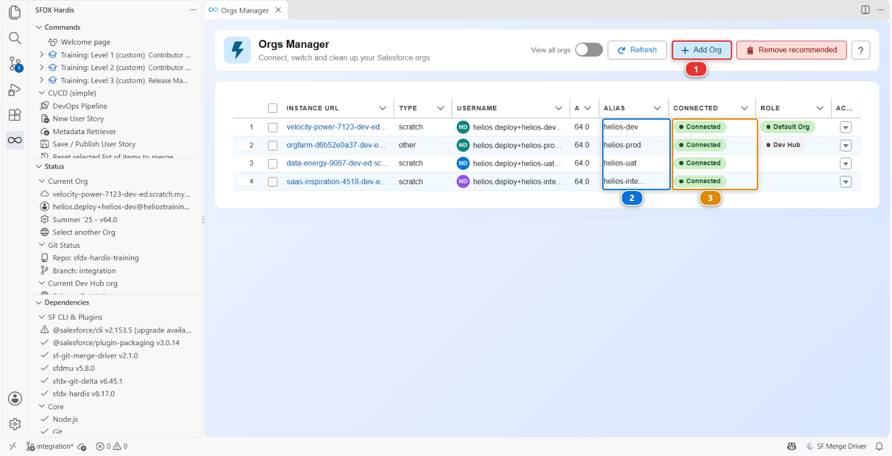
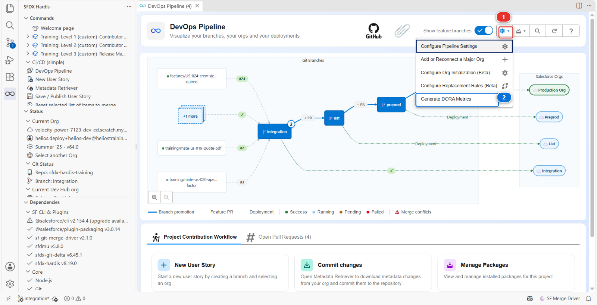
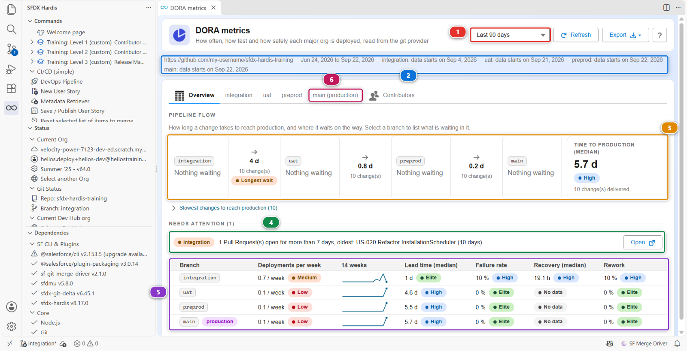
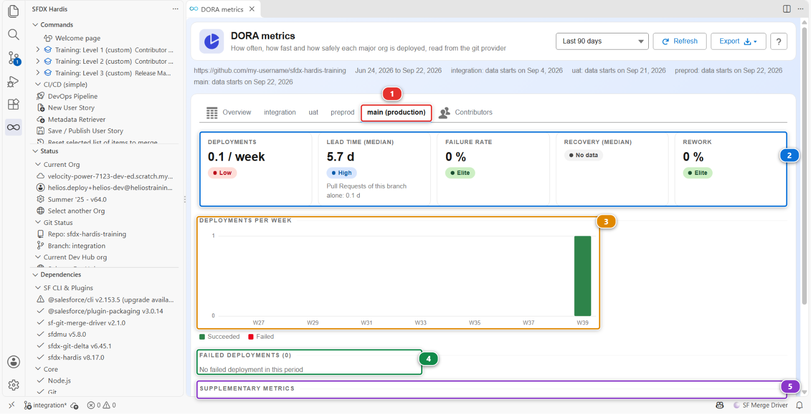
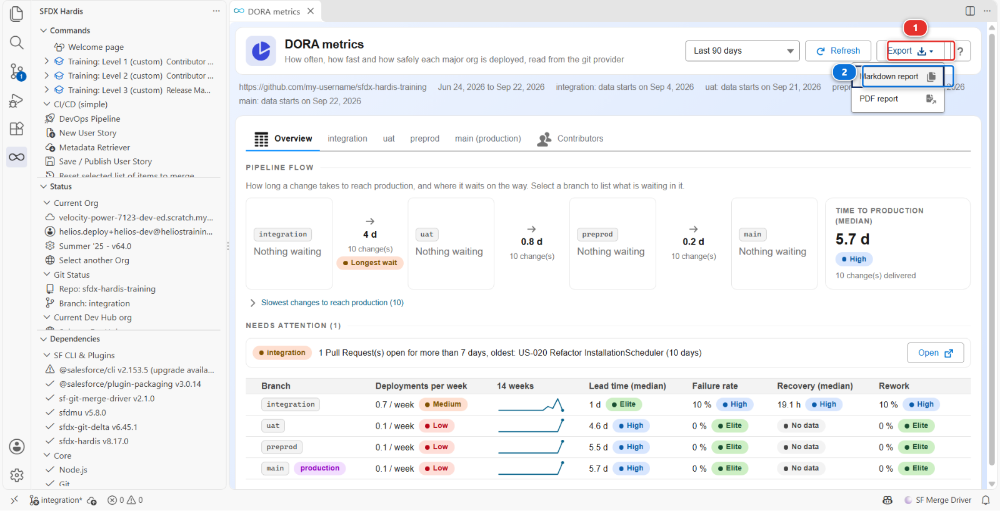

# Lab 3.6 - Livrer en production et lire vos métriques DORA

**Niveau** : 3 Release Manager

**Durée** : ~1 h<!-- observed --> (observé : médiane 1 h 01, 5 participants, le plus rapide 41 min)<!-- /observed -->

**Vous allez** : livrer en production, puis mesurer si votre pipeline vaut quelque chose.

## La situation

L'UAT a validé. La livraison part en production ce soir.

C'est le même mécanisme qu'au [Lab 3.5](3-5-promote-to-uat-and-write-release-notes.md), deux fois : `uat` dans `preprod`, puis `preprod` dans `main`.
Avec une différence qui n'est pas technique : si vous vous trompez, de vraies personnes ne pourront
pas faire leur travail demain. Tout ce qui, dans ce lab, ressemble à du cérémonial est là parce que
quelqu'un l'a sauté une fois.

## Avant de commencer

- [ ] [Lab 3.5](3-5-promote-to-uat-and-write-release-notes.md) terminé : `uat` porte la livraison et les testeurs l'ont validée
- [ ] `helios-preprod` et `helios-prod` connectées, alimentées, et configurées comme orgs de
      `preprod` et `main` au Lab 3.1
- [ ] Authentification JWT fonctionnelle pour `preprod` et `main`

## Les étapes

### 1. Vérifier les trois choses qui méritent de l'être

Avant de créer quoi que ce soit :

**Un : l'UAT est-elle vraiment validée ?** Pas "le déploiement était vert". Quelqu'un a testé et a
dit oui. Sur ce projet cette personne, c'est vous, et vous l'avez fait au [Lab 3.5, étape 6](3-5-promote-to-uat-and-write-release-notes.md#6-verifier-avec-des-yeux-de-testeur).

**Deux : quelles étapes manuelles cela va-t-il transporter ?** Regardez les deployment actions des
stories qui sortent. Une étape manuelle en production est quelque chose que vous ferez, en direct,
devant personne, à l'heure qu'est la livraison. Sachez-le maintenant.

**Trois : la production est-elle là où vous le croyez ?** Ouvrez `helios-prod` et regardez. Elle
devrait porter ce que le cours y a semé et rien d'autre pour l'instant. Sur un vrai projet, les
admins modifient la production à la main entre deux livraisons, et le [Lab 3.7](3-7-hotfix-and-retrofit.md) parle exactement de
cela. Ne présumez rien.

### 2. Répéter en preprod

De la même façon que vous avez créé la promotion au [Lab 3.5](3-5-promote-to-uat-and-write-release-notes.md) : la pastille **+ PR** sur la flèche
d'`uat` vers `preprod`, dans le diagramme DevOps Pipeline. GitHub s'ouvre sur la Pull Request d'`uat`
vers `preprod`.

Son job de contrôle est le premier à se connecter à `helios-preprod`, et il le fait avec la clé et
les secrets du [Lab 3.1](3-1-configure-the-pipeline-up-to-production.md). C'est la première connexion JWT du cours, alors regardez-la une fois :
ouvrez le contrôle depuis **Checks**, dépliez **Login & Simulate deployment**, et cherchez
`sf org login jwt`. Cette ligne, et le job qui continue au-delà, c'est votre clé de `preprod` qui
fonctionne, même au premier passage, qui s'arrête en rouge plus bas pour une autre raison.

Intitulez-la simplement :

> Promotion 2026-09 to preprod

Son premier contrôle s'arrête en **rouge**, exprès, comme celui de la promotion vers `uat` au
[Lab 3.5 étape 4](3-5-promote-to-uat-and-write-release-notes.md) : l'étape de délivrabilité de US-026 s'exécute avant le déploiement, et
personne ne l'a faite dans `helios-preprod`. Faites-y le clic, cochez sa case dans le commentaire
sfdx-hardis (ou **Mark as done in preprod** dans l'onglet **Deployment Actions** de VS Code), puis
**Re-run all jobs** sur le contrôle. Il passe au vert.

Lisez le contrôle, mergez, et regardez l'exécution **Process Deployment (sfdx-hardis)** sur
`preprod`. Ouvrez ensuite `helios-preprod` et faites-y d'abord les vérifications de l'étape 6.

C'est à cela que sert `preprod`. Elle contient ce que contient la production, personne n'y travaille,
et une livraison qui s'y déploie proprement et se comporte bien n'a plus grand-chose pour vous
surprendre en production. Une livraison qui échoue ici ne vous a rien coûté.

### 3. Créer la Pull Request de production

La pastille **+ PR** sur la flèche de `preprod` vers `main`, de `preprod` dans `main`. Son job de
contrôle est la première connexion JWT à `helios-prod`, avec `sf org login jwt` dans son log comme à
l'étape 2. Intitulez-la simplement :

> Release 2026-09 to production

Son premier contrôle s'arrête en rouge pour la même raison qu'à l'étape 2, dans la dernière org où
personne n'a fait l'étape de délivrabilité : `helios-prod`. Faites le clic en production, cochez la
case, **Re-run all jobs**, et lisez le contrôle vert qui suit.

### 4. Lire le contrôle comme si cela comptait

Quand le contrôle se termine, lisez le commentaire sfdx-hardis comme le [Lab 3.2](3-2-review-a-contributor-pull-request.md) l'a enseigné, et
ajoutez deux questions qui ne valent que pour la production :

| Question                                     | Où regarder                                                                                                                                                              |
|----------------------------------------------|--------------------------------------------------------------------------------------------------------------------------------------------------------------------------|
| **Est-ce que cela supprime quelque chose ?** | Le chiffre `deleted` de la ligne **Metadata**, affiché seulement quand quelque chose part. Une suppression en production est définitive et emporte des données avec elle |
| **Combien de temps cela va-t-il prendre ?**  | La durée du contrôle est une estimation raisonnable. Si c'est 40 minutes, ce sont 40 minutes pendant lesquelles l'org est modifiée                                       |

Si ce chiffre est là et que vous ne vous y attendiez pas, **arrêtez-vous**. Le commentaire ne
vous dira pas ce qui part : `manifest/destructiveChanges.xml` et le diff, si. Découvrez de quoi il
s'agit et qui l'a voulu. Ce n'est pas de la prudence, c'est le métier.

### 5. Merger, et rester

Mergez. L'exécution **Process Deployment (sfdx-hardis)** démarre, cette fois sur `main`.

Regardez-la. Non parce que vous pouvez faire quoi que ce soit pendant qu'elle tourne, mais parce que
savoir si elle a échoué à la deuxième minute ou à la trente-cinquième change ce que vous faites
ensuite.

Quand elle se termine, faites les éventuelles étapes manuelles post-déploiement, puis vérifiez
l'org. Celles de pré-déploiement se font avant le merge : faites-les, cochez leurs cases dans le
commentaire du contrôle, puis mergez, et le job de déploiement les enregistre, comme au
[Lab 3.5](3-5-promote-to-uat-and-write-release-notes.md).

### 6. Vérifier en production

Ouvrez `helios-prod` depuis **Orgs Manager** : trouvez-la par son alias **(2)**, vérifiez qu'elle dit
**Connected** **(3)**, puis **Open** dans le menu d'actions au bout de sa ligne. Une ligne
déconnectée propose **Reconnect** dans ce même menu ; **Add Org** **(1)** est pour une org que le
tableau n'a pas.

Vérifiez ensuite, comme pour l'UAT et avec davantage de soin :

- Les deux stories fonctionnent
- Quelque chose qui fonctionnait déjà fonctionne toujours : ouvrez une installation, vérifiez le
  composant de timeline, enregistrez un enregistrement

Cette dernière vérification existe parce que l'incident de production le plus fréquent après une
livraison n'est pas la nouvelle fonctionnalité qui échoue. C'est une ancienne.

### 7. Mesurer la pipeline, maintenant

Vous avez livré. La question qu'on pose ensuite à un release manager est "où en est-on", et elle
mérite mieux qu'une impression.

Ouvrez le panneau **DevOps Pipeline**, cliquez sur l'engrenage **(1)** en haut à droite, et
choisissez **Generate DORA Metrics** **(2)**. Vous avez utilisé **Configure Pipeline Settings** et **Add or Reconnect a
Major Org** du même menu au [Lab 3.1](3-1-configure-the-pipeline-up-to-production.md).
**Configure Org Initialization** et **Configure Replacement Rules** sont deux réglages que ce cours
laisse de côté : le
[Lab 3.1](3-1-configure-the-pipeline-up-to-production.md#trois-reglages-que-ce-cours-laisse-de-cote) dit à
quoi ils servent.

Un onglet **DORA metrics** s'ouvre et dit, pendant quelques secondes, qu'il lit les jobs de
déploiement et les Pull Requests depuis GitHub. Cette phrase est toute la conception. Rien n'est
demandé à une org : il n'y a donc pas d'org par défaut à choisir avant, et deux personnes du même
projet lisent les mêmes nombres. Ce dont le panneau a besoin, c'est de la connexion à GitHub que
vous avez donnée à l'extension au [Lab 1.2](../level-1-contributor-basics/1-2-create-your-dev-hub-scratch-orgs-and-pipeline.md).

Il arrive sur son onglet **Overview** :

Lisez le cadre avant les nombres :

- La période **(1)** est **Last 90 days**, sauf si vous choisissez 30, 180 ou 365
- La ligne sous le titre **(2)** nomme le repository et les dates de la période, puis dit où
  commencent les données d'une branche quand c'est plus d'une semaine après le début de la période.
  Ici elle le dit pour les quatre branches : votre pipeline est plus jeune que la période sur
  laquelle il est mesuré
- **Pipeline flow** **(3)** suit vos User Stories d'une org à la suivante. Vous le lisez dans un
  instant, ci-dessous
- **Needs attention** **(4)** n'est là que si sfdx-hardis a quelque chose à montrer, chaque ligne
  avec la branche concernée et, quand il y a quelque chose à ouvrir, un bouton **Open**. Il connaît
  cinq cas : le dernier job de déploiement d'une branche a échoué, des Pull Requests sont
  ouvertes depuis plus de 7 jours, le taux d'échec dépasse 10 % et a monté de 5 points depuis la
  période précédente, rien n'a été déployé depuis 30 jours, des User Stories attendent dans une org
  depuis plus de 30 jours. Si vous avez renvoyé US-020 il y a plus d'une semaine, elle est sur cette
  liste, et à raison : une Pull Request que personne ne merge et que personne ne ferme est une
  décision que quelqu'un ne prend pas
- Le tableau **(5)** contient une ligne par org majeure, dans l'ordre du pipeline, avec `main`
  marquée **production**. Une ligne ouvre l'onglet de sa branche, celui de `main` étant **(6)**

**Pipeline flow** répond à la question que le tableau laisse sans réponse : combien de temps une
User Story met-elle pour atteindre la production, et où attend-elle. Les chiffres cités ci-dessous
sont ceux de l'image, un apprenant qui a étalé le cours sur une semaine : les vôtres suivent les jours que votre propre cours a pris et le nombre de
User Stories que vous avez livrées, et un cours fait d'une traite se lit en heures, pas en jours.
Lisez-le de gauche à droite :

- Chaque case est une org du pipeline. Elle dit combien de User Stories sont dans cette org sans
  être allées plus loin, et depuis combien de temps la plus ancienne y est. Les vôtres affichent
  toutes **Nothing waiting** : vous venez de tout livrer. Sur un vrai projet, c'est là qu'un
  release manager regarde en premier, et un clic sur une case liste les User Stories qui y
  attendent
- Entre deux cases, la flèche porte l'attente médiane : les jours entre le déploiement d'une User
  Story dans une org et son déploiement dans la suivante. Les vôtres ont attendu **4 d** dans
  `integration`, **0.8 d** dans `uat` et **0.2 d** dans `preprod`. La plus longue est marquée
  **Longest wait**
- **Time to production (median)**, à droite, est le trajet entier : de la création de la Pull
  Request d'une User Story à la fin du job qui l'a déployée en production. **5.7 d, High**, sur les
  dix User Stories que vous avez livrées
- **Slowest changes to reach production** ouvre la liste derrière ce nombre, chaque User Story
  avec le jour où elle a atteint chaque org. La plus lente est la toute première que vous avez
  mergée : elle a attendu que le pipeline existe

Une User Story est suivie à partir des seules Pull Requests. Merger `integration` dans `uat`
emmène toutes les User Stories qui étaient dans `integration` à ce moment-là, et les jours sont
comptés à partir de là.

Chaque ligne porte cinq nombres. Chacun est noté **Elite**, **High**, **Medium** ou **Low**, sur la
même échelle pour toutes les branches, ou affiche **No data** :

| Colonne                  | Ce qu'elle compte vraiment                                                                                          | À quoi ressemble le bon                                                                                       |
|--------------------------|---------------------------------------------------------------------------------------------------------------------|---------------------------------------------------------------------------------------------------------------|
| **Deployments per week** | Les exécutions réussies du job de déploiement de la branche, divisées par la durée de la période                    | Hebdomadaire convient. Trimestriel veut dire que chaque livraison est énorme                                  |
| **Lead time (median)**   | Par User Story arrivée dans l'org : de la création de sa Pull Request à son déploiement dans cette org              | Des jours, pas des semaines. Un long délai veut dire que du travail stagne                                    |
| **Failure rate**         | Les jobs de déploiement en échec, divisés par échecs plus réussites. Un job annulé n'est dans aucun                 | Sous 15 %. Au-dessus, le contrôle n'attrape pas ce qu'il devrait                                              |
| **Recovery (median)**    | Les heures entre un job de déploiement en échec et le suivant qui réussit sur la même branche                       | Des heures                                                                                                    |
| **Rework**               | Les Pull Requests d'une branche de correction, ou les réussites dans la journée d'un échec : le plus grand des deux | Bas. Lisez la note ci-dessous avant d'attendre du [Lab 3.7](3-7-hotfix-and-retrofit.md) qu'il le fasse bouger |

La colonne entre les deux premières, qui porte le nombre de semaines de la période, dessine les
déploiements de la branche semaine par semaine.

Deux d'entre eux ne sont pas ce que leur nom suggère, et il vaut la peine de savoir lesquels.
**Failure rate est le taux d'échec d'un job** : une livraison qui s'est déployée au vert et a cassé
la production le mardi n'y apparaît pas. **Recovery est l'écart entre un job de déploiement rouge
et le suivant qui est vert**, pas entre un incident et sa correction. Ils mesurent votre pipeline,
pas votre org. Et le pipeline est tout ce qu'ils voient : un déploiement fait à côté, un change set
ou l'alimentation qu'a faite **Set up one of my training orgs**, n'est compté nulle part.

### 8. Lire ce qui est là, et savoir ce qui manque

Cliquez sur la ligne `main`, ou sur l'onglet **main (production)** **(1)**.

L'onglet contient les cinq nombres sous forme de tuiles **(2)**, les déploiements de chaque semaine
en barres, vertes pour les réussites et rouges pour les échecs **(3)**, les déploiements en échec
avec le temps que chacun a mis à être rattrapé **(4)**, et les métriques supplémentaires **(5)**.
Faites défiler pour voir le reste de celles-ci, et deux listes qui s'ouvrent d'un clic : les Pull
Requests qui ont mis plus de 7 jours à être mergées, et les Pull Requests de hotfix.

Vous avez livré une fois, et cet onglet dit exactement cela. Lisez-le nombre par nombre, parce que
chacun est vrai et qu'aucun ne veut dire ce qu'un lecteur pressé en retiendrait :

- **Deployments: 0.1 / week, Low.** Un job réussi, divisé par une période de 90 jours qui était
  vide jusqu'à cette semaine. La note parle de la période, pas de vous. Choisissez **Last 30 days**
  et ce même déploiement unique pèse trois fois plus
- **Lead time (median): 5.7 d, High.** Le temps que vos User Stories ont mis pour atteindre la
  production, chacune depuis la création de sa propre Pull Request : le nombre que **Time to
  production** affichait sur l'Overview. En dessous, **Pull Requests of this branch alone: 0.1 d**
  est la vie de la Pull Request de livraison, de la pastille **+ PR** à la fin de son job de
  déploiement. Deux heures environ, et ce serait noté Elite. Citer celui-là comme votre lead time
  serait flatteur et faux : la livraison a été rapide, les User Stories qu'elle emmenait
  attendaient depuis des jours
- **Failure rate: 0 %, Elite**, et **Rework: 0 %, Elite**, sur un seul déploiement. Un job rouge la
  semaine prochaine et le premier affiche 50 %
- **Recovery (median): No data.** Rien n'a échoué sur `main`, il n'y a donc rien à rattraper.
  **No data** est la réponse honnête, pas une erreur

L'image est la soirée d'un apprenant, et la vôtre différera dans le détail : les dates, un second
job sur `main` si vous avez mergé deux fois. La forme, non.

Ouvrez maintenant l'onglet `integration`. C'est là qu'est votre historique : un déploiement par
Pull Request mergée depuis que vous avez commencé, et le job rouge du [Lab 3.3](3-3-deploy-to-integration-and-read-the-log.md) dans **Failed
deployments**, avec le temps écoulé jusqu'au job vert suivant. Sur dix déploiements, ce seul échec
fait dix points de taux d'échec. Les petits nombres bougent par grands pas.

C'est la version honnête de cette étape, et c'est aussi tout l'intérêt. Des métriques DORA sur un
pipeline qui a livré une fois sont une ligne de base vide. Elles deviennent utiles à la quatrième
ou cinquième livraison, quand les nombres ont d'où bouger : le panneau dessine alors une flèche à
côté de chacun et écrit sa valeur sur la période précédente. Aujourd'hui la période d'avant est
vide, il n'y a donc pas de flèche.

### 9. Garder la ligne de base

Les nombres à l'écran sont relus à chaque fois : la ligne de base doit donc être un fichier. Ouvrez
**Export** **(1)** et choisissez **Markdown report** **(2)** :

Le panneau de commande s'ouvre et écrit le rapport pour la même période : un résumé de toutes les
branches, puis un chapitre par branche. Quand il a fini, son bouton **DORA Metrics Report** ouvre le
fichier. L'autre entrée, **PDF report**, écrit aussi un PDF.

Le rapport est un fichier, `docs/dora/dora-report-<date>.md`, et **Check my work** le cherche.
Laissez-le là où il est : il est reconstruit depuis les jobs et les Pull Requests à chaque nouvel
export, rien n'est donc commité, et le [Lab 3.11](3-11-capstone-run-a-weekly-release-cycle.md) compare le suivant avec celui-ci. Le fichier porte le
nom du jour : un second export le même jour le remplace. Si vous enchaînez avec le
[Lab 3.11](3-11-capstone-run-a-weekly-release-cycle.md) aujourd'hui, notez d'abord les nombres d'`integration` et de `main`, ou copiez le fichier
sous un autre nom.

Sous le capot : d'où viennent les nombres DORA

Le panneau a lancé :

    sf hardis:doc:dora-report --agent --data-only --compare --period 90 --json

et **Export** a lancé la même commande sans ces flags, dans le panneau de commande :

    sf hardis:doc:dora-report --period 90

Elle a **une seule** source, le fournisseur git, et c'est ce qu'il faut savoir d'elle. Jusqu'à
sfdx-hardis 8.16 les déploiements étaient lus dans l'org ; ils ne le sont plus, et la commande ne
se connecte à aucune org :

- **Un déploiement est une exécution du job de déploiement d'une branche majeure**, celui qu'un
  merge démarre. Sur GitHub, c'est une exécution du workflow **Process Deployment (sfdx-hardis)**
  déclenchée par un push sur la branche. Les exécutions qu'aucun merge n'a démarrées, une
  exécution planifiée par exemple, ne sont pas des déploiements
- **Une validation est le contrôle de déploiement d'une Pull Request**, ici une exécution de
  **Simulate Deployment (sfdx-hardis)**. Le **Validation success rate** des métriques
  supplémentaires est construit sur elles
- **Les Pull Requests** mergées dans chaque branche majeure, et celles encore ouvertes

Les jobs sont distingués par leur nom. Dans un projet qui les a renommés, quand aucune exécution
d'une branche n'est nommée comme un déploiement, chaque exécution démarrée par un push sur cette
branche compte pour un.

Elle mesure toutes les branches majeures, c'est-à-dire chaque
`config/branches/.sfdx-hardis.<branch>.yml` du projet, quand une personne la lance. Dans un job de
CI elle mesure la branche du job, et `--branches` les nomme explicitement. Ensuite, par branche :

- **Un merge est déployé** par le job réussi de son commit de merge ou, quand le fournisseur ne
  dit pas lequel c'est, par le premier job réussi démarré dans les 14 jours après le merge. Sans
  l'un ni l'autre, la date du merge tient lieu de déploiement
- **Le lead time** est compté par User Story : de la création de sa Pull Request à son déploiement
  dans l'org de l'onglet, quel que soit le merge qui l'y a amenée. La ligne en dessous garde
  l'ancienne lecture, les seules Pull Requests mergées dans cette branche, qui est aussi ce qu'une
  notification vers Grafana transporte
- **Rework** prend le plus grand de deux comptes, les Pull Requests dont la branche commence par
  `hotfix`, `fix` ou `bugfix`, et les jobs réussis qui suivent un job en échec dans les 24 heures,
  et le divise par les déploiements
- **Un job annulé** est compté à part et n'entre dans aucun taux
- **Un job relancé sur le même commit** remplace son résultat précédent chez certains fournisseurs.
  Sur GitHub, **Re-run all jobs** garde l'exécution et son dernier résultat : les contrôles qui se
  sont arrêtés au rouge exprès aux étapes 2 et 3 comptent donc comme verts

**Comment une User Story est suivie.** Aucun historique git n'est lu, seulement les Pull
Requests :

- Une Pull Request d'une branche majeure vers la suivante (`uat` vers `preprod`) emmène toutes
  les User Stories qui étaient dans sa branche source quand elle a été mergée
- Une Pull Request de promotion, la livraison sélective du [Lab 3.10](3-10-promote-a-subset-with-promotion-branches.md), emmène les Pull Requests
  listées dans sa description et rien d'autre
- Un hotfix mergé directement dans `preprod` est compté à partir de `preprod`. Le merge qui le
  redescend vers `integration` ne lui fait pas parcourir le pipeline une seconde fois
- Un changement cherry-pické à la main n'est pas suivi, pas plus qu'un changement mergé plus de
  90 jours avant la période

Les étapes entre les orgs sont les `mergeTargets` de chaque
`config/branches/.sfdx-hardis.<branch>.yml`.

**Une chose à vérifier sur n'importe quel projet.** Rework reconnaît un changement correctif à son
nom de branche. Ce projet nomme ses branches de correction `fix/`, donc le hotfix que vous livrez
au [Lab 3.7](3-7-hotfix-and-retrofit.md) compte, dans le **Rework** de `preprod`, la branche dans laquelle il est mergé.
Renommez ce préfixe en autre chose et la métrique affiche zéro en silence, sans avertissement. Un
nombre construit sur des noms de branche ne vaut que ce que vaut la convention de nommage, ce qui
mérite d'être vérifié avant d'en citer un à qui que ce soit.

Ce que font les trois flags du panneau :

- `--data-only` renvoie les nombres et n'écrit rien : ni rapport, ni CSV, ni notification. Le
  panneau dessine cette réponse telle qu'elle arrive et ne calcule rien lui-même : le panneau et
  le rapport ne peuvent donc pas se contredire
- `--compare` calcule aussi la période de même durée juste avant : c'est de là que viennent les
  flèches et les valeurs précédentes, et ce qui permet à une branche de dire où commencent ses
  données
- `--period` est la liste en haut du panneau

Les jobs terminés ne changent pas : sfdx-hardis les garde donc dans
`~/.sfdx/sfdx-hardis-cache/dora`, un fichier par repository, et ne demande au fournisseur que les
jobs des deux derniers jours et les nouveaux. **Refresh** ajoute `--refresh`, qui relit tout. Le
panneau garde aussi sa dernière réponse, pour avoir quelque chose à montrer pendant que la suivante
est lue.

**Export** écrit le rapport dans `hardis-report/`, le copie dans `docs/dora/`, et ajoute un CSV des
jobs derrière les nombres. Une exécution sur une seule branche envoie aussi une notification, vers
Slack, Teams ou Grafana quand l'un d'eux est configuré ; une exécution sur vos quatre branches n'en
envoie aucune.

Sans fournisseur git la commande échoue : il n'y a plus de repli sur `git log`, et pas de nombre
vaut mieux qu'un nombre faux. Elle échoue aussi, en disant quel droit manque, quand le token ne
peut pas lire les jobs de CI. Sur GitHub ce droit est **Actions: Read**.

Les nombres sont honnêtes d'une façon qu'un tableau de bord rempli à la main ne sera jamais.
Personne ne peut améliorer la fréquence de déploiement en éditant un tableur. Ils sont aussi plus
étroits que ce que les noms DORA laissent croire, et un release manager qui les cite devrait savoir
quelle part ils couvrent.

<!-- command-links:start -->
Documentation de la commande : [hardis:doc:dora-report](https://sfdx-hardis.cloudity.com/hardis/doc/dora-report/)
<!-- command-links:end -->

## Ce que vous devez voir

- `preprod` et `main` portant la livraison
- Une exécution **Process Deployment (sfdx-hardis)** verte sur `preprod`, puis une sur `main`
- Les stories fonctionnelles dans `helios-prod`
- Le panneau **DORA metrics** avec une ligne pour chacune de vos quatre branches, et un déploiement
  sur `main`
- Un rapport DORA dans `docs/dora/`

## En cas de problème

**La Pull Request de `uat` vers `preprod` a un conflit dans `config/.sfdx-hardis.yml`.**
Deux choses ensemble le provoquent. Votre `preprod` est partie d'un `main` plus récent que le cours
dont votre `integration` est partie (**Sync fork** sur GitHub fait avancer `main`), et une mise à
jour du cours est arrivée dans `integration` par un **Squash and merge** au lieu du merge commit que
fait **Update my course**. Git ne voit alors pas que les deux branches portent les mêmes changements
du cours, et il s'arrête là où vos réglages de pipeline touchent une ligne que le cours a modifiée.
Rien n'est perdu : `uat` contient le bon fichier. Amenez `preprod` dans `uat` par une branche à part,
depuis la **Command Palette** de VS Code :

1. **Git: Fetch**
2. **Git: Create Branch From...**, choisissez **origin/uat**, et nommez-la `fix/merge-preprod-into-uat`
3. **Git: Merge...**, et choisissez **origin/preprod**, sous **remote branches**
4. Ouvrez `config/.sfdx-hardis.yml` sous **Merge Changes**, cliquez **Accept Current Change**
   au-dessus de chaque conflit, enregistrez, cliquez **+** sur sa ligne, puis **Commit**. Current
   est `uat`, qui a déjà les changements du cours et vos réglages
5. **Publish Branch**, puis sur GitHub ouvrez sa Pull Request vers `uat`, attendez les contrôles, et
   mergez-la avec **Merge pull request**, jamais en squash : un squash fait revenir le conflit

La Pull Request vers `preprod` n'a alors plus de conflit. Son contrôle repart et s'arrête sur
l'étape de délivrabilité, comme le dit l'étape 2.

**Le déploiement en production échoue sur un composant qui marchait en preprod.**
La production a dérivé, ou elle a quelque chose que preprod n'a pas : une règle de validation en
plus, un type d'enregistrement, de vraies données qui violent une nouvelle contrainte. Lisez
l'erreur. C'est l'échec de déploiement en production le plus fréquent, et c'est l'argument pour
garder preprod aussi proche de la production que possible.

**Le déploiement a réussi à moitié.**
Les déploiements Salesforce sont atomiques par déploiement : cela veut donc généralement dire qu'une
action post-deploy a échoué après un déploiement réussi. La métadonnée est entrée, l'action non.
Relancez l'action, pas le déploiement.

**Le panneau DORA metrics dit "Upgrade sfdx-hardis".**
Le panneau a besoin de sfdx-hardis 8.17.0 ou plus récent. Cliquez sur **Open Setup**, mettez
sfdx-hardis à jour là, puis **Try Again**.

**Le panneau dit "Connect to your git provider".**
L'extension n'a pas de connexion à GitHub dans ce VS Code. Cliquez sur **Connect to Git** et
connectez-vous, comme au [Lab 1.2](../level-1-contributor-basics/1-2-create-your-dev-hub-scratch-orgs-and-pipeline.md). Le panneau lit les nombres dès qu'il est connecté.

**Le panneau dit "DORA metrics could not be read".**
Le message sous ce titre est celui de sfdx-hardis, et il nomme la cause. Celui à connaître sur un
vrai projet dit que le token du fournisseur git ne peut pas lire les jobs de CI : sur GitHub, il
manque au token **Actions: Read** sur le repository. Corrigez le token, puis cliquez sur
**Try Again**.

**Un nombre affiche "No data".**
Rien à mesurer, ce qui n'est pas une erreur : **Recovery** sur une branche où aucun déploiement n'a
échoué, ou tous les nombres d'une branche qui n'a pas été déployée dans la période.

**La livraison que vous venez de merger n'est pas dans les nombres.**
Seuls les jobs terminés sont comptés. Attendez la fin de l'exécution **Process Deployment
(sfdx-hardis)**, puis cliquez sur **Refresh**.

**Check my work dit qu'aucun rapport DORA n'a été exporté.**
Lire le panneau n'écrit aucun fichier. Faites l'étape 9 : **Export**, puis **Markdown report**.

## Vérifiez votre travail

Welcome page > **Training: Level 3** > **Check my work**, puis choisissez le **Lab 3.6**.

## Pour aller plus loin

- [Déployer vers les orgs majeures](https://sfdx-hardis.cloudity.com/salesforce-devops-deploy-major-branches/)
- [Métriques DORA](https://sfdx-hardis.cloudity.com/hardis/doc/salesforce-devops-dora-report/)

[Suite : Lab 3.7 - La production est cassée : hotfix et retrofit](3-7-hotfix-and-retrofit.md){ .md-button .md-button--primary }
